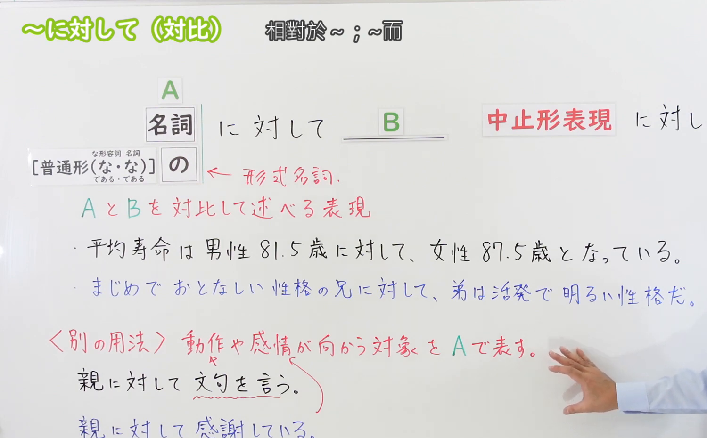
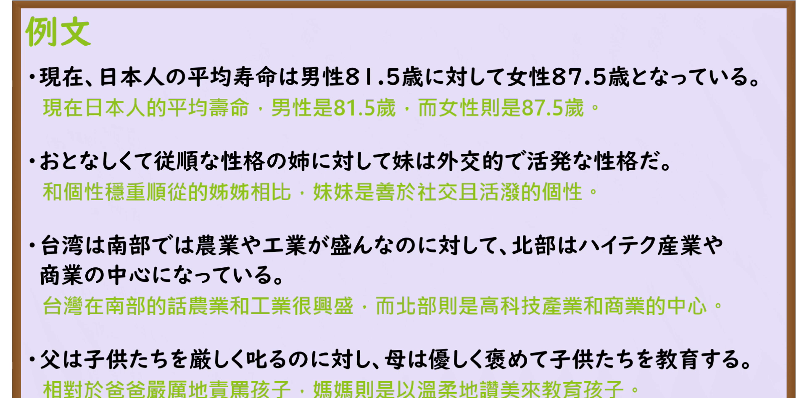

---
{
  "id": "N3-G-0062",
  "kind": "grammar",
  "level": "N3",
  "title": "〜に対して（与……相对／相比之下）",
  "card_revision": 1,
  "schema_version": 1,
  "source": {
    "lesson": "N3 第62个语法",
    "material": "出口日語原视频板书、日语自动字幕与Hagoromo文型检索正文",
    "video": "https://www.youtube.com/watch?v=5_rJ1okxLpg",
    "screenshot": "assets/grammar/n3/N3-G-0062-connection.png",
    "screenshot_seconds": 248,
    "screenshot_crop": {
      "x": 0,
      "y": 0,
      "width": 1500,
      "height": 930
    }
  },
  "tags": [
    "に対して",
    "に対する",
    "N3"
  ],
  "confusions": [
    "〜に比べて",
    "〜一方（で）",
    "〜に反して"
  ]
}
---

# N3 第62个语法：〜に対して

# 视频学习资料整理

本课讲解 N3 语法形式「〜に対して」。

## 接续图（板书与讲解）

- 视频链接：[出口日語 N3 第62个语法](https://www.youtube.com/watch?v=5_rJ1okxLpg)
- 真实时间：04:08（248.00秒）
- 原图尺寸：1920×1080
- 裁切说明：选用 04:08 画面，此时画面左上方语法标题与中文释义「〜に対して 相對於〜」清晰无渐隐，板书已完整书写句型对比用法接续「名詞＋に対して」与小句对比「名詞／な形＋なのに対して／イ形・動詞普通形＋のに対して」；出口老师在板书中特别强调本课专项讲解两相对照的对比对照功能，与第56课的对象用法形成互补。固定左上角（0, 0），裁切区域为宽 1500、高 930，去除右侧人像与底部空白，完整保留全部板书与顶部标题。
- 图片：

## 例句图（视频例句）

- 视频链接：[出口日語 N3 第62个语法](https://www.youtube.com/watch?v=5_rJ1okxLpg)
- 真实时间：04:42（282.00秒）
- 原图尺寸：1920×1080
- 裁切说明：提取自视频 04:42 处的例句黑板页面。固定左上角（0, 0），裁切区域为宽 1920、高 950，裁去底部多余边框与杂物，完整保留四条例句及中文翻译。
- 图片：

# 核心

## 功能一：将两个事物或两方特征进行对照，表示鲜明的正反对比（与……相对／相比之下）

**最上位意味カテゴリー：**

- **に対して：** ものごとの関係（事物之间的关系）

**中位意味カテゴリー：**

- **に対して：** 対比（对比与映衬）

**意味：**

- **に対して：** 対比（截然相反特征之鲜明对照）

**くわしい意味記述：**

- **に対して：** XとYの２つの事物について，その性質を対照的に示す時に使う。（将前后两种事物、性格、状况截然相反的特点形成鲜明比照；书面语中顿常作「〜に対し」，接动词或形容词小句时使用「〜のに対して」）。

### 例句

1. 現在、日本人の平均寿命は男性81.5歳に対して、女性は87.5歳となっている。

   （目前日本人的平均寿命，男性为81.5岁，相比之下女性达到了87.5岁。）

2. おとなしくて従順な性格の姉に対して、妹は外向的で活発な性格だ。

   （与性格文静顺从的姐姐相比，妹妹性格外向且活泼好动。）

3. 台湾は南部で農業や工業が盛んなのに対して、北部はハイテク産業や商業の中心になっている。

   （台湾南部农业和制造业繁荣，相比之下北部则是高科技产业与商业中心。）

4. 父は子どもたちを厳しく叱るのに対し、母は優しく褒めて子どもたちを育てる。

   （父亲对孩子管教严厉苛责，与此相对母亲则以温和表扬来培育孩子。）

# 来源

- [出口日語原视频](https://www.youtube.com/watch?v=5_rJ1okxLpg)
- [Hagoromo 文型検索「にたいして」](https://hagoromo-text.work/lookup?vid=1413)（查询日期：2026-09-25）
