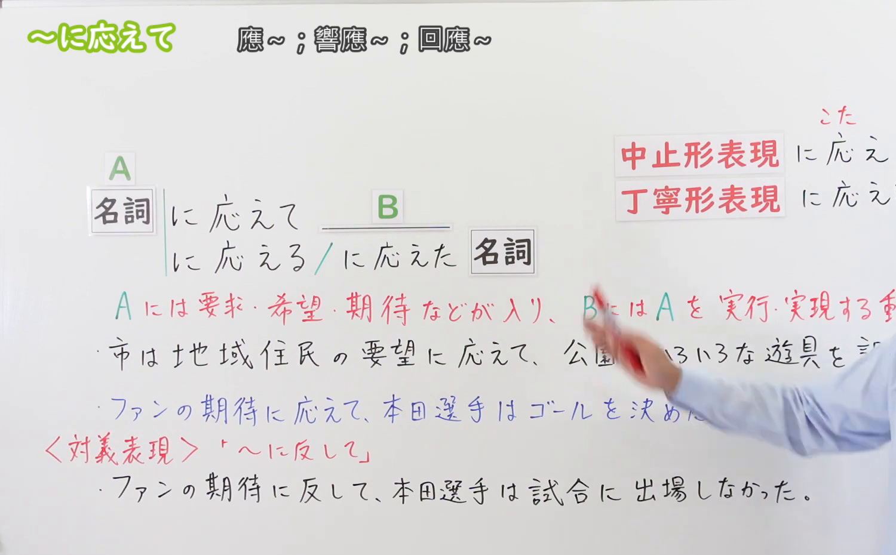
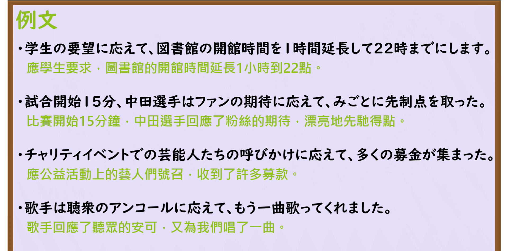

---
{
  "id": "N3-G-0063",
  "kind": "grammar",
  "level": "N3",
  "title": "〜に応えて／〜に応え（回应……／不负……）",
  "card_revision": 1,
  "schema_version": 1,
  "source": {
    "lesson": "N3 第63个语法",
    "material": "出口日語原视频板书、日语自动字幕与Hagoromo文型检索正文",
    "video": "https://www.youtube.com/watch?v=lFC05D19jxs",
    "screenshot": "assets/grammar/n3/N3-G-0063-connection.png",
    "screenshot_seconds": 187,
    "screenshot_crop": {
      "x": 0,
      "y": 0,
      "width": 1500,
      "height": 930
    }
  },
  "tags": [
    "に応えて",
    "に応え",
    "N3"
  ],
  "confusions": [
    "〜に従って",
    "〜に応じて",
    "〜に対して"
  ]
}
---

# N3 第63个语法：〜に応えて／〜に応え

# 视频学习资料整理

本课讲解 N3 语法形式「〜に応えて／〜に応え」。

## 接续图（板书与讲解）

- 视频链接：[出口日語 N3 第63个语法](https://www.youtube.com/watch?v=lFC05D19jxs)
- 真实时间：03:07（187.00秒）
- 原图尺寸：1920×1080
- 裁切说明：选用 03:07 画面，此时画面左上方语法标题与中文释义「〜に応えて 回應〜」清晰无渐隐，板书已完整书写接续规则「名詞（期待・要望・要請・声援・アンコール）＋に応えて」以及修饰体「〜に応える＋名詞」「〜に応えた＋名詞」与书面硬语「〜に応え」；出口老师在板书中特别强调动作主体采取行动以满足前项众人期望的呼应关系。固定左上角（0, 0），裁切区域为宽 1500、高 930，去除右侧人像与底部空白，完整保留全部板书与顶部标题。
- 图片：

## 例句图（视频例句）

- 视频链接：[出口日語 N3 第63个语法](https://www.youtube.com/watch?v=lFC05D19jxs)
- 真实时间：03:36（216.00秒）
- 原图尺寸：1920×1080
- 裁切说明：提取自视频 03:36 处的例句黑板页面。固定左上角（0, 0），裁切区域为宽 1920、高 950，裁去底部多余边框与杂物，完整保留四条例句及中文翻译。
- 图片：

# 核心

## 功能一：顺应、满足外部的期待、愿望、要求或呼声采取相应行动（回应……／不负……）

**最上位意味カテゴリー：**

- **に応えて：** ものごとの関係（事物之间的关系）

**中位意味カテゴリー：**

- **に応えて：** 関連・対応（关联与呼应）

**意味：**

- **に応えて：** 関連（顺应诉求与行动对应）

**くわしい意味記述：**

- **に応えて：** 期待や要望など，要求を表す名詞に接続し，その要求に対応して何か行動を行ったことを表す。（接在表示期待、期望、要求、呼吁、声援等名词之后，表示为不辜负该期待或满足要求而付出努力、采取行动。书面语可用中止形「〜に応え」）。

### 例句

1. 学生たちの切実な要望に応えて、図書館の開館時間を夜10時まで1時間延長した。

   （响应广大学生的切身诉求，图书馆开馆时间延长了1小时至晚上10点。）

2. 試合開始直後、中田選手はサポーターの熱い期待に応えて見事な先制ゴールを奪った。

   （比赛刚开场，中田选手不负球迷的热切期待，漂亮地攻入了领先的一球。）

3. チャリティーイベントでの出演者たちの呼びかけに応えて、多額の義援金が集まった。

   （响应慈善活动中演员们的号召呼吁，募集到了大笔善款。）

4. 歌手は観客たちの鳴り止まないアンコールに応えて、もう1曲ステージで歌ってくれた。

   （歌手回应观众们经久不息的返场掌声，在舞台上又献唱了一曲。）

# 来源

- [出口日語原视频](https://www.youtube.com/watch?v=lFC05D19jxs)
- [Hagoromo 文型検索「にこたえて」](https://hagoromo-text.work/lookup?vid=1255)（查询日期：2026-09-25）
