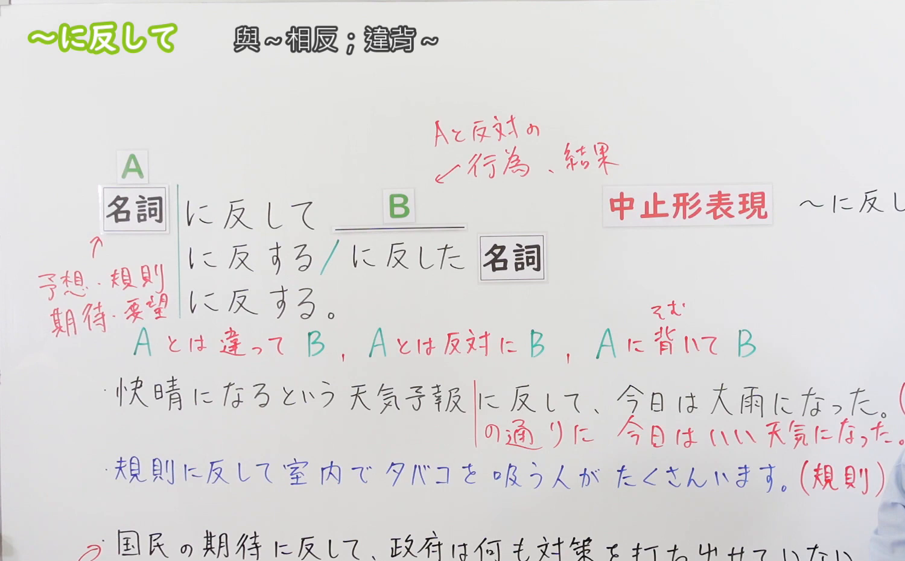
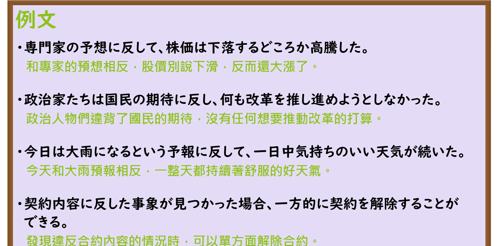

---
{
  "id": "N3-G-0064",
  "kind": "grammar",
  "level": "N3",
  "title": "〜に反して／〜に反し（与……相反／违反……）",
  "card_revision": 1,
  "schema_version": 1,
  "source": {
    "lesson": "N3 第64个语法",
    "material": "出口日語原视频板书、日语自动字幕与Hagoromo文型检索正文",
    "video": "https://www.youtube.com/watch?v=F9uarI-B0i8",
    "screenshot": "assets/grammar/n3/N3-G-0064-connection.png",
    "screenshot_seconds": 272,
    "screenshot_crop": {
      "x": 0,
      "y": 0,
      "width": 1500,
      "height": 930
    }
  },
  "tags": [
    "に反して",
    "に反し",
    "N3"
  ],
  "confusions": [
    "〜に対して",
    "〜とは逆に",
    "〜に背いて"
  ]
}
---

# N3 第64个语法：〜に反して／〜に反し

# 视频学习资料整理

本课讲解 N3 语法形式「〜に反して／〜に反し」。

## 接续图（板书与讲解）

- 视频链接：[出口日語 N3 第64个语法](https://www.youtube.com/watch?v=F9uarI-B0i8)
- 真实时间：04:32（272.00秒）
- 原图尺寸：1920×1080
- 裁切说明：选用 04:32 画面，此时画面左上方语法标题与中文释义「〜に反して 和〜相反；違反〜」清晰无渐隐，板书已完整书写接续形式「名詞＋に反して」以及修饰体「〜に反する／〜に反した＋名詞」与硬语形式「〜に反し」；出口老师在板书中清晰划分了出乎预测意料（予想・期待・意図に反して）与抵触规则法律（法律・規則・契約に反して）两层核心涵义。固定左上角（0, 0），裁切区域为宽 1500、高 930，去除右侧人像与底部空白，完整保留全部板书与顶部标题。
- 图片：

## 例句图（视频例句）

- 视频链接：[出口日語 N3 第64个语法](https://www.youtube.com/watch?v=F9uarI-B0i8)
- 真实时间：05:05（305.00秒）
- 原图尺寸：1920×1080
- 裁切说明：提取自视频 05:05 处的例句黑板页面。固定左上角（0, 0），裁切区域为宽 1920、高 950，裁去底部多余边框与杂物，完整保留四条例句及中文翻译。
- 图片：

# 核心

## 功能一：与原先的预测、愿望或计划产生截然相反的事态，或违背法律契约规范（与……相反／违反……）

**最上位意味カテゴリー：**

- **に反して：** ものごとの関係（事物之间的关系）

**中位意味カテゴリー：**

- **に反して：** 対比（对比与相悖）

**意味：**

- **に反して：** 対比（意料之外或规范相悖）

**くわしい意味記述：**

- **に反して：** 「〜と違って」「〜と反対に」という意味を表す。「意，意思，意志，予想，期待」といった名詞がよく使われる。（表示现实事态的发展完全背离了原本的意向、期望、预想；亦可用于表示行为直接抵触或违反法律法规、社会公序良俗或合同条款。书面中止形常作「〜に反し」）。

### 例句

1. 多くの専門家の予想に反して、株価は下落するどころか急騰を見せた。

   （出乎多数专家的预测意料，股价不仅没有下跌反而一路暴涨。）

2. 与党の政治家たちは国民の期待に反し、何ら実効性のある改革を推し進めようとしなかった。

   （执政党政客们辜负了国民的期望，丝毫没有推进任何切实有效的改革。）

3. 今日は大雨になるという天気予報に反して、一日中爽やかに晴れ渡った。

   （与今天会有大暴雨的天气预报相反，整整一天都晴空万里十分宜人。）

4. 契約内容に反した重大な事象が見つかった場合、一方的に契約を解除することができる。

   （若发现违反合同约定的重大违规行为，可以单方面解除合同。）

# 来源

- [出口日語原视频](https://www.youtube.com/watch?v=F9uarI-B0i8)
- [Hagoromo 文型検索「にはんして」](https://hagoromo-text.work/lookup?vid=1337)（查询日期：2026-09-25）
