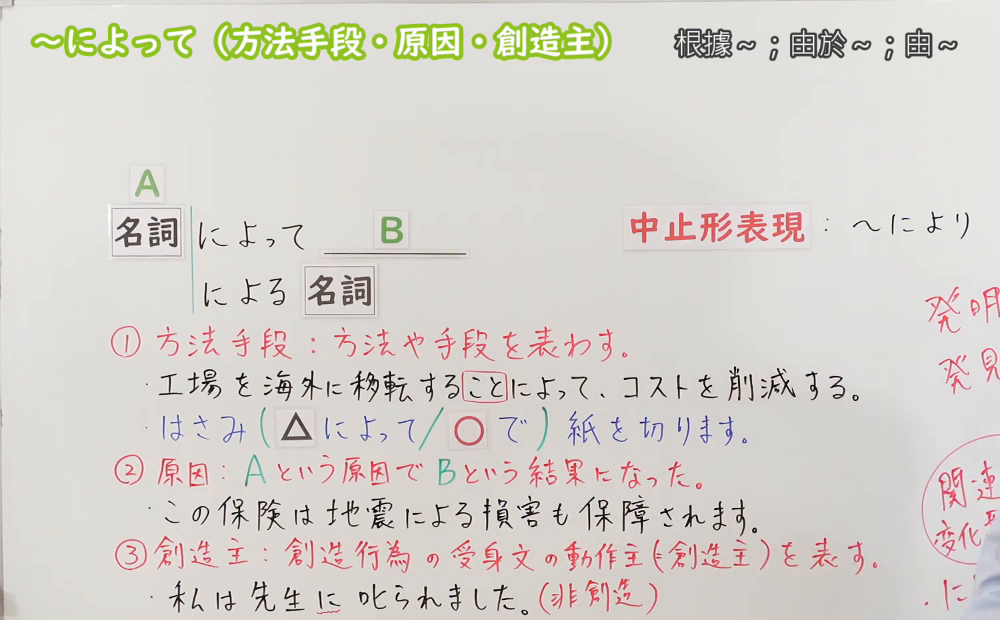
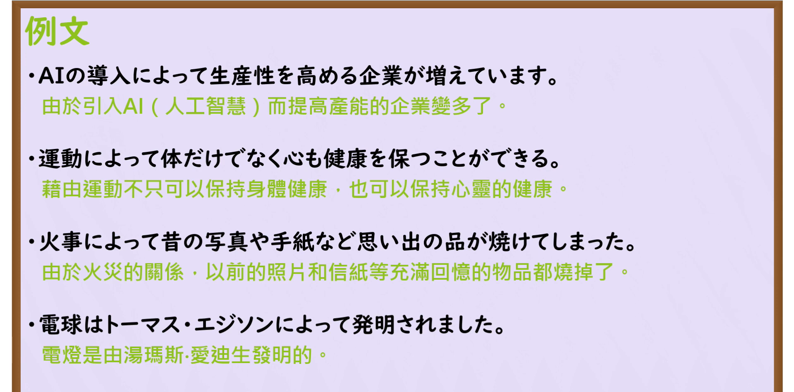

---
{
  "id": "N3-G-0065",
  "kind": "grammar",
  "level": "N3",
  "title": "〜によって（通过……／因……／由……所……）",
  "card_revision": 1,
  "schema_version": 1,
  "source": {
    "lesson": "N3 第65个语法",
    "material": "出口日語原视频板书、日语自动字幕与Hagoromo文型检索正文",
    "video": "https://www.youtube.com/watch?v=G_dza9I4ZcI",
    "screenshot": "assets/grammar/n3/N3-G-0065-connection.png",
    "screenshot_seconds": 333,
    "screenshot_crop": {
      "x": 0,
      "y": 0,
      "width": 1500,
      "height": 930
    }
  },
  "tags": [
    "によって",
    "により",
    "N3"
  ],
  "confusions": [
    "〜で",
    "〜によって（各不相同）",
    "〜のおかげで"
  ]
}
---

# N3 第65个语法：〜によって

# 视频学习资料整理

本课讲解 N3 语法形式「〜によって」。

## 接续图（板书与讲解）

- 视频链接：[出口日語 N3 第65个语法](https://www.youtube.com/watch?v=G_dza9I4ZcI)
- 真实时间：05:33（333.00秒）
- 原图尺寸：1920×1080
- 裁切说明：选用 05:33 画面，此时画面左上方语法标题与中文释义「〜によって 透過〜；因為〜；由〜」清晰无渐隐，板书已完整书写接续规则「名詞＋によって」以及书面体「〜により」与修饰体「〜による＋名詞」；出口老师在板书中清晰划分了本课的三大基石功能：1番手段方法、2番原因理由、3番被动文动作主体（创造发明者）。固定左上角（0, 0），裁切区域为宽 1500、高 930，去除右侧人像与底部空白，完整保留全部板书与顶部标题。
- 图片：

## 例句图（视频例句）

- 视频链接：[出口日語 N3 第65个语法](https://www.youtube.com/watch?v=G_dza9I4ZcI)
- 真实时间：06:00（360.00秒）
- 原图尺寸：1920×1080
- 裁切说明：提取自视频 06:00 处的例句黑板页面。固定左上角（0, 0），裁切区域为宽 1920、高 950，裁去底部多余边框与杂物，完整保留四条例句及中文翻译。
- 图片：

# 核心

## 功能一：表示实现某一目的、目标所采取的途径、手段或工具（通过……／借由……）

**最上位意味カテゴリー：**

- **によって：** ものごとの関係（事物之间的关系）

**中位意味カテゴリー：**

- **によって：** 手段・媒介（手段与媒介）

**意味：**

- **によって：** 手段・方法（达成目的之方法手段）

**くわしい意味記述：**

- **によって：** Nで。Nから。Nは何かを行う場合の手段や方法を表す。（多用于较为正式庄重的场合，表示利用先进技术、制度、途径或特定动作来达成后项结果）。

### 例句

1. AI技術の導入によって、日々の生産性を大幅に向上させる企業が増えています。

   （通过引入AI人工智能技术，大幅提升日常生产力的企业与日俱增。）

2. 毎日の適度な運動によって、身体だけでなく心の健康も保つことができる。

   （通过每天坚持适度运动，不仅是身体、连心理健康也能得以维持。）

3. 何度も読み書きを繰り返すことによって、新しい単語の記憶は着実に定着していく。

   （通过反复多次朗读与书写，新单词的记忆才能切实巩固下来。）

## 功能二：表示突发天灾事故、客观事态导致某种不良或显著结果（由于……／因……而导致）

**最上位意味カテゴリー：**

- **によって：** ものごとの関係（事物之间的关系）

**中位意味カテゴリー：**

- **によって：** 手段・媒介（因果关联）

**意味：**

- **によって：** 原因（客观事态导致之后果）

**くわしい意味記述：**

- **によって：** 不慮の事故や自然災害など，客観的な原因や理由を表す。（前项接地震、火灾、台风、事故或客观事实，表示引发了后项不良消极后果；后项绝不接请求、意志或命令）。

### 例句

1. 不慮の火災事故によって、昔の貴重な写真や手紙などの思い出の品がすべて焼けてしまった。

   （由于突发的火灾意外，过去珍贵的老照片和信件等充满回忆的物品全都付之一炬。）

2. 昨夜発生した大型台風によって、市内の各所で大規模な停電や倒木が発生した。

   （由于昨晚发生的强台风，市内多处发生了大范围停电和树木倒伏。）

3. 不注意な操作によって、保存前の重要なデータが誤って消去されてしまった。

   （由于粗心大意的误操作，尚未保存的重要数据被不慎删除了。）

## 功能三：在被动语态句中引出创造、发明、著作或建筑物的建造主体（由……所发明／创造）

**最上位意味カテゴリー：**

- **によって：** ものごとの関係（事物之间的关系）

**中位意味カテゴリー：**

- **によって：** 手段・媒介（施动主体）

**意味：**

- **によって：** 動作主（创造发明作品之动作主体）

**くわしい意味記述：**

- **によって：** Nに。Nで。Nは受け身文の中で動作をするものや，原因となるものを表す。（用于具有历史意义的大发明、著名艺术创作、宏伟建筑等被动句式中，引出发明者、创作者或营建者）。

### 例句

1. 白熱電球は、アメリカの発明家トーマス・エジソンによって改良・実用化されました。

   （白炽灯是由美国发明家托马斯·爱迪生改良并实现实用化的。）

2. この有名な交響曲は、晩年のベートーヴェンによって作曲された名作である。

   （这部著名的交响曲是由晚年的贝多芬谱写的传世杰作。）

3. 当時の壮大な城郭は、戦国時代の有力な武将によって築城されたと伝えられている。

   （据记载，当年那座宏伟的城堡是由战国时期的实力派武将修筑的。）

# 来源

- [出口日語原视频](https://www.youtube.com/watch?v=G_dza9I4ZcI)
- [Hagoromo 文型検索「によって」](https://hagoromo-text.work/lookup?vid=1352)（查询日期：2026-09-25）
