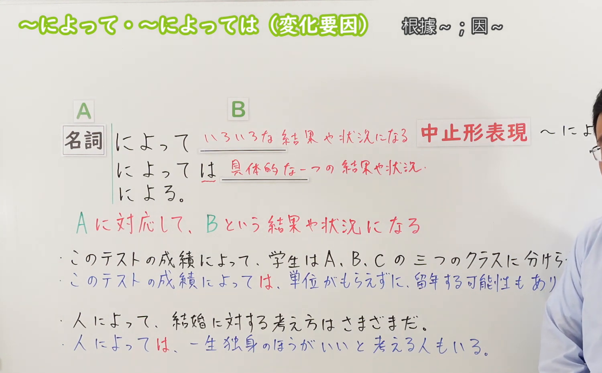
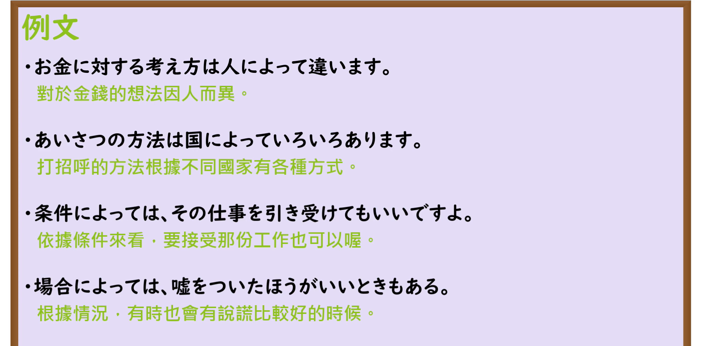

---
{
  "id": "N3-G-0066",
  "kind": "grammar",
  "level": "N3",
  "title": "〜によって／〜によっては（因……而异／根据……不同）",
  "card_revision": 1,
  "schema_version": 1,
  "source": {
    "lesson": "N3 第66个语法",
    "material": "出口日語原视频板书、日语自动字幕与Hagoromo文型检索正文",
    "video": "https://www.youtube.com/watch?v=lmW8ZLH1gpg",
    "screenshot": "assets/grammar/n3/N3-G-0066-connection.png",
    "screenshot_seconds": 247,
    "screenshot_crop": {
      "x": 0,
      "y": 0,
      "width": 1500,
      "height": 930
    }
  },
  "tags": [
    "によって",
    "によっては",
    "N3"
  ],
  "confusions": [
    "〜に応じて",
    "〜によって（手段原因）",
    "〜次第で"
  ]
}
---

# N3 第66个语法：〜によって／〜によっては

# 视频学习资料整理

本课讲解 N3 语法形式「〜によって／〜によっては」。

## 接续图（板书与讲解）

- 视频链接：[出口日語 N3 第66个语法](https://www.youtube.com/watch?v=lmW8ZLH1gpg)
- 真实时间：04:07（247.00秒）
- 原图尺寸：1920×1080
- 裁切说明：选用 04:07 画面，此时画面左上方语法标题与中文释义「〜によって／〜によっては 根據〜；因〜而異」清晰无渐隐，板书已完整书写接续规则「名詞＋によって（後接違う・異なる・様々）」与强调特定极端的「名詞＋によっては（後接特定可能性）」；出口老师在板书中详细辨析了本课差异对应用法与第65课手段原因用法的显著差别。固定左上角（0, 0），裁切区域为宽 1500、高 930，去除右侧人像与底部空白，完整保留全部板书与顶部标题。
- 图片：

## 例句图（视频例句）

- 视频链接：[出口日語 N3 第66个语法](https://www.youtube.com/watch?v=lmW8ZLH1gpg)
- 真实时间：04:38（278.00秒）
- 原图尺寸：1920×1080
- 裁切说明：提取自视频 04:38 处的例句黑板页面。固定左上角（0, 0），裁切区域为宽 1920、高 950，裁去底部多余边框与杂物，完整保留四条例句及中文翻译。
- 图片：

# 核心

## 功能一：表示由于前项不同条件或基准的存在，产生多样化的差异结果，或在特定条件下引发某一可能（因……而异／根据……不同）

**最上位意味カテゴリー：**

- **によって：** ものごとの関係（事物之间的关系）

**中位意味カテゴリー：**

- **によって：** 関連・対応（关联与呼应）

**意味：**

- **によって：** 対応（差异对应与特定条件结果）

**くわしい意味記述：**

- **によって：** Nの違いで。Nに応じて。「Nによって」の後に「違う、変わる」といった動詞がよく使われる。「しだいで」「いかんによって」と同じ意味を持つ。（「〜によって」后项多接表示变化、差异、种类的词汇；「〜によっては」则引出在某一特定极端条件或场合下可能发生的单一具体事态）。

### 例句

1. お金に対する価値観や使い方への考え方は、人によって大きく違います。

   （对待金钱的价值观以及对花销方式的看法，因人而异大不相同。）

2. 初対面の人と出会った際の挨拶の方法や習慣は、国や文化によっていろいろあります。

   （与初次见面者相遇时的问候方式与礼节习惯，因国家和文化而形形色色各不相同。）

3. 提示された条件によっては、今回の新しいプロジェクトの仕事を引き受けてもいいですよ。

   （根据贵方后续给出的具体合作条件，我也不是不能考虑接下这个新项目。）

4. 状況や場合によっては、相手を思いやるために嘘をついた方が良いときもある。

   （在某些特定的场合与情境下，出于对对方体贴照顾，说善意的谎言反而更好。）

# 来源

- [出口日語原视频](https://www.youtube.com/watch?v=lmW8ZLH1gpg)
- [Hagoromo 文型検索「によって」](https://hagoromo-text.work/lookup?vid=1353)（查询日期：2026-09-25）
