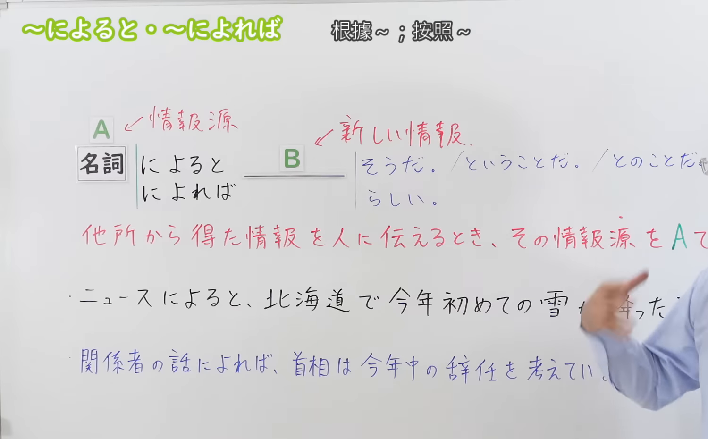

---
{
  "id": "N3-G-0067",
  "kind": "grammar",
  "level": "N3",
  "title": "〜によると／〜によれば（据……所说／根据……消息）",
  "card_revision": 1,
  "schema_version": 1,
  "source": {
    "lesson": "N3 第67个语法",
    "material": "出口日語原视频板书、日语自动字幕与Hagoromo文型检索正文",
    "video": "https://www.youtube.com/watch?v=r5faAxFKnjw",
    "screenshot": "assets/grammar/n3/N3-G-0067-connection.png",
    "screenshot_seconds": 127,
    "screenshot_crop": {
      "x": 0,
      "y": 0,
      "width": 1500,
      "height": 930
    }
  },
  "tags": [
    "によると",
    "によれば",
    "N3"
  ],
  "confusions": [
    "〜によれば",
    "〜からいうと",
    "〜として"
  ]
}
---

# N3 第67个语法：〜によると／〜によれば

# 视频学习资料整理

本课讲解 N3 语法形式「〜によると／〜によれば」。

## 接续图（板书与讲解）

- 视频链接：[出口日語 N3 第67个语法](https://www.youtube.com/watch?v=r5faAxFKnjw)
- 真实时间：02:07（127.00秒）
- 原图尺寸：1920×1080
- 裁切说明：选用 02:07 画面，此时画面左上方语法标题与中文释义「〜によると／〜によれば 根據〜；據說〜」清晰无渐隐，板书已完整书写接续规则「名詞（情報源）＋によると／によれば」以及句末呼应助动词「〜そうだ／〜らしい／〜とのことだ／〜ということだ」；出口老师在板书中特别强调该句型专用于引出传闻出处，不可省略句末的传闻推测表达。固定左上角（0, 0），裁切区域为宽 1500、高 930，去除右侧人像与底部空白，完整保留全部板书与顶部标题。
- 图片：

## 例句图（视频例句）

- 视频链接：[出口日語 N3 第67个语法](https://www.youtube.com/watch?v=r5faAxFKnjw)
- 真实时间：04:35（275.00秒）
- 原图尺寸：1920×1080
- 裁切说明：提取自视频 04:35 处的例句黑板页面。固定左上角（0, 0），裁切区域为宽 1920、高 950，裁去底部多余边框与杂物，完整保留四条例句及中文翻译。
- 图片：

# 核心

## 功能一：明确标引所获传闻或推断依据的情报出处与信息来源（据……所说／根据……消息）

**最上位意味カテゴリー：**

- **によると：** ものごとの関係（事物之间的关系）

**中位意味カテゴリー：**

- **によると：** 手段・媒介（媒介与出处）

**意味：**

- **によると：** 情報源（传闻信息与判断依据之出处）

**くわしい意味記述：**

- **によると：** Nでは。見たり聞いたりして得た情報の出所や，判断の根拠を表す。「によると」の前には，「話，調査，人名，機関名，聞く/聞いた，調べた/調査した」といった言葉がよく現れる。 「によれば」と同じ意味で使う。（句末必须与「〜そうだ」「〜らしい」「〜とのことだ」「〜ということだ」等传闻或推量助动词相呼应）。

### 例句

1. 政府の公式発表によれば、今年の日本のGDPはマイナス成長になる見込みとのことだ。

   （根据日本政府的官方通报，今年日本GDP预计将出现负增长。）

2. テレビのニュースによると、近所の竹やぶから1億円の入ったバッグが発見されたそうです。

   （据电视新闻报道，在附近竹林里发现了一个装有1亿日元现金的皮包。）

3. 島田課長の話によると、今年度の忘年会は感染症予防のため行わないことになったということだ。

   （听岛田课长透露，本年度的年终忘年会因防疫考量已决定停办。）

4. 祖父の話によれば、昭和の昔は新幹線や飛行機の中でも乗客が普通にタバコを吸っていたらしい。

   （据我祖父回忆，在昭和时代甚至连新干线和客机机舱里乘客都能照常抽烟。）

# 来源

- [出口日語原视频](https://www.youtube.com/watch?v=r5faAxFKnjw)
- [Hagoromo 文型検索「によると」](https://hagoromo-text.work/lookup?vid=1363)（查询日期：2026-09-25）
