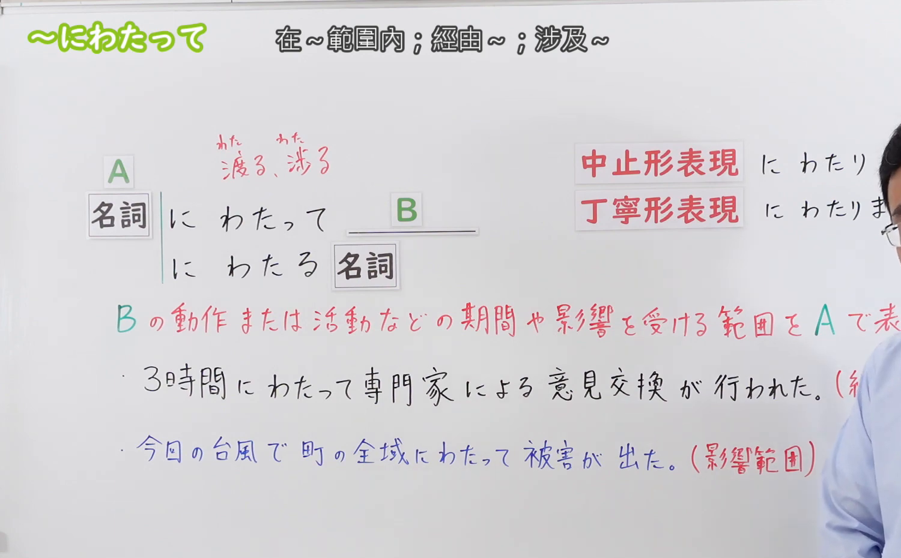
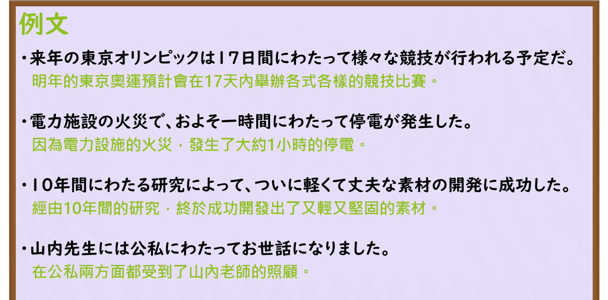

---
{
  "id": "N3-G-0068",
  "kind": "grammar",
  "level": "N3",
  "title": "〜にわたって／〜にわたり（历时……之久／跨越……全域）",
  "card_revision": 1,
  "schema_version": 1,
  "source": {
    "lesson": "N3 第68个语法",
    "material": "出口日語原视频板书、日语自动字幕与Hagoromo文型检索正文",
    "video": "https://www.youtube.com/watch?v=yAumoMDB3Y8",
    "screenshot": "assets/grammar/n3/N3-G-0068-connection.png",
    "screenshot_seconds": 156,
    "screenshot_crop": {
      "x": 0,
      "y": 0,
      "width": 1500,
      "height": 930
    }
  },
  "tags": [
    "にわたって",
    "にわたり",
    "N3"
  ],
  "confusions": [
    "〜を通じて",
    "〜を通して",
    "〜から〜にかけて"
  ]
}
---

# N3 第68个语法：〜にわたって／〜にわたり

# 视频学习资料整理

本课讲解 N3 语法形式「〜にわたって／〜にわたり」。

## 接续图（板书与讲解）

- 视频链接：[出口日語 N3 第68个语法](https://www.youtube.com/watch?v=yAumoMDB3Y8)
- 真实时间：02:36（156.00秒）
- 原图尺寸：1920×1080
- 裁切说明：选用 02:36 画面，此时画面左上方语法标题与中文释义「〜にわたって 歷時〜；跨越〜」清晰无渐隐，板书已完整书写接续规则「名詞（時間・期間・回数・空間・範囲）＋にわたって」以及修饰体「〜にわたる＋名詞」与硬语形式「〜にわたり」；出口老师在板书中特别强调前项必定包含数量概念，表示其影响或持续贯穿整个时间与空间的宏大尺度。固定左上角（0, 0），裁切区域为宽 1500、高 930，去除右侧人像与底部空白，完整保留全部板书与顶部标题。
- 图片：

## 例句图（视频例句）

- 视频链接：[出口日語 N3 第68个语法](https://www.youtube.com/watch?v=yAumoMDB3Y8)
- 真实时间：03:02（182.00秒）
- 原图尺寸：1920×1080
- 裁切说明：提取自视频 03:02 处的例句黑板页面。固定左上角（0, 0），裁切区域为宽 1920、高 950，裁去底部多余边框与杂物，完整保留四条例句及中文翻译。
- 图片：

# 核心

## 功能一：表示某一动作、事态或现象在较长时间跨度或广阔空间全域中持续铺展（历时……之久／跨越……全域）

**最上位意味カテゴリー：**

- **にわたって：** 場所・時間（时间与空间）

**中位意味カテゴリー：**

- **にわたって：** 起点・終点（时空范畴）

**意味：**

- **にわたって：** 範囲（全幅广度与完整覆盖）

**くわしい意味記述：**

- **にわたって：** その範囲全体にある動作や状態が広がっていることを表す。（接在带有数量词的时间、次数、场所、范围名词之后，强调动作或状态贯穿该范围的自始至终。书面中止形常作「〜にわたり」，连体修饰形为「〜にわたる＋名詞」）。

### 例句

1. 来年の東京オリンピックは、17日間にわたって多彩な競技が行われる予定だ。

   （明年的东京奥运会，计划在长达17天的时间里开展各类竞技赛事。）

2. 送電施設の落雷火災により、市内広域でおよそ1時間にわたって大規模停電が発生した。

   （因供电设施遭雷击起火，市内广大区域持续了约1小时的大规模停电。）

3. 研究所のチームが10年間にわたる地道な研究を重ねた結果、軽量で頑丈な新素材の開発に成功した。

   （研究所团队历经长达10年之久的潜心钻研，终于成功研发出轻质坚固的新材料。）

4. 恩師である山内先生には、学生時代から現在に至るまで公私にわたって大変お世話になりました。

   （作为我的恩师，山内老师无论在公事学业还是私下生活中都给予了我关怀与教导。）

# 来源

- [出口日語原视频](https://www.youtube.com/watch?v=yAumoMDB3Y8)
- [Hagoromo 文型検索「にわたって」](https://hagoromo-text.work/lookup?vid=1366)（查询日期：2026-09-25）
