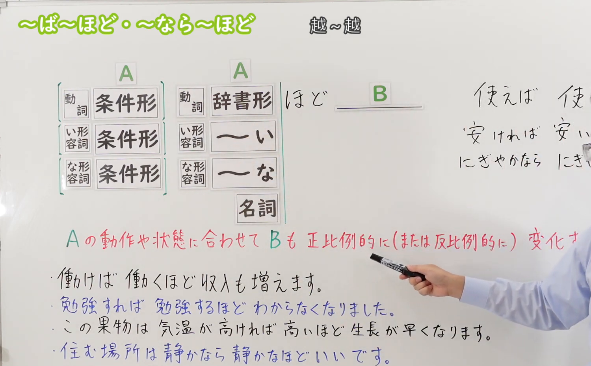
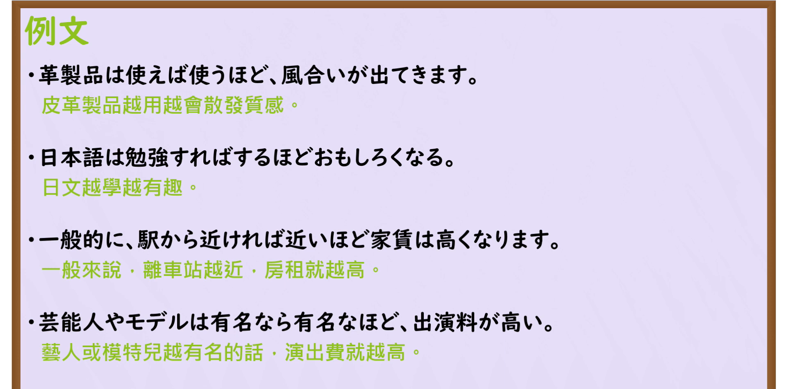

---
{
  "id": "N3-G-0069",
  "kind": "grammar",
  "level": "N3",
  "title": "〜ば〜ほど／〜なら〜ほど（越……越……）",
  "card_revision": 1,
  "schema_version": 1,
  "source": {
    "lesson": "N3 第69个语法",
    "material": "出口日語原视频板书、日语自动字幕与Hagoromo文型检索正文",
    "video": "https://www.youtube.com/watch?v=DxgBlUlC3m0",
    "screenshot": "assets/grammar/n3/N3-G-0069-connection.png",
    "screenshot_seconds": 138,
    "screenshot_crop": {
      "x": 0,
      "y": 0,
      "width": 1500,
      "height": 930
    }
  },
  "tags": [
    "ば〜ほど",
    "なら〜ほど",
    "ほど",
    "N3"
  ],
  "confusions": [
    "〜につれて",
    "〜にしたがって",
    "〜とともに"
  ]
}
---

# N3 第69个语法：〜ば〜ほど／〜なら〜ほど

# 视频学习资料整理

本课讲解 N3 语法形式「〜ば〜ほど／〜なら〜ほど」。

## 接续图（板书与讲解）

- 视频链接：[出口日語 N3 第69个语法](https://www.youtube.com/watch?v=DxgBlUlC3m0)
- 真实时间：02:18（138.00秒）
- 原图尺寸：1920×1080
- 裁切说明：选用 02:18 画面，此时画面左上方语法标题与中文释义「〜ば〜ほど／〜なら〜ほど 越〜越〜」清晰无渐隐，板书已完整书写动词「VばVるほど」、イ形「AければAいほど」、ナ形「NaならNaなほど」、名词「Nほど」全品类接续规则；出口老师在板书中特别用括弧标注了前项假定形可根据语境灵活省略的口语缩略规则。固定左上角（0, 0），裁切区域为宽 1500、高 930，去除右侧人像与底部空白，完整保留全部板书与顶部标题。
- 图片：

## 例句图（视频例句）

- 视频链接：[出口日語 N3 第69个语法](https://www.youtube.com/watch?v=DxgBlUlC3m0)
- 真实时间：07:30（450.00秒）
- 原图尺寸：1920×1080
- 裁切说明：提取自视频 07:30 处的例句黑板页面。固定左上角（0, 0），裁切区域为宽 1920、高 950，裁去底部多余边框与杂物，完整保留四条例句及中文翻译。
- 图片：

# 核心

## 功能一：表示前项条件或事态的程度越是发生改变，后项联动事态随之成比例同向加深（越……越……）

**最上位意味カテゴリー：**

- **ば〜ほど：** ものごとの関係（事物之间的关系）

**中位意味カテゴリー：**

- **ば〜ほど：** 関連・対応（关联与对应）

**意味：**

- **ば〜ほど：** 関連（程度正比例联动变化）

**くわしい意味記述：**

- **ば〜ほど：** 「一方の程度が変われば，それとともに他方も変わる」という意味を表す。（同一动词或形容词在前项以假定形、在后项以连体形重复出现；口语中常可省略前项假定形，直接作「Vるほど」「Aいほど」「Naなほど」）。

### 例句

1. 上質な革製品は、丁寧に使い込めば使い込むほど独特の風合いと艶が出てきます。

   （高档皮具越是悉心使用，就越能散发出独特的质感与光泽。）

2. 外国語の習得は、勉強すればするほど奥深くて面白くなっていくものだ。

   （掌握一门外语就是这样，越是深入钻研，就越发觉得博大精深妙趣横生。）

3. 一般的に賃貸物件は、最寄り駅から近ければ近いほど家賃の相場が高くなります。

   （一般来说，出租公寓距离最近的车站越近，租金行情就越高。）

4. テレビに出演する芸能人や人気モデルは、世間の知名度が有名なら有名なほど出演料が高額になる。

   （在电视上亮相的艺人与人气模特，知名度越响亮出场费就越昂贵。）

# 来源

- [出口日語原视频](https://www.youtube.com/watch?v=DxgBlUlC3m0)
- [Hagoromo 文型検索「ほど」](https://hagoromo-text.work/lookup?vid=1438)（查询日期：2026-09-25）
