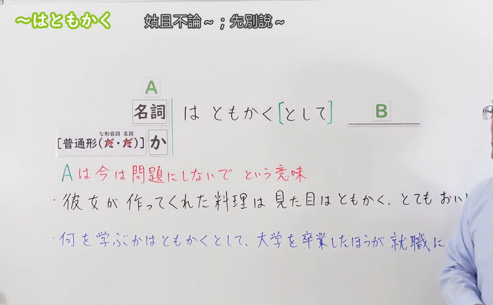
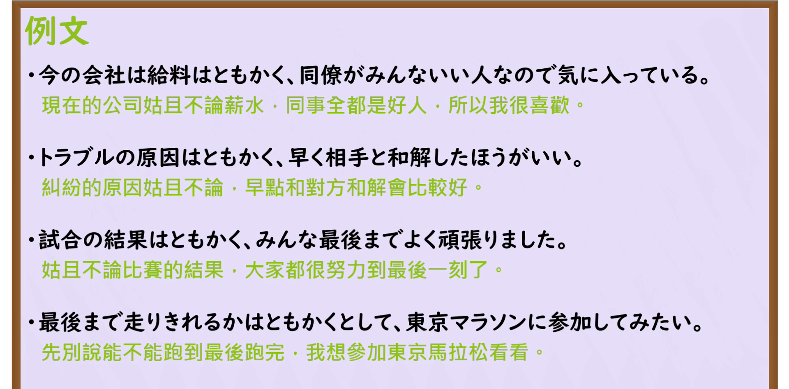

---
{
  "id": "N3-G-0070",
  "kind": "grammar",
  "level": "N3",
  "title": "〜はともかく／〜はともかくとして（姑且不论……／暂且不提……）",
  "card_revision": 1,
  "schema_version": 1,
  "source": {
    "lesson": "N3 第70个语法",
    "material": "出口日語原视频板书、日语自动字幕与Hagoromo文型检索正文",
    "video": "https://www.youtube.com/watch?v=L9bPZkBjNhk",
    "screenshot": "assets/grammar/n3/N3-G-0070-connection.png",
    "screenshot_seconds": 82,
    "screenshot_crop": {
      "x": 0,
      "y": 0,
      "width": 1500,
      "height": 930
    }
  },
  "tags": [
    "はともかく",
    "はともかくとして",
    "N3"
  ],
  "confusions": [
    "〜はさておき",
    "〜はもちろん",
    "〜どころか"
  ]
}
---

# N3 第70个语法：〜はともかく／〜はともかくとして

# 视频学习资料整理

本课讲解 N3 语法形式「〜はともかく／〜はともかくとして」。

## 接续图（板书与讲解）

- 视频链接：[出口日語 N3 第70个语法](https://www.youtube.com/watch?v=L9bPZkBjNhk)
- 真实时间：01:22（82.00秒）
- 原图尺寸：1920×1080
- 裁切说明：选用 01:22 画面，此时画面左上方语法标题与中文释义「〜はともかく 暫且不提〜；姑且不論〜」清晰无渐隐，板书已完整书写接续规则「名詞／疑問詞小句＋はともかく（として）」；出口老师在板书中特别强调本句型专用于表明“前项虽然也值得考虑或存在问题，但当下优先搁置一旁，首先集中陈述后项更为关键的核心要素”。固定左上角（0, 0），裁切区域为宽 1500、高 930，去除右侧人像与底部空白，完整保留全部板书与顶部标题。
- 图片：

## 例句图（视频例句）

- 视频链接：[出口日語 N3 第70个语法](https://www.youtube.com/watch?v=L9bPZkBjNhk)
- 真实时间：03:55（235.00秒）
- 原图尺寸：1920×1080
- 裁切说明：提取自视频 03:55 处的例句黑板页面。固定左上角（0, 0），裁切区域为宽 1920、高 950，裁去底部多余边框与杂物，完整保留四条例句及中文翻译。
- 图片：

# 核心

## 功能一：将前项事实或次要考量暂时搁置一旁不予深究，优先强调更为重要的核心事项（姑且不论……／暂且不提……）

**最上位意味カテゴリー：**

- **はともかく：** ものごとの関係（事物之间的关系）

**中位意味カテゴリー：**

- **はともかく：** 無関係・除外（搁置与排除）

**意味：**

- **はともかく：** 無関係（优先排序与暂且搁置）

**くわしい意味記述：**

- **はともかく：** 「〜はとにかくとして…」の形で、「〜」と「…」を比較し，「〜のことも考えなければならないが，今は…を優先する」と言いたい時に使う。（承认前项事项的存在或重要性，但说话人认为当前应当搁置前项，把关注焦点集中在后项更为重要的判断、感受或行动上）。

### 例句

1. 今の勤務先は、給料の多さはともかく、職場の同僚がみんな温かい人たちなので気に入っている。

   （目前的公司薪资待遇姑且不论，好在同事们都非常和善暖心，我很称心如意。）

2. トラブルが起きた原因はともかくとして、まずは関係者と真摯に話し合い、早急に和解した方がいい。

   （发生纠纷的原因暂且不论，当务之急是与当事人诚恳协商尽早化解。）

3. 試合の勝敗という結果はともかく、選手全員が試合終了の笛が鳴るまで全力でよく頑張りました。

   （比赛胜负的结果暂且搁置不提，全体队员奋战拼搏到终场哨响，表现得非常出色。）

4. 実際に完走できるかどうかはともかくとして、一度記念に東京マラソンにエントリーしてみたい。

   （能否真正跑完全程暂且不论，我也想报名一次东京马拉松作为人生的留念。）

# 来源

- [出口日語原视频](https://www.youtube.com/watch?v=L9bPZkBjNhk)
- [Hagoromo 文型検索「はともかく」](https://hagoromo-text.work/lookup?vid=1466)（查询日期：2026-09-25）
