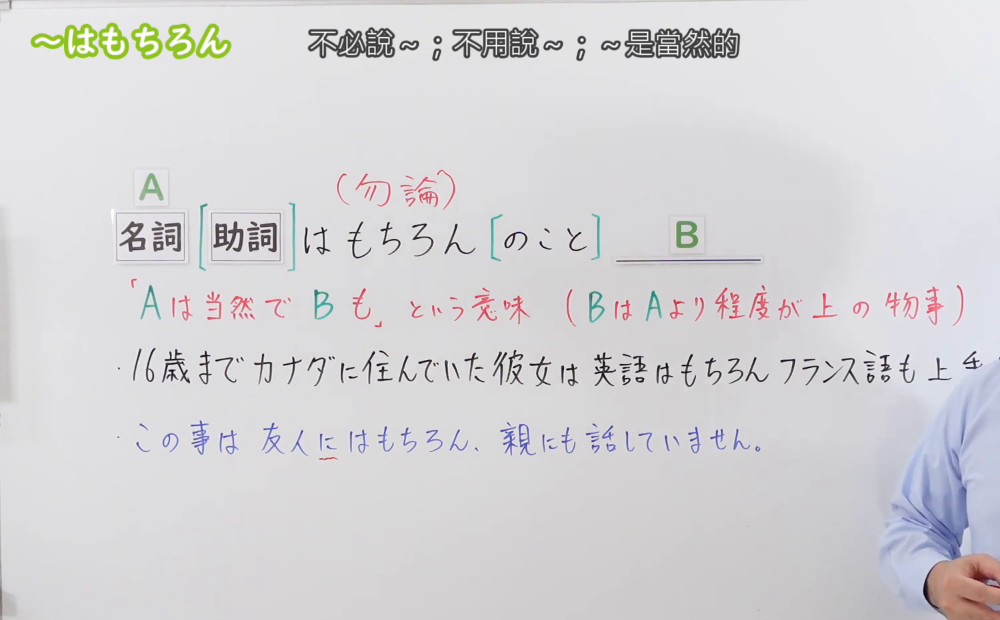
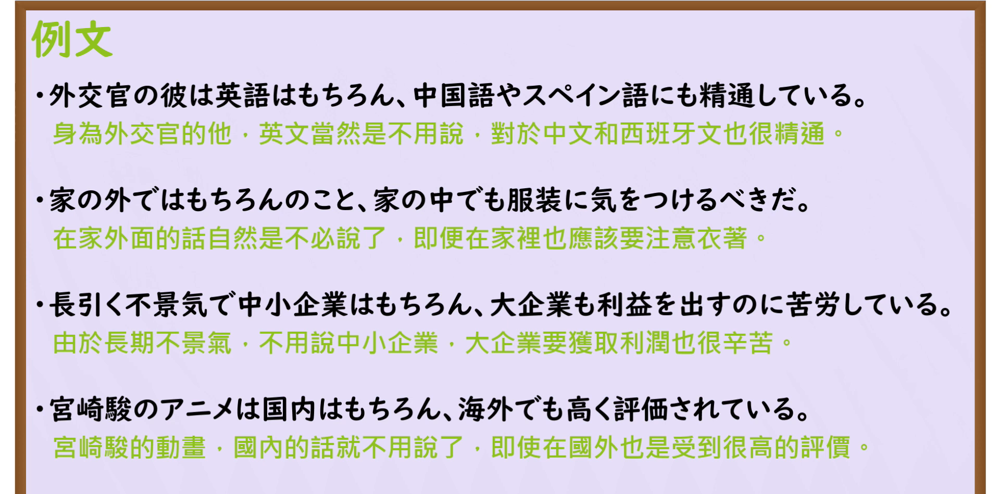

---
{
  "id": "N3-G-0071",
  "kind": "grammar",
  "level": "N3",
  "title": "〜はもちろん（那是当然……而且……）",
  "card_revision": 1,
  "schema_version": 1,
  "source": {
    "lesson": "N3 第71个语法",
    "material": "出口日語原视频板书、日语自动字幕与Hagoromo文型检索正文",
    "video": "https://www.youtube.com/watch?v=CPeQ49uGQUU",
    "screenshot": "assets/grammar/n3/N3-G-0071-connection.png",
    "screenshot_seconds": 172,
    "screenshot_crop": {
      "x": 0,
      "y": 0,
      "width": 1500,
      "height": 930
    }
  },
  "tags": [
    "はもちろん",
    "N3"
  ],
  "confusions": [
    "〜ばかりでなく",
    "〜だけでなく",
    "〜はおろか"
  ]
}
---

# N3 第71个语法：〜はもちろん

# 视频学习资料整理

本课讲解 N3 语法形式「〜はもちろん」。

## 接续图（板书与讲解）

- 视频链接：[出口日語 N3 第71个语法](https://www.youtube.com/watch?v=CPeQ49uGQUU)
- 真实时间：02:52（172.00秒）
- 原图尺寸：1920×1080
- 裁切说明：选用 02:52 画面，此时画面左上方语法标题与中文释义「〜はもちろん 不用說〜；當然〜」清晰无渐隐，板书已完整书写接续规则「名詞（＋助詞）＋はもちろん」以及后项常与助词「も」呼应的递进结构；出口老师在板书中特别强调前项提出显而易见、理所当然的前提，以此衬托后项程度更高或范围更广的事态。固定左上角（0, 0），裁切区域为宽 1500、高 930，去除右侧人像与底部空白，完整保留全部板书与顶部标题。
- 图片：

## 例句图（视频例句）

- 视频链接：[出口日語 N3 第71个语法](https://www.youtube.com/watch?v=CPeQ49uGQUU)
- 真实时间：03:07（187.00秒）
- 原图尺寸：1920×1080
- 裁切说明：提取自视频 03:07 处的例句黑板页面。固定左上角（0, 0），裁切区域为宽 1920、高 950，裁去底部多余边框与杂物，完整保留四条例句及中文翻译。
- 图片：

# 核心

## 功能一：提出理所当然的前提，以此衬托并追加程度更深或范围更广的事项（那是当然……而且……）

**最上位意味カテゴリー：**

- **はもちろん：** ものごとの関係（事物之间的关系）

**中位意味カテゴリー：**

- **はもちろん：** 付加（累加与递进）

**意味：**

- **はもちろん：** 付加（当然前提之递进添加）

**くわしい意味記述：**

- **はもちろん：** Nのことは当然だが，Nよりさらに程度が上のことも加えて言いたい時に使う。（提出前项作为毋庸置疑的前提基准，并在后项进一步追加程度更深、范围更广的同向事实；后项通常与助词「も」紧密呼应）。

### 例句

1. 外交官の彼は、英語はもちろん中国語やスペイン語にも精通している。

   （作为外交官的他，英语自不必说，就连中文和西班牙语也十分精通。）

2. このホテルは、サービスの質の高さはもちろん、窓から見える美しい夜景も格別だ。

   （这家酒店服务品质高超自不用说，从窗户眺望到的绝美夜景也格外动人。）

3. この料理店は、料理の美味しさはもちろん、店内の落ち着いた雰囲気も素晴らしい。

   （这家餐厅菜肴美味那是自然，店内典雅沉静的氛围也极具魅力。）

4. 週末の遊園地は、地元の家族連れはもちろん、国内外からの観光客でも大いに賑わっていた。

   （周末的游乐园里，本地家庭自不必提，就连国内外游客也络绎不绝热闹非凡。）

# 来源

- [出口日語原视频](https://www.youtube.com/watch?v=CPeQ49uGQUU)
- [Hagoromo 文型検索「はもちろん」](https://hagoromo-text.work/lookup?vid=1471)（查询日期：2026-09-25）
