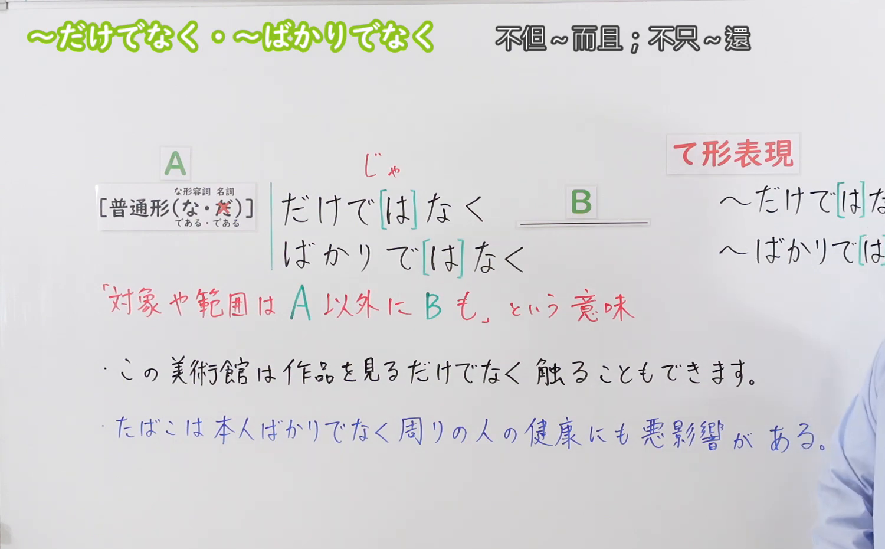
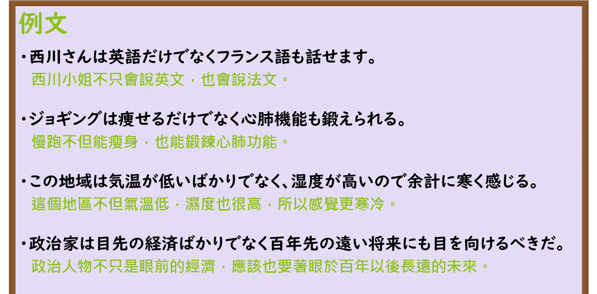

---
{
  "id": "N3-G-0072",
  "kind": "grammar",
  "level": "N3",
  "title": "〜だけでなく／〜ばかりでなく（不仅……而且……）",
  "card_revision": 1,
  "schema_version": 1,
  "source": {
    "lesson": "N3 第72个语法",
    "material": "出口日語原视频板书、日语自动字幕与Hagoromo文型检索正文",
    "video": "https://www.youtube.com/watch?v=OB_pY2buM7c",
    "screenshot": "assets/grammar/n3/N3-G-0072-connection.png",
    "screenshot_seconds": 215,
    "screenshot_crop": {
      "x": 0,
      "y": 0,
      "width": 1500,
      "height": 930
    }
  },
  "tags": [
    "だけでなく",
    "ばかりでなく",
    "N3"
  ],
  "confusions": [
    "〜はもちろん",
    "〜のみならず",
    "〜に加えて"
  ]
}
---

# N3 第72个语法：〜だけでなく／〜ばかりでなく

# 视频学习资料整理

本课讲解 N3 语法形式「〜だけでなく／〜ばかりでなく」。

## 接续图（板书与讲解）

- 视频链接：[出口日語 N3 第72个语法](https://www.youtube.com/watch?v=OB_pY2buM7c)
- 真实时间：03:35（215.00秒）
- 原图尺寸：1920×1080
- 裁切说明：选用 03:35 画面，此时画面左上方语法标题与中文释义「〜だけでなく・〜ばかりでなく 不但〜而且；不只〜還」清晰无渐隐，板书已完整书写接续规则「[普通形(な・だ / である・である)] だけでなく / ばかりでなく」及「対象や範囲は A 以外に B も」语义说明；出口老师在板书中详细辨析了「だけでなく」与「ばかりでなく」的用法，并补充了「て形表現（〜だけでなく[て]／〜ばかりでなく[て]）」。固定左上角（0, 0），裁切区域为宽 1500、高 930，去除右侧人像与底部空白，完整保留全部板书与顶部标题。
- 图片：

## 例句图（视频例句）

- 视频链接：[出口日語 N3 第72个语法](https://www.youtube.com/watch?v=OB_pY2buM7c)
- 真实时间：04:01（241.00秒）
- 原图尺寸：1920×1080
- 裁切说明：提取自视频 04:01 处的例句黑板页面。固定左上角（0, 0），裁切区域为宽 1920、高 950，裁去底部多余边框与杂物，完整保留四条例句及中文翻译。
- 图片：

# 核心

## 功能一：表示不仅局限于前项范围，同时还包含扩展至其他同类或更进一步的事物（不仅……而且……）

**最上位意味カテゴリー：**

- **だけでなく：** ものごとの関係（事物之间的关系）

**中位意味カテゴリー：**

- **だけでなく：** 非限定（不限于此）

**意味：**

- **だけでなく：** 非限定（范围扩充与兼备并存）

**くわしい意味記述：**

- **だけでなく：** 「だけでなく」の前に述べるＰに限定せず，範囲がもっと広いという意味。（不仅不局限于前项事物，后项进一步涵盖更广泛的要素；「ばかりでなく」语气比「だけでなく」更加丰富进逼）。

### 例句

1. 彼は英語だけでなく、独学で習得したフランス語も流暢に話すことができる。

   （他不仅会说英语，连自学掌握的法语也能讲得十分流利。）

2. 毎日のジョギングは、足腰を鍛えるだけでなく脳の働きを活性化する効果もある。

   （每天慢跑不仅能锻炼腿脚，对活化大脑机能也有显著效果。）

3. この高山植物の花は、見た目が可憐で美しいばかりでなく、薬草としての効能も秘めている。

   （这种高山植物的花朵不仅外形楚楚动人，还蕴藏着作为药草的药用价值。）

4. 我が社は国内の既存市場ばかりでなく、急速に拡大する海外市場の開拓にも注力している。

   （我们公司不仅立足于国内既有市场，更全力投入开拓急速扩张的海外市场。）

# 来源

- [出口日語原视频](https://www.youtube.com/watch?v=OB_pY2buM7c)
- [Hagoromo 文型検索「だけでなく」](https://hagoromo-text.work/lookup?vid=687)（查询日期：2026-09-25）
