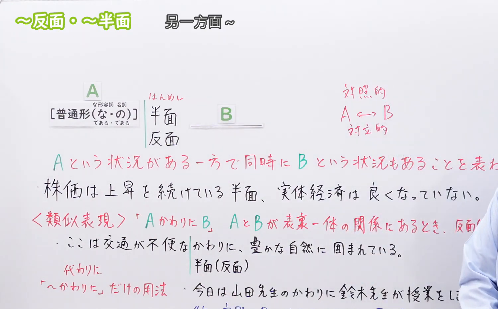
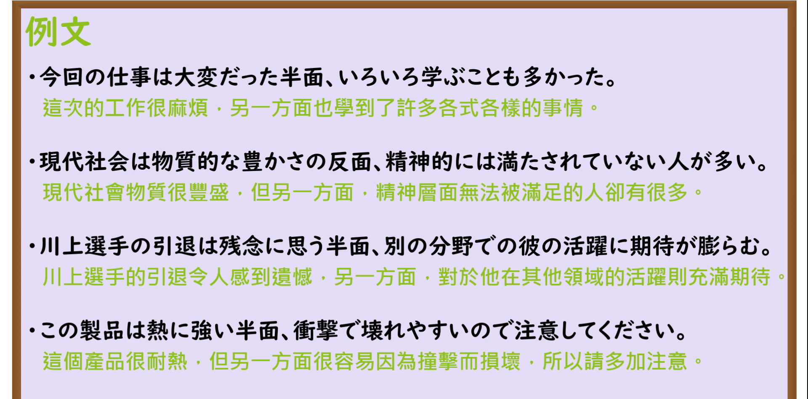

---
{
  "id": "N3-G-0073",
  "kind": "grammar",
  "level": "N3",
  "title": "〜反面／〜半面（然而相反的是……／另一面则是……）",
  "card_revision": 1,
  "schema_version": 1,
  "source": {
    "lesson": "N3 第73个语法",
    "material": "出口日語原视频板书、日语自动字幕与Hagoromo文型检索正文",
    "video": "https://www.youtube.com/watch?v=1IiJiLgwrYs",
    "screenshot": "assets/grammar/n3/N3-G-0073-connection.png",
    "screenshot_seconds": 276,
    "screenshot_crop": {
      "x": 0,
      "y": 0,
      "width": 1500,
      "height": 930
    }
  },
  "tags": [
    "反面",
    "半面",
    "N3"
  ],
  "confusions": [
    "〜に対して",
    "〜一方（で）",
    "〜ものの"
  ]
}
---

# N3 第73个语法：〜反面／〜半面

# 视频学习资料整理

本课讲解 N3 语法形式「〜反面／〜半面」。

## 接续图（板书与讲解）

- 视频链接：[出口日語 N3 第73个语法](https://www.youtube.com/watch?v=1IiJiLgwrYs)
- 真实时间：04:36（276.00秒）
- 原图尺寸：1920×1080
- 裁切说明：选用 04:36 画面，此时画面左上方语法标题与中文释义「〜反面／〜半面 另一面卻〜；相反的〜」清晰无渐隐，板书已完整书写接续形式「普通形（な形な／である・名詞である）＋反面」以及「その反面」形式；出口老师在板书中特别强调前项与后项必须是同一事物内蕴含的正反矛盾两极特征。固定左上角（0, 0），裁切区域为宽 1500、高 930，去除右侧人像与底部空白，完整保留全部板书与顶部标题。
- 图片：

## 例句图（视频例句）

- 视频链接：[出口日語 N3 第73个语法](https://www.youtube.com/watch?v=1IiJiLgwrYs)
- 真实时间：04:54（294.00秒）
- 原图尺寸：1920×1080
- 裁切说明：提取自视频 04:54 处的例句黑板页面。固定左上角（0, 0），裁切区域为宽 1920、高 950，裁去底部多余边框与杂物，完整保留四条例句及中文翻译。
- 图片：

# 核心

## 功能一：指出同一事物并存的两个截然相反的侧面或矛盾特征（然而相反的是……／另一面则是……）

**最上位意味カテゴリー：**

- **反面：** ものごとの関係（事物之间的关系）

**中位意味カテゴリー：**

- **反面：** 対比（对比与映衬）

**意味：**

- **反面：** 対比（同一事物正反两面之鲜明对比）

**くわしい意味記述：**

- **反面：** ある事柄の２つの面を対比して，前に述べたことと反対の性質や特徴や傾向を述べる時に使う表現。（对同一个事物、选择或境遇的一体两面展开辩证对比，在肯定其正面特质的同时指出其负面代价，反之亦然；汉字亦可作「半面」）。

### 例句

1. インターネットは生活を飛躍的に便利にした反面、個人情報の流出という深刻な危険も孕んでいる。

   （互联网使生活飞跃式便利的另一面，也潜藏着个人隐私泄露的严重隐患。）

2. 都会での一人暮らしは自由で気楽な反面、病気になった時などに強い孤独を感じやすい。

   （在大都市独自生活虽然自由惬意，但生病时却极易感到强烈的孤独。）

3. 今回の海外プロジェクトは非常にやりがいがあった反面、プレッシャーも並大抵ではなかった。

   （这次的海外项目虽然极具挑战与成就感，但承担的压力也绝非同小可。）

4. 薬は病気を治す優れた効果がある反面、思わぬ副作用をもたらす可能性もある。

   （药物在具有治疗疾病优良疗效的同时，也有可能带来意料之外的副作用。）

# 来源

- [出口日語原视频](https://www.youtube.com/watch?v=1IiJiLgwrYs)
- [Hagoromo 文型検索「はんめん」](https://hagoromo-text.work/lookup?vid=1474)（查询日期：2026-09-25）
