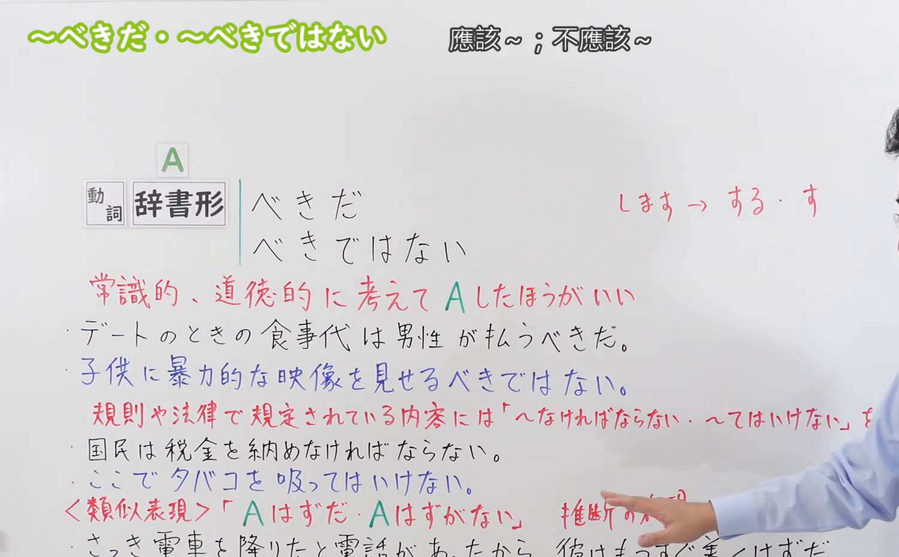
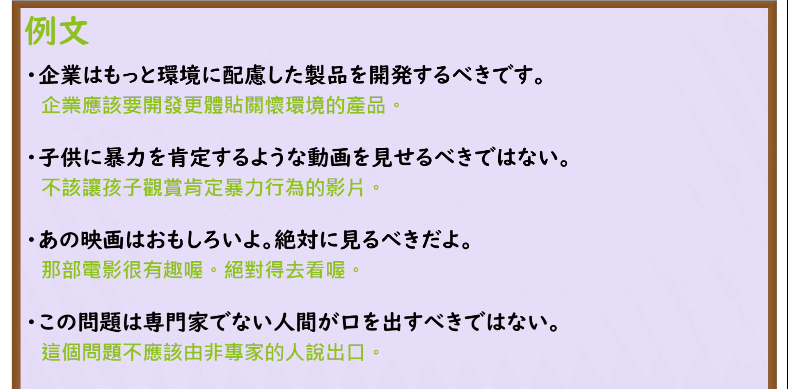

---
{
  "id": "N3-G-0074",
  "kind": "grammar",
  "level": "N3",
  "title": "〜べきだ／〜べきではない（理应……／应当……；不该……）",
  "card_revision": 1,
  "schema_version": 1,
  "source": {
    "lesson": "N3 第74个语法",
    "material": "出口日語原视频板书、日语自动字幕与Hagoromo文型检索正文",
    "video": "https://www.youtube.com/watch?v=vUO6aYil7bU",
    "screenshot": "assets/grammar/n3/N3-G-0074-connection.png",
    "screenshot_seconds": 258,
    "screenshot_crop": {
      "x": 0,
      "y": 0,
      "width": 1500,
      "height": 930
    }
  },
  "tags": [
    "べきだ",
    "べきではない",
    "N3"
  ],
  "confusions": [
    "〜なければならない",
    "〜たほうがいい",
    "〜ことだ"
  ]
}
---

# N3 第74个语法：〜べきだ／〜べきではない

# 视频学习资料整理

本课讲解 N3 语法形式「〜べきだ／〜べきではない」。

## 接续图（板书与讲解）

- 视频链接：[出口日語 N3 第74个语法](https://www.youtube.com/watch?v=vUO6aYil7bU)
- 真实时间：04:18（258.00秒）
- 原图尺寸：1920×1080
- 裁切说明：选用 04:18 画面，此时画面左上方语法标题与中文释义「〜べきだ／〜べきではない 應該〜；必須〜」清晰无渐隐，板书已完整书写接续规则「動詞辞書形＋べきだ／べきではない」以及サ变动词特例「するべき／すべき」与连体形「べき＋名詞」；出口老师在板书中特别强调该句型立足于社会常理、公序良俗与道德义务，表达理所当然的当为断定。固定左上角（0, 0），裁切区域为宽 1500、高 930，去除右侧人像与底部空白，完整保留全部板书与顶部标题。
- 图片：

## 例句图（视频例句）

- 视频链接：[出口日語 N3 第74个语法](https://www.youtube.com/watch?v=vUO6aYil7bU)
- 真实时间：04:40（280.00秒）
- 原图尺寸：1920×1080
- 裁切说明：提取自视频 04:40 处的例句黑板页面。固定左上角（0, 0），裁切区域为宽 1920、高 950，裁去底部多余边框与杂物，完整保留四条例句及中文翻译。
- 图片：

# 核心

## 功能一：基于普遍社会道德、公序良俗或人之常情，断定某事理应去做或决不该为（理应……／应当……；不该……）

**最上位意味カテゴリー：**

- **べきだ：** 考え・感情（思想与情感）

**中位意味カテゴリー：**

- **べきだ：** 主張・断定的評価（主张与评价断定）

**意味：**

- **べきだ：** 主張（道义当为与规劝断定）

**くわしい意味記述：**

- **べきだ：** 「〜するのが正しい」「〜であるのが正しい」と忠告や助言するときに使う。話し手自身の行為や事柄については使わない。（从常识或伦理出发表明说话人认为理应如何的正义主张或真诚劝告；否定形为「〜べきではない」；修饰名词时用「〜べき＋名詞」）。

### 例句

1. 現代のグローバル企業は、利益だけでなく地球環境に配慮した製品を開発するべきです。

   （现代跨国企业理应顾及地球环境，研发更环保的产品。）

2. 約束の時間にどうしても遅れそうな時は、事前に相手に一本連絡を入れるべきだ。

   （如果无论如何都要迟到，事先理应给对方去个电话说明。）

3. 他人のプライベートな事情について、面白半分で無責任な噂を広めるべきではない。

   （对于他人的私人隐私，绝不应当出于猎奇而无责任地散布谣言。）

4. 子供の前で親が激しい口論をしたり、感情的に怒鳴りつけたりするべきではない。

   （在孩子面前，父母绝不应该发生激烈争吵或情绪化地大声呵斥。）

# 来源

- [出口日語原视频](https://www.youtube.com/watch?v=vUO6aYil7bU)
- [Hagoromo 文型検索「べき」](https://hagoromo-text.work/lookup?vid=1487)（查询日期：2026-09-25）
