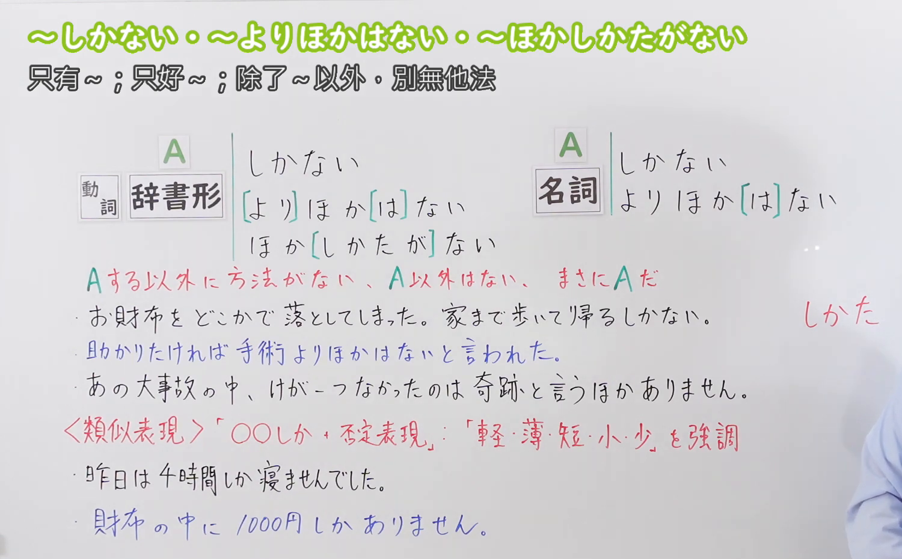
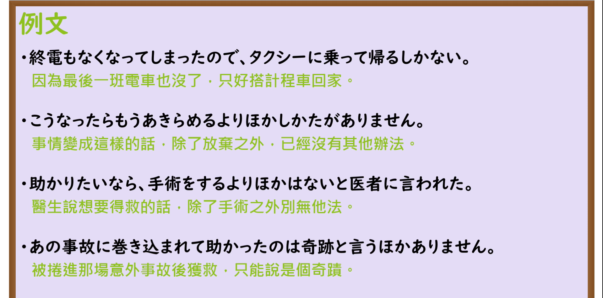

---
{
  "id": "N3-G-0075",
  "kind": "grammar",
  "level": "N3",
  "title": "〜しかない／〜よりほかない（唯有……／只能……）",
  "card_revision": 1,
  "schema_version": 1,
  "source": {
    "lesson": "N3 第75个语法",
    "material": "出口日語原视频板书、日语自动字幕与Hagoromo文型检索正文",
    "video": "https://www.youtube.com/watch?v=D3_uQq7FTl8",
    "screenshot": "assets/grammar/n3/N3-G-0075-connection.png",
    "screenshot_seconds": 242,
    "screenshot_crop": {
      "x": 0,
      "y": 0,
      "width": 1500,
      "height": 930
    }
  },
  "tags": [
    "しかない",
    "よりほかない",
    "N3"
  ],
  "confusions": [
    "〜ざるを得ない",
    "〜ほかない",
    "〜にすぎない"
  ]
}
---

# N3 第75个语法：〜しかない／〜よりほかない

# 视频学习资料整理

本课讲解 N3 语法形式「〜しかない／〜よりほかない」。

## 接续图（板书与讲解）

- 视频链接：[出口日語 N3 第75个语法](https://www.youtube.com/watch?v=D3_uQq7FTl8)
- 真实时间：04:02（242.00秒）
- 原图尺寸：1920×1080
- 裁切说明：选用 04:02 画面，此时画面左上方语法标题与中文释义「〜しかない／〜より他はない 只能〜；只有〜」清晰无渐隐，板书已完整书写接续规则「動詞辞書形＋しかない／より他はない／ほか仕方がない」；出口老师在板书中特别强调该句型表达除此动作之外别无他选的无奈境地或坚决决心。固定左上角（0, 0），裁切区域为宽 1500、高 930，去除右侧人像与底部空白，完整保留全部板书与顶部标题。
- 图片：

## 例句图（视频例句）

- 视频链接：[出口日語 N3 第75个语法](https://www.youtube.com/watch?v=D3_uQq7FTl8)
- 真实时间：04:21（261.00秒）
- 原图尺寸：1920×1080
- 裁切说明：提取自视频 04:21 处的例句黑板页面。固定左上角（0, 0），裁切区域为宽 1920、高 950，裁去底部多余边框与杂物，完整保留四条例句及中文翻译。
- 图片：

# 核心

## 功能一：表示别无其他方法或选择途径，唯有采取该唯一行动（唯有……／只能……）

**最上位意味カテゴリー：**

- **しかない：** 考え・感情（思想与情感）

**中位意味カテゴリー：**

- **しかない：** 主張・断定的評価（主张与评价断定）

**意味：**

- **しかない：** 評価（无可奈何之唯一选择）

**くわしい意味記述：**

- **しかない：** 「〜するより他に方法がない」「〜するしかしかたがない」という意味。（表示在受限的客观条件或紧迫关头，除此做法外别无良策；书面硬语亦可作「〜より他はない」「〜ほか仕方がない」）。

### 例句

1. 終電もとっくになくなってしまったので、諦めてタクシーに乗って帰るしかない。

   （末班电车早就开走了，只得死心打出租车回家。）

2. 事故で全財産の入った財布を落としてしまった以上、警察に届けて連絡を待つより他はない。

   （既然装有全部家当的钱包丢失了，唯有向警方报案并耐心等待联络。）

3. 自らの重大なミスで会社に迷惑をかけたのだから、誠意を持って謝罪するしかない。

   （既然因自己的严重失误给公司造成了麻烦，就唯有拿出诚意赔礼道歉。）

4. 台風で飛行機が全便欠航になったため、ホテルをもう一泊予約して待機するよりほかなかった。

   （由于台风导致航班全线停飞，别无他法只能在酒店续住一晚等待恢复。）

# 来源

- [出口日語原视频](https://www.youtube.com/watch?v=D3_uQq7FTl8)
- [Hagoromo 文型検索「しかない」](https://hagoromo-text.work/lookup?vid=579)（查询日期：2026-09-25）
