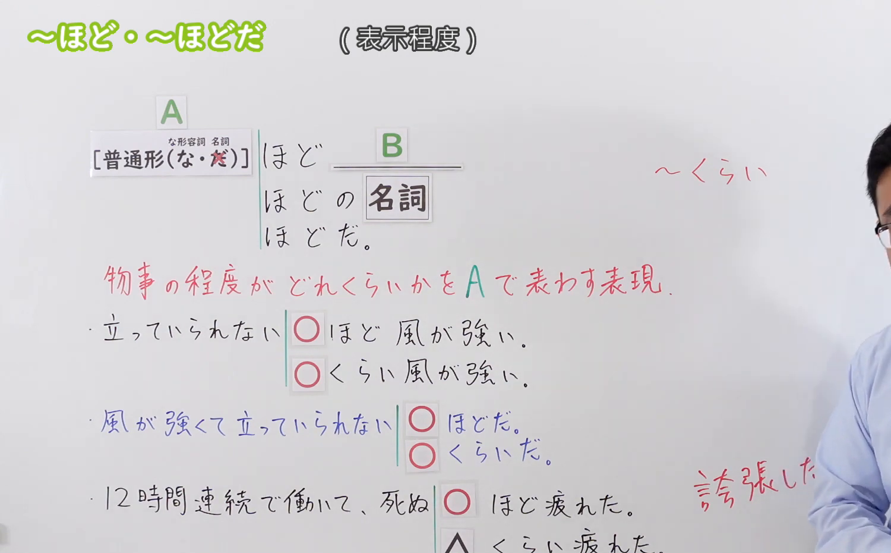

---
{
  "id": "N3-G-0076",
  "kind": "grammar",
  "level": "N3",
  "title": "〜ほど（达到……的程度／甚至……）",
  "card_revision": 1,
  "schema_version": 1,
  "source": {
    "lesson": "N3 第76个语法",
    "material": "出口日語原视频板书、日语自动字幕与Hagoromo文型检索正文",
    "video": "https://www.youtube.com/watch?v=P23VS3tkPhw",
    "screenshot": "assets/grammar/n3/N3-G-0076-connection.png",
    "screenshot_seconds": 206,
    "screenshot_crop": {
      "x": 0,
      "y": 0,
      "width": 1500,
      "height": 930
    }
  },
  "tags": [
    "ほど",
    "N3"
  ],
  "confusions": [
    "〜くらい",
    "〜ば〜ほど",
    "〜ほど〜はない"
  ]
}
---

# N3 第76个语法：〜ほど

# 视频学习资料整理

本课讲解 N3 语法形式「〜ほど」。

## 接续图（板书与讲解）

- 视频链接：[出口日語 N3 第76个语法](https://www.youtube.com/watch?v=P23VS3tkPhw)
- 真实时间：03:26（206.00秒）
- 原图尺寸：1920×1080
- 裁切说明：选用 03:26 画面，此时画面左上方语法标题与中文释义「〜ほど 到了〜程度；甚至〜」清晰无渐隐，板书已完整书写接续规则「動詞辞書形・名詞・な形な＋ほど」以及与「〜くらい」的对比；出口老师在板书中特别强调「〜ほど」多用于带有夸张、形象化比喻修辞的高程度表达（如「死ぬほど疲れた」），比口语「くらい」更具书面感与表现力。固定左上角（0, 0），裁切区域为宽 1500、高 930，去除右侧人像与底部空白，完整保留全部板书与顶部标题。
- 图片：

## 例句图（视频例句）

- 视频链接：[出口日語 N3 第76个语法](https://www.youtube.com/watch?v=P23VS3tkPhw)
- 真实时间：03:41（221.00秒）
- 原图尺寸：1920×1080
- 裁切说明：提取自视频 03:41 处的例句黑板页面。固定左上角（0, 0），裁切区域为宽 1920、高 950，裁去底部多余边框与杂物，完整保留四条例句及中文翻译。
- 图片：

# 核心

## 功能一：举出极端的具体状态或比喻性事例，形象说明事态程度之深（达到……的程度／甚至……）

**最上位意味カテゴリー：**

- **ほど：** ものごとの関係（事物之间的关系）

**中位意味カテゴリー：**

- **ほど：** 比較（比较与比照）

**意味：**

- **ほど：** 程度（比喻修辞之高程度表征）

**くわしい意味記述：**

- **ほど：** ある事柄Xの程度が，「ほど」とともに使われる要素Yと同じくらいだという意味を表す。（借由举出带有夸张或具体感受的事态作为比照标尺，极力渲染前项状态之深；常与身体感觉、心理反应相联系）。

### 例句

1. 今日の真冬の寒さは厳しく、公園の池の水が一面凍りつくほど寒い。

   （今天严冬的寒意刺骨，冷到连公园水池里的水都结起厚冰的程度。）

2. 週末に休みなく12時間ぶっ続けで働き詰めて、死ぬほど疲れてしまった。

   （周末一刻不停连续高强度工作了12个小时，累到快要虚脱的程度。）

3. 全校生徒の集まる卒業式の壇上で足を滑らせて転んでしまい、穴があったら入りたいほど恥ずかしかった。

   （在全校齐聚的毕业典礼台上脚滑摔倒，简直羞耻到想找个地缝钻进去。）

4. 親身に話を聞いて、彼が当時どれほど過酷でつらかったのかが痛いほどよく分かりました。

   （悉心听取倾诉后，我切身体会到了他当时究竟承受了何等深重的痛苦。）

# 来源

- [出口日語原视频](https://www.youtube.com/watch?v=P23VS3tkPhw)
- [Hagoromo 文型検索「ほど」](https://hagoromo-text.work/lookup?vid=1507)（查询日期：2026-09-25）
