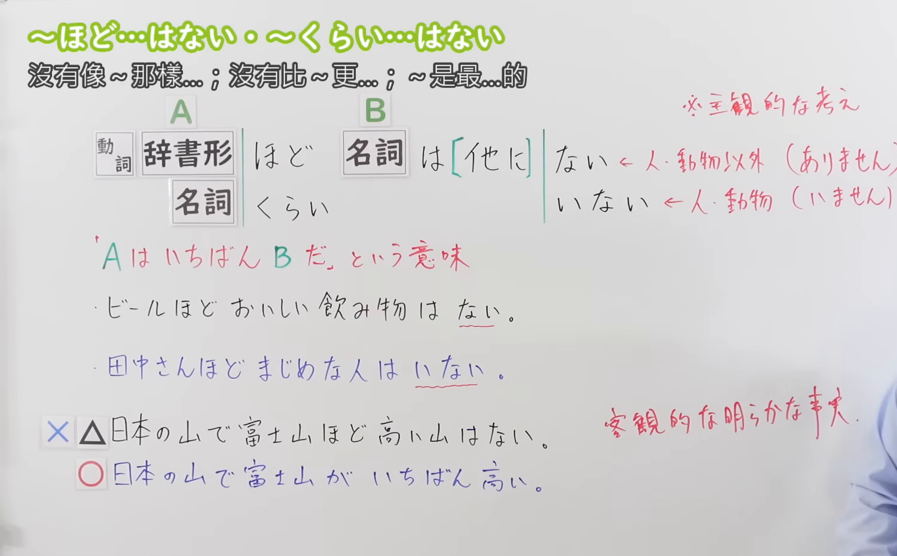
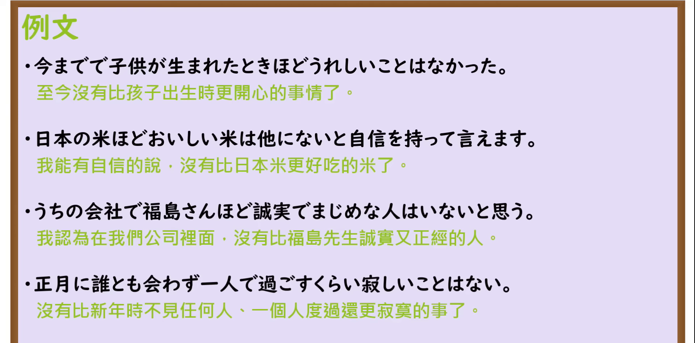

---
{
  "id": "N3-G-0077",
  "kind": "grammar",
  "level": "N3",
  "title": "〜ほど〜はない／〜くらい〜はない（没有比……更……的）",
  "card_revision": 1,
  "schema_version": 1,
  "source": {
    "lesson": "N3 第77个语法",
    "material": "出口日語原视频板书、日语自动字幕与Hagoromo文型检索正文",
    "video": "https://www.youtube.com/watch?v=4duXe89L8ZQ",
    "screenshot": "assets/grammar/n3/N3-G-0077-connection.png",
    "screenshot_seconds": 276,
    "screenshot_crop": {
      "x": 0,
      "y": 0,
      "width": 1500,
      "height": 930
    }
  },
  "tags": [
    "ほど〜はない",
    "くらい〜はない",
    "N3"
  ],
  "confusions": [
    "〜ほど",
    "〜に越したことはない",
    "〜一番"
  ]
}
---

# N3 第77个语法：〜ほど〜はない／〜くらい〜はない

# 视频学习资料整理

本课讲解 N3 语法形式「〜ほど〜はない／〜くらい〜はない」。

## 接续图（板书与讲解）

- 视频链接：[出口日語 N3 第77个语法](https://www.youtube.com/watch?v=4duXe89L8ZQ)
- 真实时间：04:36（276.00秒）
- 原图尺寸：1920×1080
- 裁切说明：选用 04:36 画面，此时画面左上方语法标题与中文释义「〜ほど〜はない／〜くらい〜はない 沒有比〜更〜的」清晰无渐隐，板书已完整书写句型接续「動詞辞書形・名詞＋ほど／くらい〜（名詞・形容詞）はない」；出口老师在板书中特别辨析了客观事实通常用最高级「富士山が一番高い」，而主观感受与强烈主张时优先使用本句型「ビールほどおいしい飲み物はない」。固定左上角（0, 0），裁切区域为宽 1500、高 930，去除右侧人像与底部空白，完整保留全部板书与顶部标题。
- 图片：

## 例句图（视频例句）

- 视频链接：[出口日語 N3 第77个语法](https://www.youtube.com/watch?v=4duXe89L8ZQ)
- 真实时间：05:01（301.00秒）
- 原图尺寸：1920×1080
- 裁切说明：提取自视频 05:01 处的例句黑板页面。固定左上角（0, 0），裁切区域为宽 1920、高 950，裁去底部多余边框与杂物，完整保留四条例句及中文翻译。
- 图片：

# 核心

## 功能一：基于说话人的主观断定或感触，表示在同类中再无出其右者（没有比……更……的）

**最上位意味カテゴリー：**

- **ほど〜はない：** ものごとの関係（事物之间的关系）

**中位意味カテゴリー：**

- **ほど〜はない：** 比較（比较与否定排除）

**意味：**

- **ほど〜はない：** 比較（无与伦比之最高程度）

**くわしい意味記述：**

- **ほど〜はない：** 「XはYほど」でXとYを比べて，XがYよりたいしたことではないと述べる時に使う。（以说话人的主观体验或高度确信为基准，否定存在超越前项的存在，从而凸显前项为同类事物中的极致最高峰；句尾固定呼应否定「〜はない／〜はいない」）。

### 例句

1. 暑い真夏の炎天下で汗を流した後に飲む冷えたビールほど、美味しい飲み物はない。

   （在盛夏烈日下大汗淋漓之后喝上一杯冰镇啤酒，没有比这更畅快过瘾的饮品了。）

2. 一生懸命に努力を重ねて準備した試験で0点を取った時ほど、悲しく惨めな瞬間はなかった。

   （为之付出全力悉心备考的测试中却得了零分，再也没有比那一刻更让人沮丧心碎的了。）

3. 苦労を重ねてようやく完成させた自作の小説が出版されると決まった時ほど、嬉しい日はなかった。

   （历经坎坷潜心创作的自著小说终于敲定出版，再也没有比那天更让人欣喜若狂的日子了。）

4. 周囲の誰に対しても温かく誠実に接する田中さんほど、信頼の置ける立派な人物はいない。

   （对身边的每一个人都报以温和与诚恳的田中先生，再也没有比他更值得信赖的高尚之人了。）

# 来源

- [出口日語原视频](https://www.youtube.com/watch?v=4duXe89L8ZQ)
- [Hagoromo 文型検索「ほど」](https://hagoromo-text.work/lookup?vid=1509)（查询日期：2026-09-25）
