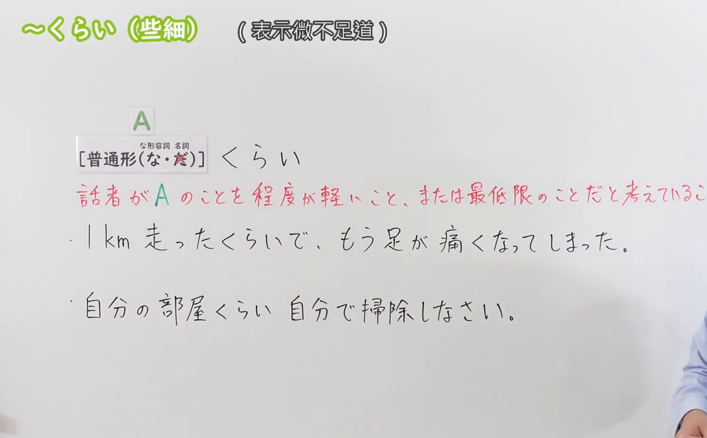
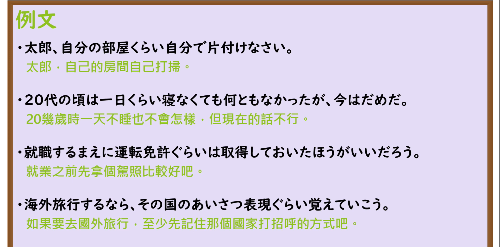

---
{
  "id": "N3-G-0078",
  "kind": "grammar",
  "level": "N3",
  "title": "〜くらい／〜ぐらい（至少……／哪怕只是……／连……这样微不足道的事）",
  "card_revision": 1,
  "schema_version": 1,
  "source": {
    "lesson": "N3 第78个语法",
    "material": "出口日語原视频板书、日语自动字幕与Hagoromo文型检索正文",
    "video": "https://www.youtube.com/watch?v=KweyB6rYqqw",
    "screenshot": "assets/grammar/n3/N3-G-0078-connection.png",
    "screenshot_seconds": 130,
    "screenshot_crop": {
      "x": 0,
      "y": 0,
      "width": 1500,
      "height": 930
    }
  },
  "tags": [
    "くらい",
    "ぐらい",
    "N3"
  ],
  "confusions": [
    "〜ほど",
    "〜くらい（程度）",
    "〜など"
  ]
}
---

# N3 第78个语法：〜くらい／〜ぐらい

# 视频学习资料整理

本课讲解 N3 语法形式「〜くらい／〜ぐらい」。

## 接续图（板书与讲解）

- 视频链接：[出口日語 N3 第78个语法](https://www.youtube.com/watch?v=KweyB6rYqqw)
- 真实时间：02:10（130.00秒）
- 原图尺寸：1920×1080
- 裁切说明：选用 02:10 画面，此时画面左上方语法标题与中文释义「〜くらい 至少〜；連〜程度的事」清晰无渐隐，板书已完整书写接续规则「動詞辞書形・動詞た形・名詞＋くらい／ぐらい」；出口老师在板书中特别强调本课专项讲解其表示轻视、不足挂齿或最起码底线的特殊语感（如「自分の部屋くらい自分で片付けなさい」）。固定左上角（0, 0），裁切区域为宽 1500、高 930，去除右侧人像与底部空白，完整保留全部板书与顶部标题。
- 图片：

## 例句图（视频例句）

- 视频链接：[出口日語 N3 第78个语法](https://www.youtube.com/watch?v=KweyB6rYqqw)
- 真实时间：02:29（149.00秒）
- 原图尺寸：1920×1080
- 裁切说明：提取自视频 02:29 处的例句黑板页面。固定左上角（0, 0），裁切区域为宽 1920、高 950，裁去底部多余边框与杂物，完整保留四条例句及中文翻译。
- 图片：

# 核心

## 功能一：举出最起码、不足挂齿或轻而易举的小事，表达起码应当做到或对轻微程度的感叹（至少……／哪怕只是……／连……这样微不足道的事）

**最上位意味カテゴリー：**

- **くらい：** ものごとの様子（事物的情态）

**中位意味カテゴリー：**

- **くらい：** 程度（底限与轻微程度）

**意味：**

- **くらい：** 程度（起码底限与不足为奇）

**くわしい意味記述：**

- **くらい：** 程度について，一例をあげて，判断の基準を表す表現。（提出极其简单、微小的事项作为最基础底线，常用于带有批评催促意味的劝告；亦可用于表示仅仅发生轻微动作就引发超出预期的反应）。

### 例句

1. もう中学生になったのだから、自分の部屋の片付けくらい自分でやりなさい。

   （既然已经是中学生了，至少收拾自己房间这种起码的事该自己做。）

2. 海外旅行へ出発する前に、現地の基本的な挨拶の表現くらいは覚えておこう。

   （在动身出国旅行前，哪怕最基本的几句当地问候语总该记一记。）

3. 社会人として企業に就職する前に、普通自動車の運転免許ぐらいは取得しておいた方がいい。

   （作为社会人进入企业就职前，哪怕小汽车驾照总该事先考出来。）

4. たった1キロ走ったくらいで息が上がって足が痛くなるなんて、運動不足も甚だしい。

   （只不过跑了短短1公里就气喘吁吁腿酸脚痛，这也未免太缺乏锻炼了。）

# 来源

- [出口日語原视频](https://www.youtube.com/watch?v=KweyB6rYqqw)
- [Hagoromo 文型検索「くらい」](https://hagoromo-text.work/lookup?vid=469)（查询日期：2026-09-25）
