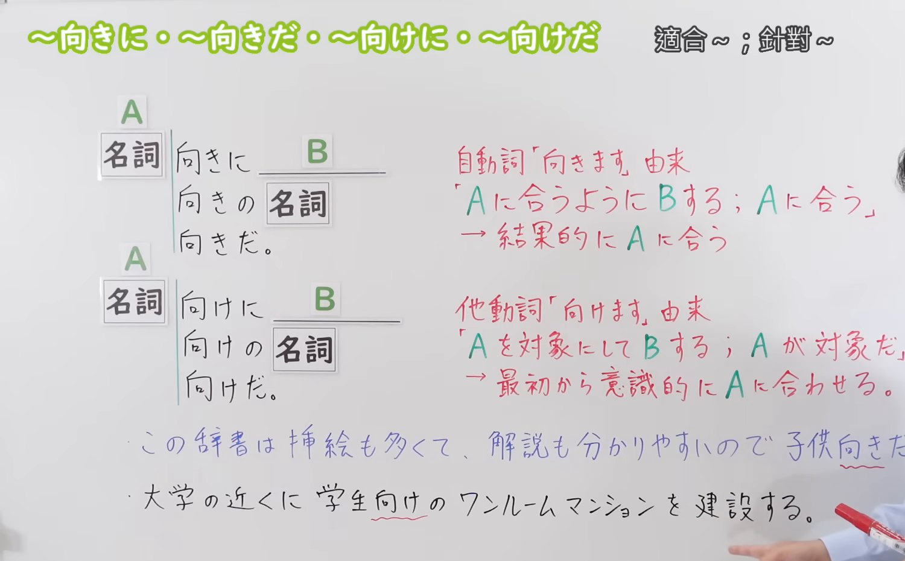
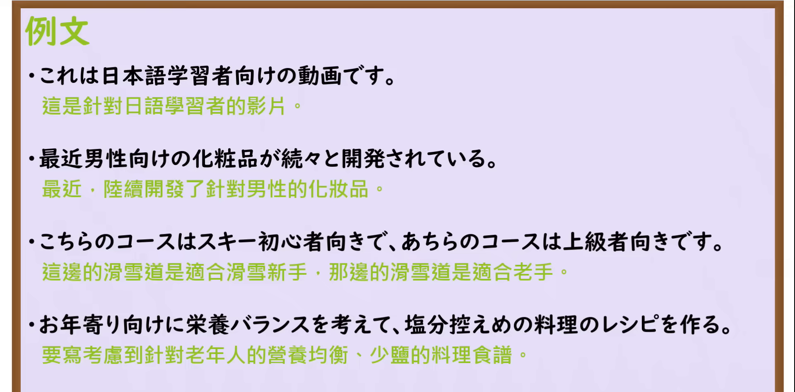

---
{
  "id": "N3-G-0079",
  "kind": "grammar",
  "level": "N3",
  "title": "〜向き／〜向け（适合于……／专为……面向设计）",
  "card_revision": 1,
  "schema_version": 1,
  "source": {
    "lesson": "N3 第79个语法",
    "material": "出口日語原视频板书、日语自动字幕与Hagoromo文型检索正文",
    "video": "https://www.youtube.com/watch?v=8Jl1tXDaGOo",
    "screenshot": "assets/grammar/n3/N3-G-0079-connection.png",
    "screenshot_seconds": 224,
    "screenshot_crop": {
      "x": 0,
      "y": 0,
      "width": 1500,
      "height": 930
    }
  },
  "tags": [
    "向き",
    "向け",
    "N3"
  ],
  "confusions": [
    "〜向き",
    "〜向け",
    "〜用",
    "〜対象"
  ]
}
---

# N3 第79个语法：〜向き／〜向け

# 视频学习资料整理

本课讲解 N3 语法形式「〜向き／〜向け」。

## 接续图（板书与讲解）

- 视频链接：[出口日語 N3 第79个语法](https://www.youtube.com/watch?v=8Jl1tXDaGOo)
- 真实时间：03:44（224.00秒）
- 原图尺寸：1920×1080
- 裁切说明：选用 03:44 画面，此时画面左上方语法标题与中文释义「〜向き／〜向け 適合〜；為〜而設」清晰无渐隐，板书已完整书写两大系统并列对比：「名詞＋向き（自然符合／適合）」与「名詞＋向け（主观意图针对设计／專為〜製造）」以及连体形「〜向きの／向けの＋名詞」；出口老师在板书中特别强调了「合う（自然契合）」与「合わせる（主动对齐）」的思维差异。固定左上角（0, 0），裁切区域为宽 1500、高 930，去除右侧人像与底部空白，完整保留全部板书与顶部标题。
- 图片：

## 例句图（视频例句）

- 视频链接：[出口日語 N3 第79个语法](https://www.youtube.com/watch?v=8Jl1tXDaGOo)
- 真实时间：04:10（250.00秒）
- 原图尺寸：1920×1080
- 裁切说明：提取自视频 04:10 处的例句黑板页面。固定左上角（0, 0），裁切区域为宽 1920、高 950，裁去底部多余边框与杂物，完整保留四条例句及中文翻译。
- 图片：

# 核心

## 功能一：事物本身的天然特质、口味或难度正巧吻合某群体（适合于……）

**最上位意味カテゴリー：**

- **向き：** ものごとの関係（事物之间的关系）

**中位意味カテゴリー：**

- **向き：** 関連・対応（关联与适应）

**意味：**

- **向き：** 対応（客观性质自然适宜）

**くわしい意味記述：**

- **向き：** 「〜のために良い」という意味。人を表す名詞に接続する。（表示客观属性刚好适合该群体的体质、性格、爱好或水平；强调客观契合度）。

### 例句

1. この解説書は、専門用語が少なく平易な言葉で書かれているため初心者向きだ。

   （这本解说书专业术语少且用语通俗浅显，非常适合初学者阅读。）

2. こちらの甘口カレーは、辛いものが苦手な人や小さな子供向きの優しい味付けです。

   （这款微甜咖喱调味温和，非常适合怕辣的人群和幼童食用。）

3. この小型軽量のノートパソコンは、毎日街中を持ち歩いて外出するビジネスパーソン向きだ。

   （这款轻巧便捷的笔记本电脑，非常适合需要每天携带外出的商务人士。）

## 功能二：生产制造者带着明确意图，专门针对某特定对象量身打造（专为……而设立／面向……）

**最上位意味カテゴリー：**

- **向き：** ものごとの関係（事物之间的关系）

**中位意味カテゴリー：**

- **向き：** 関連・対応（关联与目标指向）

**意味：**

- **向き：** 対応（主观意图目标设计）

**くわしい意味記述：**

- **向き：** 最初からその人を対象として意識的に合わせることを表す。（从一开始就以该特定群体为目标受众进行设计、生产或销售，修饰名词时用「〜向けの＋名詞」）。

### 例句

1. これは世界各地の日本語学習者向けに、わかりやすく文法を解説した教育動画です。

   （这是专为全球各地的日语学习者量身制作、通俗讲解语法的教学视频。）

2. この新しく開発された化粧品シリーズは、20代の働く若い女性向けに企画された。

   （这个全新研发的化妆品系列，是专门面向20多岁年轻职业女性企划推出的。）

3. 市役所の窓口では、最近急増している外国人居住者向けの生活案内ガイドブックを配布している。

   （市政府服务窗口正在免费发放专为外籍定居者编写的日常生活指南手册。）

# 来源

- [出口日語原视频](https://www.youtube.com/watch?v=8Jl1tXDaGOo)
- [Hagoromo 文型検索「むき」](https://hagoromo-text.work/lookup?vid=1566)（查询日期：2026-09-25）
