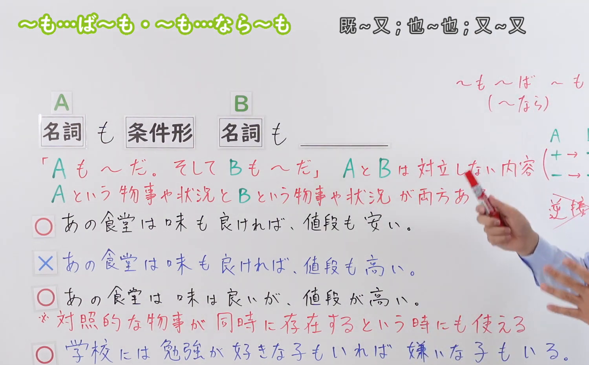
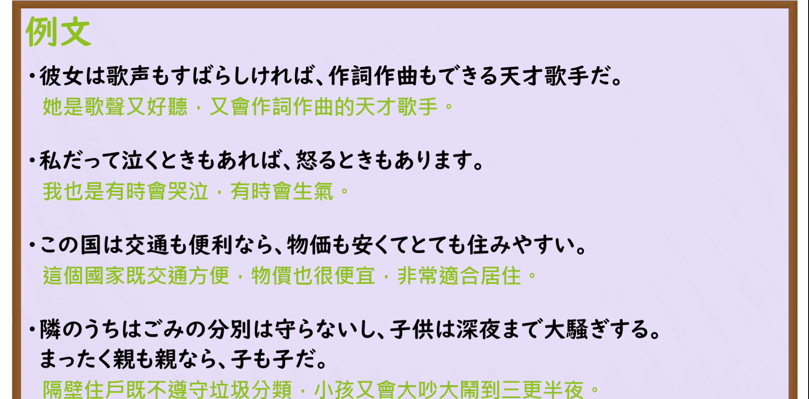

---
{
  "id": "N3-G-0080",
  "kind": "grammar",
  "level": "N3",
  "title": "〜も〜ば〜も／〜も〜なら〜も（既……又……／也……也……）",
  "card_revision": 1,
  "schema_version": 1,
  "source": {
    "lesson": "N3 第80个语法",
    "material": "出口日語原视频板书、日语自动字幕与Hagoromo文型检索正文",
    "video": "https://www.youtube.com/watch?v=8OR_bSVFszw",
    "screenshot": "assets/grammar/n3/N3-G-0080-connection.png",
    "screenshot_seconds": 244,
    "screenshot_crop": {
      "x": 0,
      "y": 0,
      "width": 1500,
      "height": 930
    }
  },
  "tags": [
    "も〜ば〜も",
    "も〜なら〜も",
    "N3"
  ],
  "confusions": [
    "〜だけでなく〜も",
    "〜も〜し〜も",
    "〜とともに"
  ]
}
---

# N3 第80个语法：〜も〜ば〜も／〜も〜なら〜も

# 视频学习资料整理

本课讲解 N3 语法形式「〜も〜ば〜も／〜も〜なら〜も」。

## 接续图（板书与讲解）

- 视频链接：[出口日語 N3 第80个语法](https://www.youtube.com/watch?v=8OR_bSVFszw)
- 真实时间：04:04（244.00秒）
- 原图尺寸：1920×1080
- 裁切说明：选用 04:04 画面，此时画面左上方语法标题与中文释义「〜も〜ば〜も／〜も〜なら〜も 既〜又〜；也〜也〜」清晰无渐隐，板书已完整书写接续公式「名詞＋も＋動詞ば形／イ形ければ／ナ形なら／名詞なら＋名詞＋も」；出口老师在板书中特别强调前后两项通常保持评价同向性（同为正面赞赏或同为负面评价），用于全面罗列事物兼备的多种属性。固定左上角（0, 0），裁切区域为宽 1500、高 930，去除右侧人像与底部空白，完整保留全部板书与顶部标题。
- 图片：

## 例句图（视频例句）

- 视频链接：[出口日語 N3 第80个语法](https://www.youtube.com/watch?v=8OR_bSVFszw)
- 真实时间：04:27（267.00秒）
- 原图尺寸：1920×1080
- 裁切说明：提取自视频 04:27 处的例句黑板页面。固定左上角（0, 0），裁切区域为宽 1920、高 950，裁去底部多余边框与杂物，完整保留四条例句及中文翻译。
- 图片：

# 核心

## 功能一：并列列举事物的两个同向属性或特征，强调兼而有之（既……又……／也……也……）

**最上位意味カテゴリー：**

- **も〜ば〜も：** ものごとの関係（事物之间的关系）

**中位意味カテゴリー：**

- **も〜ば〜も：** 並列・反復（并列与反复）

**意味：**

- **も〜ば〜も：** 並立・列挙（同向属性之兼备列举）

**くわしい意味記述：**

- **も〜ば〜も：** 「N1も〜ば（なら）」と「N2も〜」は，同じ評価（プラスとプラス、マイナスとマイナス）を表し，前の事柄に後ろの事柄を加えて言いたい時に使う。（前后两项并提，表明该人或事物兼具两种同类性质；后项亦常作「〜もあれば〜もある」）。

### 例句

1. 彼女は天性の歌声も素晴らしければ、ステージでの豊かな表現力も抜群だ。

   （她不仅天生歌喉优美动听，舞台上富有感染力的表现力也出类拔萃。）

2. この新型スマートフォンは、カメラの性能も良ければ、バッテリーの持ちも非常に長い。

   （这款新型智能手机不仅摄像头性能优异，电池续航能力也格外持久。）

3. 人生というものは、思わぬ幸運に恵まれる良い時もあれば、厳しい試練に遭う苦しい時もある。

   （所谓人生，既有巧遇良机诸事顺遂的顺境，也有历经考验坎坷艰难的逆境。）

4. 近頃の野菜は、スーパーでの販売価格も高ければ、天候不順で品質もあまり良くない。

   （最近市场上的蔬菜，不仅超市卖价昂贵，受天气异常影响品质也差强人意。）

# 来源

- [出口日語原视频](https://www.youtube.com/watch?v=8OR_bSVFszw)
- [Hagoromo 文型検索「も〜ば」](https://hagoromo-text.work/lookup?vid=41)（查询日期：2026-09-25）
