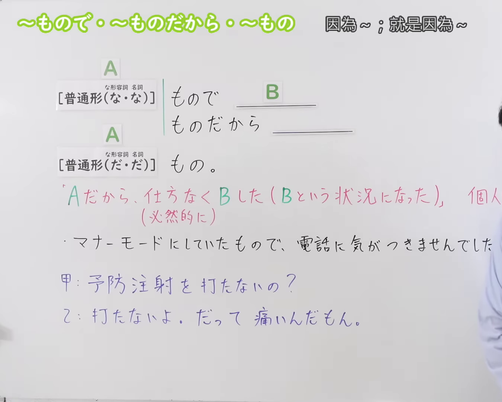
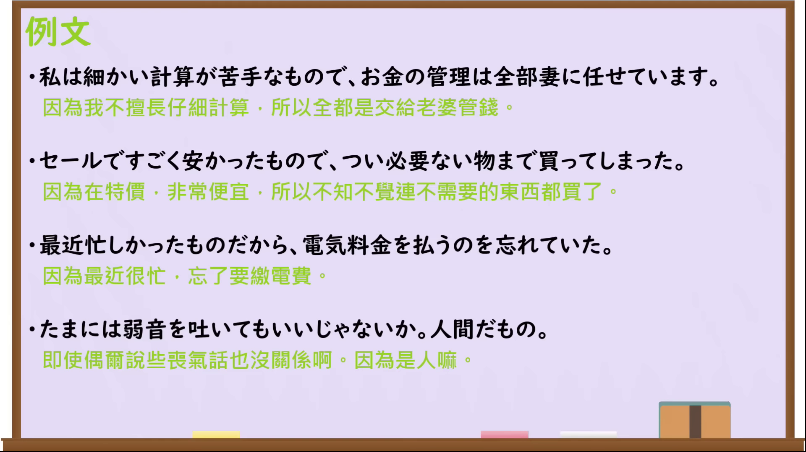

---
{
  "id": "N3-G-0081",
  "kind": "grammar",
  "level": "N3",
  "title": "〜もので／〜ものだから／〜もの（因为……；就是因为……）",
  "card_revision": 1,
  "schema_version": 1,
  "source": {
    "lesson": "N3 第81个语法",
    "material": "出口日語原视频板书、日语自动字幕与Hagoromo文型检索正文",
    "video": "https://www.youtube.com/watch?v=kYs8iMN-ILk",
    "screenshot": "assets/grammar/n3/N3-G-0081-connection.png",
    "screenshot_seconds": 1,
    "screenshot_crop": {
      "x": 0,
      "y": 0,
      "width": 1350,
      "height": 1080
    }
  },
  "tags": [
    "もので",
    "ものだから",
    "もの",
    "N3"
  ],
  "confusions": [
    "〜から",
    "〜ので",
    "〜わけだ"
  ]
}
---

# N3 第81个语法：〜もので／〜ものだから／〜もの

# 视频学习资料整理

本课讲解 N3 语法形式「〜もので／〜ものだから／〜もの」。

## 接续图（板书与讲解）

- 视频链接：[出口日語 N3 第81个语法](https://www.youtube.com/watch?v=kYs8iMN-ILk)
- 真实时间：00:01（1.00秒）
- 原图尺寸：1920×1080
- 裁切说明：选用 00:01 画面，左上方清晰显示语法标题「〜もので・〜ものだから・〜もの」与中文释义「因為〜；就是因為〜」，接续展示普通形接「もので」「ものだから」「もの。」，并用红字详细说明「Aだから、仕方なくBした（Bという状況になった）（必然的に）」。固定左上角（0, 0），裁切区域为宽 1920、高 1080，裁去右侧讲师身躯与底部多余空白。
- 图片：

## 例句图（视频例句）

- 视频链接：[出口日語 N3 第81个语法](https://www.youtube.com/watch?v=kYs8iMN-ILk)
- 真实时间：03:28（208.42秒）
- 原图尺寸：1920×1080
- 裁切说明：提取自视频 03:28 处的例句黑板页面。固定左上角（0, 0），裁切区域为宽 1920、高 1080，保留完整例句与中文释义。
- 图片：

# 核心

## 功能一：因为A，所以无可奈何地做了B（变成了B的状态）（必然地）

**最上位意味カテゴリー：**

- **ものだから：** ものごとの関係（事物之间的关系）
- **もんだから：** ものごとの関係（事物之间的关系）

**中位意味カテゴリー：**

- **ものだから：** 原因・理由（原因与理由）
- **もんだから：** 原因・理由（原因与理由）

**意味：**

- **ものだから：** 原因・理由（原因与理由）
- **もんだから：** 原因・理由（原因与理由）

**くわしい意味記述：**

- **ものだから：** 予想外の出来事のXのせいでYということになった。「Vていたものだから，Vれたものだから」という自分の意志ではどうすることもできない出来事から，都合の悪い出来事が起こったと伝えたいときに使う。「もんだから」はくだけた言い方で，同じ意味である。（因为预想之外的事情X而导致了Y的结果。常以“Vていたものだから、Vれたものだから”的形式，用于想表达由于自身意志无法左右的突发事情而导致了不巧、不利的结果。「もんだから」是较为随意的口语表达，含义相同。）
- **もんだから：** 予想外の出来事のXのせいでYということになった。「Vていたものだから，Vれたものだから」という自分の意志ではどうすることもできない出来事から，都合の悪い出来事が起こったと伝えたいときに使う。「ものだから」と同じ意味である。（因为预想之外的事情X而导致了Y的结果。常以“Vていたものだから、Vれたものだから”的形式，用于想表达由于自身意志无法左右的突发事情而导致了不巧、不利的结果。与「ものだから」含义相同。）

**派生語：** もんだから

### 例句

1. 出がけにお客が来たものだから、遅くなってしまいました。

   （刚要出门时来了客人，所以就迟到了。）

2. 彼は博士論文書こうとしているものだから、いろいろ教えてもらった方がいいわけよ。

   （正因为他正打算写博士论文，所以向他多请教请教比较好哦。）

3. 実はついこの先の病家まで来たものですから、どんなご様子かと思って……。

   （实际上是因为我刚好来到这前头的病人家里，就想着来看看您的近况如何……）

4. 出がけにお客が来たもんだから、遅くなっちゃったよ。ごめん。

   （刚要出门时来了客人，所以来晚了。抱歉啊。）

# 来源

- [出口日語原视频](https://www.youtube.com/watch?v=kYs8iMN-ILk)
- [Hagoromo 文型検索「ものだから」](https://hagoromo-text.work/)（查询日期：2026-09-25）
