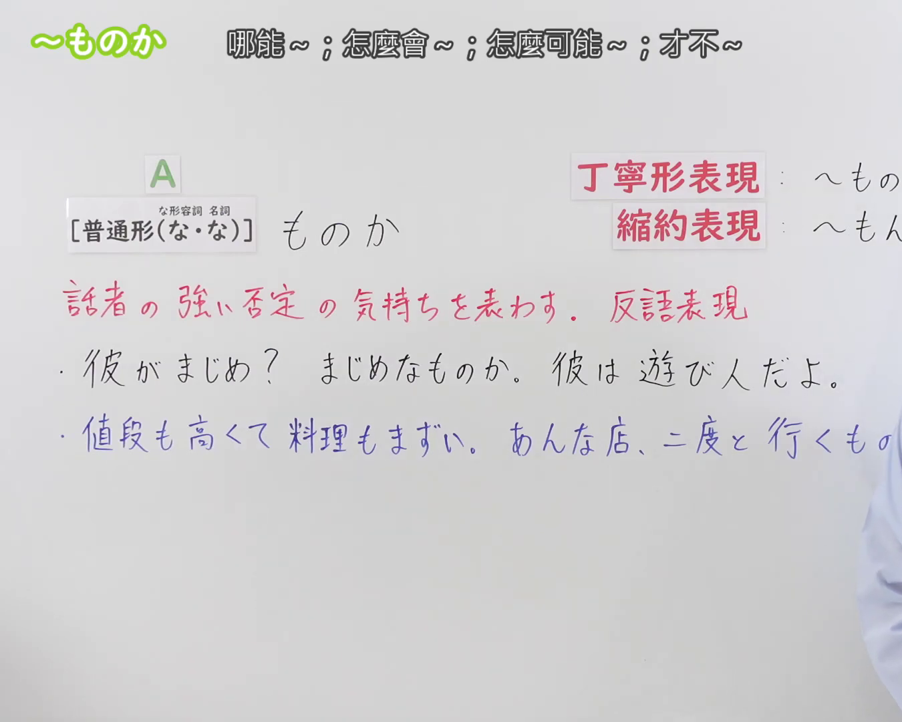
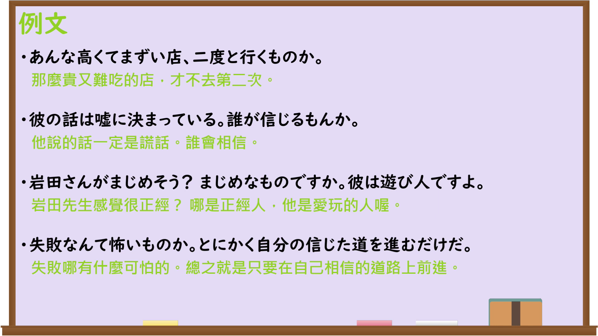

---
{
  "id": "N3-G-0082",
  "kind": "grammar",
  "level": "N3",
  "title": "〜ものか（哪能……；怎么会……；怎么可能……；才不……）",
  "card_revision": 1,
  "schema_version": 1,
  "source": {
    "lesson": "N3 第82个语法",
    "material": "出口日語原视频板书、日语自动字幕与Hagoromo文型检索正文",
    "video": "https://www.youtube.com/watch?v=OjUWkULvYzI",
    "screenshot": "assets/grammar/n3/N3-G-0082-connection.png",
    "screenshot_seconds": 1,
    "screenshot_crop": {
      "x": 0,
      "y": 0,
      "width": 1350,
      "height": 1080
    }
  },
  "tags": [
    "ものか",
    "もんか",
    "ものですか",
    "N3"
  ],
  "confusions": [
    "〜わけがない",
    "〜はずがない",
    "〜っこない"
  ]
}
---

# N3 第82个语法：〜ものか

# 视频学习资料整理

本课讲解 N3 语法形式「〜ものか」。

## 接续图（板书与讲解）

- 视频链接：[出口日語 N3 第82个语法](https://www.youtube.com/watch?v=OjUWkULvYzI)
- 真实时间：00:01（1.00秒）
- 原图尺寸：1920×1080
- 裁切说明：选用 00:01 画面，左上方清晰显示语法标题「〜ものか」与中文释义「哪能〜；怎麼會〜；怎麼可能〜；才不〜」，接续展示普通形接「ものか」，右侧展示丁寧形「〜ものですか」与缩约表现「〜もんか」，红字解释「話者の強い否定の気持ちを表す。反語表現」。固定左上角（0, 0），裁切区域为宽 1920、高 1080，裁去右侧讲师身躯与底部多余空白。
- 图片：

## 例句图（视频例句）

- 视频链接：[出口日語 N3 第82个语法](https://www.youtube.com/watch?v=OjUWkULvYzI)
- 真实时间：03:59（239.60秒）
- 原图尺寸：1920×1080
- 裁切说明：提取自视频 03:59 处的例句黑板页面。固定左上角（0, 0），裁切区域为宽 1920、高 1080，保留完整例句与中文释义。
- 图片：

# 核心

## 功能一：表达说话人强烈的否定心情，属于反问表现（绝不……；怎么会……）

**最上位意味カテゴリー：**

- **ものか：** 考え・感情（想法与感情）

**中位意味カテゴリー：**

- **ものか：** 主張・断定的評価（主张与断定性评价）

**意味：**

- **ものか：** 強い否定（强烈的否定）

**くわしい意味記述：**

- **ものか：** 強い否定を表す。話者の強い感情を表す。会話では「もんか」になることが多い。（表示强烈的否定。表达说话人强烈的情感。在日常会话中常转化为「もんか」。）

**派生語：** 未列出

### 例句

1. あんなやつに教えてなどやるものか。

   （我才不会去教那种家伙呢。）

2. こんな粗末な機械で楽しく遊べるものか。

   （用这么简陋破旧的机器，怎么可能玩得痛快开心呢。）

3. 当時の国民には二十歳の徴兵対象者はもちろん、学齢に達する子供は大事な労働力であった。それをとりあげられてなるものか。

   （对当时的国民而言，年满二十岁的适龄征兵对象自不必说，就连学龄儿童也是不可或缺的重要劳动力。哪能容忍被就此夺走呢。）

4. 何が安心なものか。今日だってな、俺が挨拶してたら、こいつ笑ってやがるんだよ。

   （安心个什么呀！就连今天，我正向大家打招呼致意呢，这家伙居然在那儿嬉皮笑脸的。）

# 来源

- [出口日語原视频](https://www.youtube.com/watch?v=OjUWkULvYzI)
- [Hagoromo 文型検索「ものか」](https://hagoromo-text.work/)（查询日期：2026-09-25）
