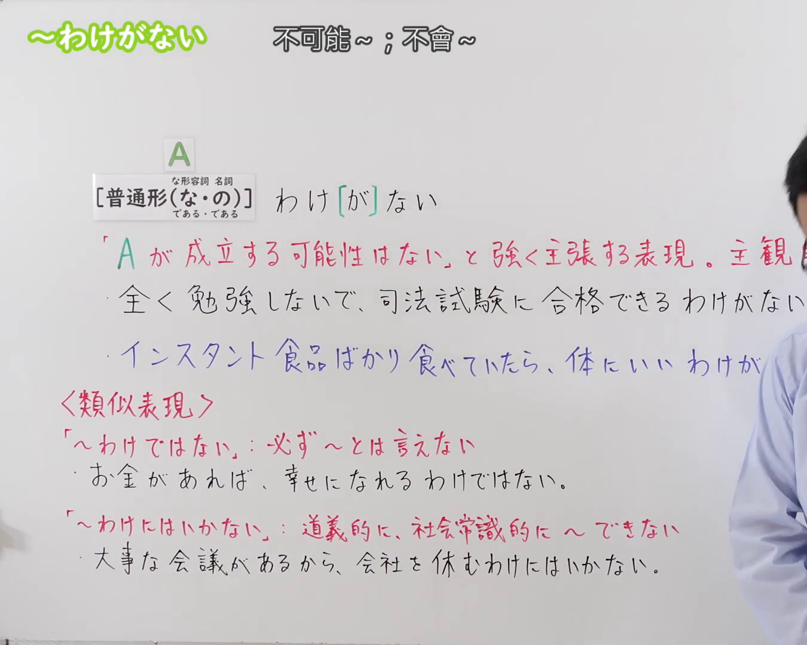

---
{
  "id": "N3-G-0083",
  "kind": "grammar",
  "level": "N3",
  "title": "〜わけがない（不可能……；不会……）",
  "card_revision": 1,
  "schema_version": 1,
  "source": {
    "lesson": "N3 第83个语法",
    "material": "出口日語原视频板书、日语自动字幕与日本語NET文法正文",
    "video": "https://www.youtube.com/watch?v=c9luVdzwDpU",
    "screenshot": "assets/grammar/n3/N3-G-0083-connection.png",
    "screenshot_seconds": 1,
    "screenshot_crop": {
      "x": 0,
      "y": 0,
      "width": 1350,
      "height": 1080
    }
  },
  "tags": [
    "わけがない",
    "わけない",
    "N3"
  ],
  "confusions": [
    "〜はずがない",
    "〜わけではない",
    "〜わけにはいかない"
  ]
}
---

# N3 第83个语法：〜わけがない

# 视频学习资料整理

本课讲解 N3 语法形式「〜わけがない」。

## 接续图（板书与讲解）

- 视频链接：[出口日語 N3 第83个语法](https://www.youtube.com/watch?v=c9luVdzwDpU)
- 真实时间：00:01（1.00秒）
- 原图尺寸：1920×1080
- 裁切说明：选用 00:01 画面，左上方清晰显示语法标题「〜わけがない」与中文释义「不可能〜；不會〜」，接续展示普通形接「わけ[が]ない」，红字解释「Aが成立する可能性はない、と強く主張する表現。主観的判断」。固定左上角（0, 0），裁切区域为宽 1920、高 1080，裁去右侧讲师身躯与底部多余空白。
- 图片：

## 例句图（视频例句）

- 视频链接：[出口日語 N3 第83个语法](https://www.youtube.com/watch?v=c9luVdzwDpU)
- 真实时间：03:40（220.40秒）
- 原图尺寸：1920×1080
- 裁切说明：提取自视频 03:40 处的例句黑板页面。固定左上角（0, 0），裁切区域为宽 1920、高 1080，保留完整例句与中文释义。
- 图片：

# 核心

## 功能一：强烈主张A成立的可能性为零，属于说话人的主观断定表现（绝不可能……）

**くわしい意味記述：**

- **わけがない：** ～は考えられない / 絶対に〜でない。話し手が確信を持って、「〜ではない」と言う時に使う表現。可能性を完全に否定する。（难以想象……／绝对不是……。说话人带着确凿把握明确表示“并非如此”时使用的表达方式。对该事态成立的可能性予以彻底否定。）

### 例句

1. あんな下手な絵が売れるわけがない。

   （画得那么糟糕差劲的画，绝不可能卖得出去。）

2. 歌が下手な彼が歌手になれるわけがない。

   （唱歌跑调那么难听的他，怎么可能当得上专业歌手呢。）

3. こんなに仕事が残っているのに、今日中に終わるわけがない。

   （还堆积着这么多工作没处理，绝不可能在今天之内做得完。）

4. 全然勉強してないのに、君がJLPT N3に合格するわけがないよ。

   （明明平时一点书都没读，你怎么可能考得过 JLPT N3 嘛。）

# 来源

- [出口日語原视频](https://www.youtube.com/watch?v=c9luVdzwDpU)
- [日本語NET「〜わけがない」](https://nihongokyoshi-net.com/2018/04/16/jlptn2-grammar-wakeganai/)（查询日期：2026-09-25）
