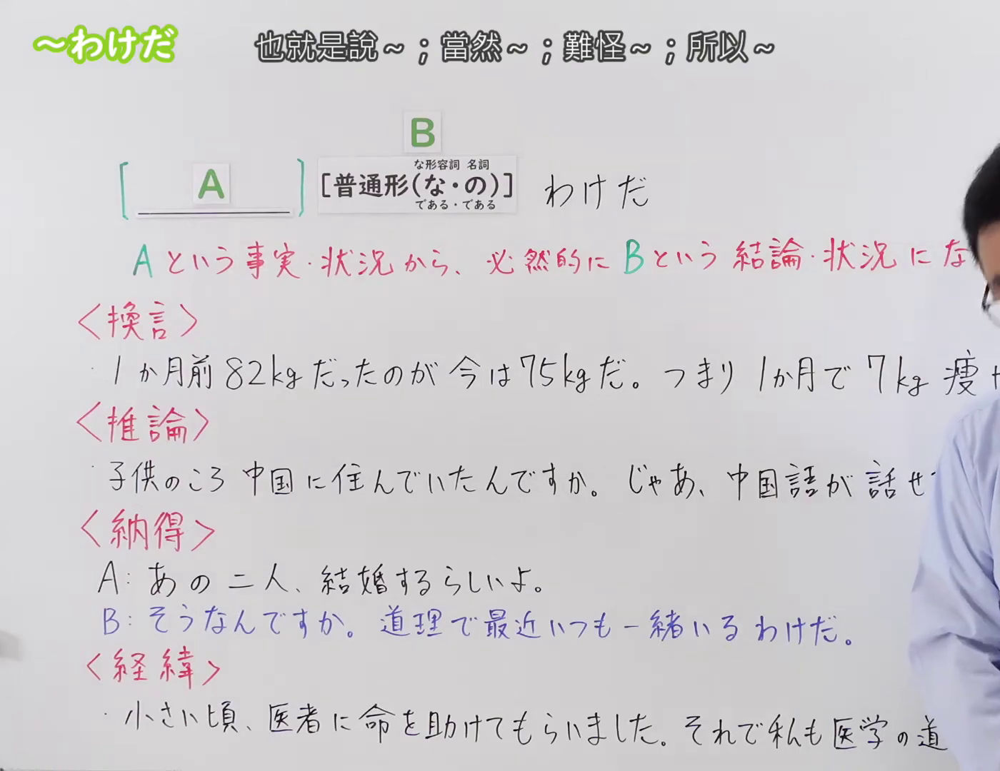
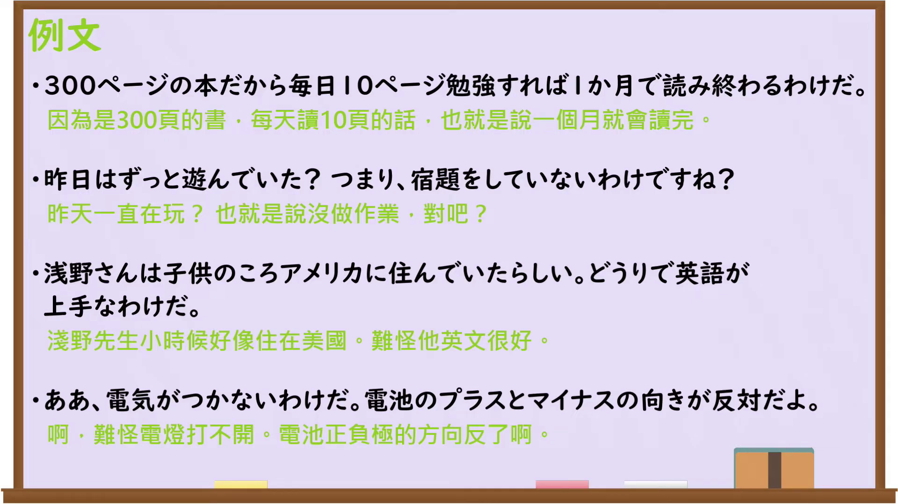

---
{
  "id": "N3-G-0084",
  "kind": "grammar",
  "level": "N3",
  "title": "〜わけだ（也就是说……；当然……；难怪……；所以……）",
  "card_revision": 1,
  "schema_version": 1,
  "source": {
    "lesson": "N3 第84个语法",
    "material": "出口日語原视频板书、日语自动字幕与日本語NET文法正文",
    "video": "https://www.youtube.com/watch?v=r-X9nF5xtgs",
    "screenshot": "assets/grammar/n3/N3-G-0084-connection.png",
    "screenshot_seconds": 1,
    "screenshot_crop": {
      "x": 0,
      "y": 0,
      "width": 1400,
      "height": 1080
    }
  },
  "tags": [
    "わけだ",
    "というわけだ",
    "N3"
  ],
  "confusions": [
    "〜わけがない",
    "〜わけではない",
    "〜はずだ"
  ]
}
---

# N3 第84个语法：〜わけだ

# 视频学习资料整理

本课讲解 N3 语法形式「〜わけだ」。

## 接续图（板书与讲解）

- 视频链接：[出口日語 N3 第84个语法](https://www.youtube.com/watch?v=r-X9nF5xtgs)
- 真实时间：00:01（1.00秒）
- 原图尺寸：1920×1080
- 裁切说明：选用 00:01 画面，左上方清晰显示语法标题「〜わけだ」与中文释义「也就是說〜；當然〜；難怪〜；所以〜」，接续展示普通形接「わけだ」，红字解释「Aという事実・状況から、必然的にBという結論・状況になる」。板书下方进一步梳理换言、推论、納得、经纬四种具体细分语境。固定左上角（0, 0），裁切区域为宽 1920、高 1080，裁去右侧讲师身躯与底部多余空白。
- 图片：

## 例句图（视频例句）

- 视频链接：[出口日語 N3 第84个语法](https://www.youtube.com/watch?v=r-X9nF5xtgs)
- 真实时间：05:03（303.35秒）
- 原图尺寸：1920×1080
- 裁切说明：提取自视频 05:03 处的例句黑板页面。固定左上角（0, 0），裁切区域为宽 1920、高 1080，保留完整例句与中文释义。
- 图片：

# 核心

## 功能一：从A这一事实或状况出发，必然会得出B的结论或发展为B的状况

**くわしい意味記述：**

- **わけだ：** ①・・・なのだから当然～という結果になる。/ だから～になるのか。ある事実や状況から、当然そうなることを説明したり、説明を聞いてよくわかったときに使う。②・・・なので、〜ということだね。相手が言ったことや意見などを反復したり、再度確認するときに使う表現。（①因为……所以理所当然会产出……的结果／正因为如此才会变成……啊。用于从某一既定事实或客观状况出发，顺理成章地说明必然产生的结果；或是听到对方解释缘由后顿悟理解时使用。②因为是……，也就是说……对吧。用于复述或再次核实对方刚才陈述的言论与观点。）

### 例句

1. カルロスさん、日本に来てもう２０年なんだって。あ〜、それで日本語がペラペラなわけだ。

   （听说卡洛斯来日本已经整整二十年了。啊～怪不得他日语说得这么流利熟练呢。）

2. 田中さんは最近、彼女と別れたらしいですよ。それで、最近元気が無いわけだ。

   （听说田中最近似乎和女朋友分手了。难怪他这几天看起来总是无精打采的。）

3. 今日、近くで花火大会があるそうだよ。あ～、それでこんなに人が多いわけだ。

   （听说今天附近要举办烟花大会呢。啊～怪不得这里聚集了这么多人啊。）

4. 来年度から始業時間が１５分早くなるって。じゃあ、今９時だから、８時４５分になるというわけですね。

   （听说从下一学年起上班时间要提前十五分钟。那么现在是九点，也就是说届时要变成八点四十五分了对吧。）

# 来源

- [出口日語原视频](https://www.youtube.com/watch?v=r-X9nF5xtgs)
- [日本語NET「〜わけだ / 〜というわけだ」](https://nihongokyoshi-net.com/2019/01/23/jlptn3-grammar-wakeda/)（查询日期：2026-09-25）
