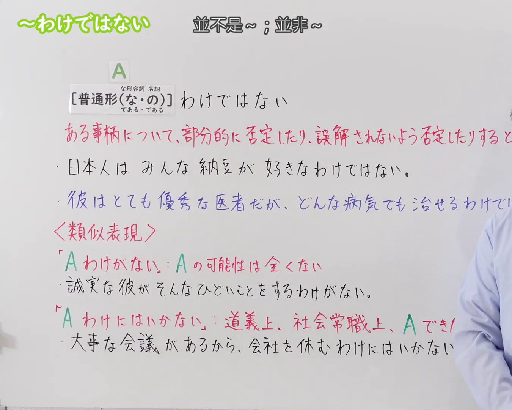
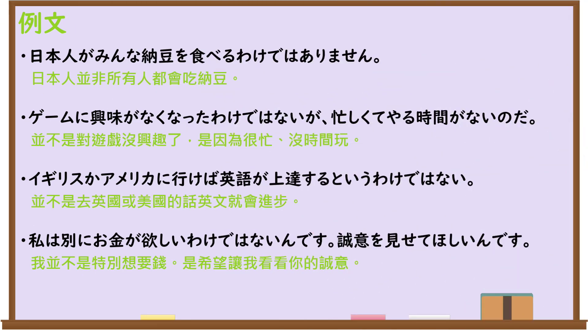

---
{
  "id": "N3-G-0085",
  "kind": "grammar",
  "level": "N3",
  "title": "〜わけではない（并不是……；并非……）",
  "card_revision": 1,
  "schema_version": 1,
  "source": {
    "lesson": "N3 第85个语法",
    "material": "出口日語原视频板书、日语自动字幕与日本語NET文法正文",
    "video": "https://www.youtube.com/watch?v=gVoymo5X_gQ",
    "screenshot": "assets/grammar/n3/N3-G-0085-connection.png",
    "screenshot_seconds": 1,
    "screenshot_crop": {
      "x": 0,
      "y": 0,
      "width": 1350,
      "height": 1080
    }
  },
  "tags": [
    "わけではない",
    "わけじゃない",
    "N3"
  ],
  "confusions": [
    "〜わけがない",
    "〜わけだ",
    "〜というものではない"
  ]
}
---

# N3 第85个语法：〜わけではない

# 视频学习资料整理

本课讲解 N3 语法形式「〜わけではない」。

## 接续图（板书与讲解）

- 视频链接：[出口日語 N3 第85个语法](https://www.youtube.com/watch?v=gVoymo5X_gQ)
- 真实时间：00:01（1.00秒）
- 原图尺寸：1920×1080
- 裁切说明：选用 00:01 画面，左上方清晰显示语法标题「〜わけではない」与中文释义「並不是〜；並非〜」，接续展示普通形接「わけではない」，红字解释「ある事柄について、部分的に否定したり、誤解されないよう否定したりする」。下方与类似表现「Aわけがない」对比说明。固定左上角（0, 0），裁切区域为宽 1920、高 1080，裁去右侧讲师身躯与底部多余空白。
- 图片：

## 例句图（视频例句）

- 视频链接：[出口日語 N3 第85个语法](https://www.youtube.com/watch?v=gVoymo5X_gQ)
- 真实时间：03:48（228.11秒）
- 原图尺寸：1920×1080
- 裁切说明：提取自视频 03:48 处的例句黑板页面。固定左上角（0, 0），裁切区域为宽 1920、高 1080，保留完整例句与中文释义。
- 图片：

# 核心

## 功能一：针对某件事情进行部分否定，或为了避免被他人误解而予以委婉否定

**くわしい意味記述：**

- **わけではない：** 全部が〜とは言えない。部分否定の「〜というものではない」と同じ意味で使われる。また、直前のことから当然予想されることを婉曲的に否定するのにも用いられる。（不能说全部都……。与表示部分否定的“〜というものではない”具有相同含义。此外，也常用于委婉推翻或否定根据前文自然推导出的理所当然之预期。）

### 例句

1. このレストランはいつも込んでいるが、値段が安いわけではない。

   （这家餐馆虽然总是高朋满座，但并不意味着它的菜价很便宜。）

2. 毎日、料理をするが、料理が上手なわけじゃない。

   （我虽然每天都下厨做饭，但绝不代表我做饭手艺很棒。）

3. たくさんお金持があっても、幸せになれるわけじゃない。

   （即使坐拥巨额财富，也未必就能获得人生的幸福。）

4. お酒が飲めないわけではないよ。ただ弱いんだ。

   （我也不是滴酒不能沾，只是不胜酒力、很容易醉罢了。）

# 来源

- [出口日語原视频](https://www.youtube.com/watch?v=gVoymo5X_gQ)
- [日本語NET「わけではない / わけじゃない」](https://nihongokyoshi-net.com/2018/07/18/jlptn3-grammar-wakedewanai/)（查询日期：2026-09-25）
