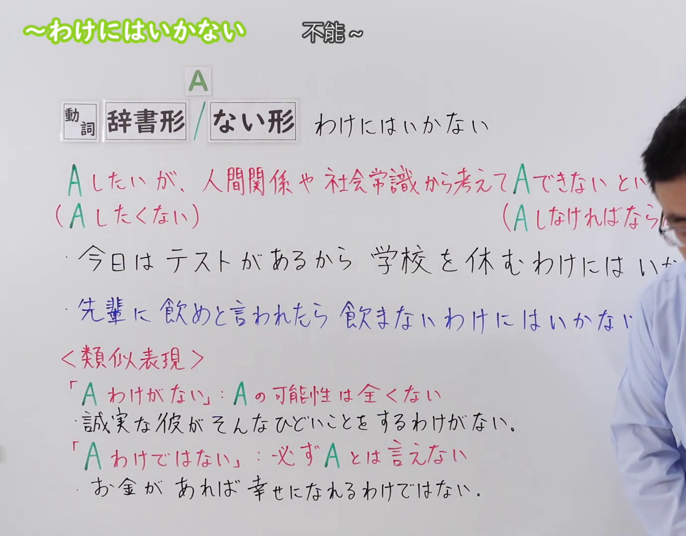
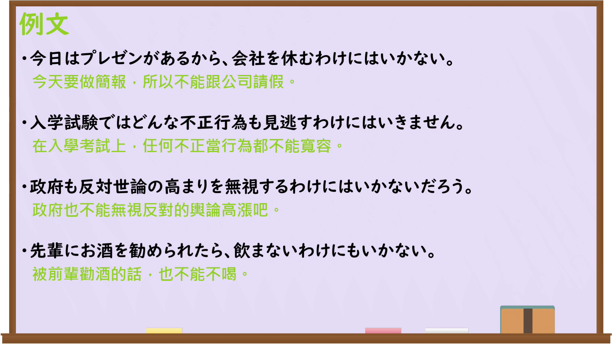

---
{
  "id": "N3-G-0086",
  "kind": "grammar",
  "level": "N3",
  "title": "〜わけにはいかない（不能……；不得不……）",
  "card_revision": 1,
  "schema_version": 1,
  "source": {
    "lesson": "N3 第86个语法",
    "material": "出口日語原视频板书、日语自动字幕与日本語NET文法正文",
    "video": "https://www.youtube.com/watch?v=9gnDhpPLKk8",
    "screenshot": "assets/grammar/n3/N3-G-0086-connection.png",
    "screenshot_seconds": 1,
    "screenshot_crop": {
      "x": 0,
      "y": 0,
      "width": 1380,
      "height": 1080
    }
  },
  "tags": [
    "わけにはいかない",
    "ないわけにはいかない",
    "N3"
  ],
  "confusions": [
    "〜わけがない",
    "〜わけではない",
    "〜ざるを得ない"
  ]
}
---

# N3 第86个语法：〜わけにはいかない

# 视频学习资料整理

本课讲解 N3 语法形式「〜わけにはいかない」。

## 接续图（板书与讲解）

- 视频链接：[出口日語 N3 第86个语法](https://www.youtube.com/watch?v=9gnDhpPLKk8)
- 真实时间：00:01（1.00秒）
- 原图尺寸：1920×1080
- 裁切说明：选用 00:01 画面，左上方清晰显示语法标题「〜わけにはいかない」与中文释义「不能〜」，接续展示动词辞书形／ない形接「わけにはいかない」，红字解释「Aしたいが、人間関係や社会常識から考えてAできない（Aしたくない）」。固定左上角（0, 0），裁切区域为宽 1920、高 1080，裁去右侧讲师身躯与底部多余空白。
- 图片：

## 例句图（视频例句）

- 视频链接：[出口日語 N3 第86个语法](https://www.youtube.com/watch?v=9gnDhpPLKk8)
- 真实时间：05:39（339.04秒）
- 原图尺寸：1920×1080
- 裁切说明：提取自视频 05:39 处的例句黑板页面。固定左上角（0, 0），裁切区域为宽 1920、高 1080，保留完整例句与中文释义。
- 图片：

# 核心

## 功能一：虽然心里想做A，但顾及人际关系或社会常识无法做A；或虽然不想做A，但从道义责任考虑不得不做A

**くわしい意味記述：**

- **わけにはいかない：** ①～したい気持ちはあるが理由があって～できない。②〜しなければならない / 〜するのが当然だ。（①虽然主观上有想要去做的意愿，但出于情理、常识或外部制约等原因而无法去做。②必须去做……／按常理去做出该行动是理所应当的。）

### 例句

1. 明日はテストがあるから、ゲームをするわけにはいかない。

   （因为明天有重要考试，所以绝不能贪玩打游戏。）

2. ちょっと熱があるけど、今日は大事な会議があるから休むわけにはいかない。

   （虽然有点发烧，但今天有极其重要的会议，所以我不能请假缺席。）

3. 親友の結婚式なのだから、出席しないわけにはいかないだろう。

   （毕竟是挚友的大喜婚礼，无论如何都不能不去出席吧。）

4. 先輩に飲めと言われたので、飲まないわけにはいかなかった。

   （因为被前辈劝酒指令喝下，碍于情面实在无法不喝。）

# 来源

- [出口日語原视频](https://www.youtube.com/watch?v=9gnDhpPLKk8)
- [日本語NET「〜わけにはいかない」](https://nihongokyoshi-net.com/2019/05/21/jlptn3-grammar-wakeniwaikanai/)（查询日期：2026-09-25）
