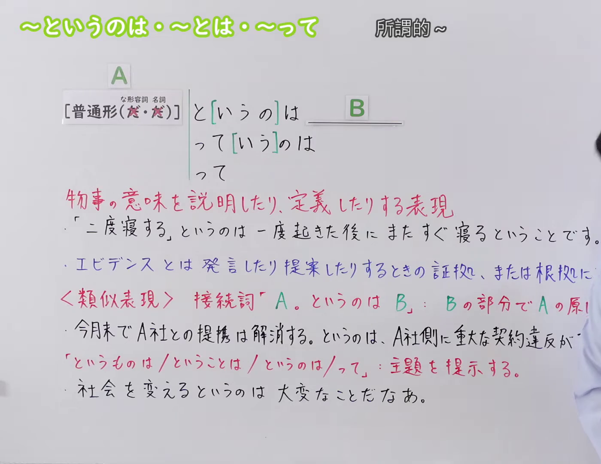
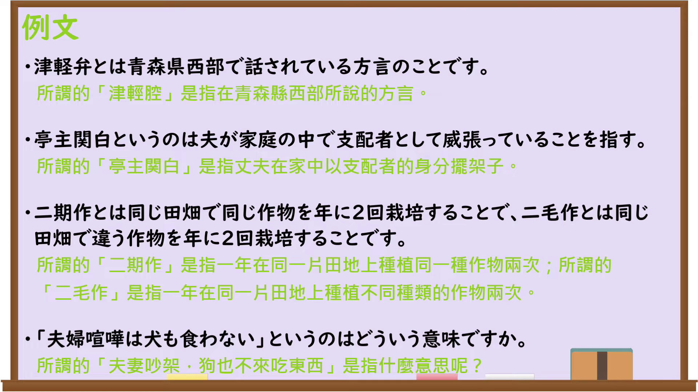

---
{
  "id": "N3-G-0087",
  "kind": "grammar",
  "level": "N3",
  "title": "〜というのは／〜とは／〜って（所谓的……）",
  "card_revision": 1,
  "schema_version": 1,
  "source": {
    "lesson": "N3 第87个语法",
    "material": "出口日語原视频板书、日语自动字幕与tanosuke文法正文",
    "video": "https://www.youtube.com/watch?v=jvHiwSk207c",
    "screenshot": "assets/grammar/n3/N3-G-0087-connection.png",
    "screenshot_seconds": 1,
    "screenshot_crop": {
      "x": 0,
      "y": 0,
      "width": 1400,
      "height": 1080
    }
  },
  "tags": [
    "というのは",
    "とは",
    "って",
    "N3"
  ],
  "confusions": [
    "〜ということだ",
    "〜というものだ",
    "〜といえば"
  ]
}
---

# N3 第87个语法：〜というのは／〜とは／〜って

# 视频学习资料整理

本课讲解 N3 语法形式「〜というのは／〜とは／〜って」。

## 接续图（板书与讲解）

- 视频链接：[出口日語 N3 第87个语法](https://www.youtube.com/watch?v=jvHiwSk207c)
- 真实时间：00:01（1.00秒）
- 原图尺寸：1920×1080
- 裁切说明：选用 00:01 画面，左上方清晰显示语法标题「〜というのは・〜とは・〜って」与中文释义「所謂的〜」，接续展示普通形接「と[いうの]は」「って[いう]のは」「って」，红字解释「物事の意味を説明したり、定義したりする表現」。固定左上角（0, 0），裁切区域为宽 1920、高 1080，裁去右侧讲师身躯与底部多余空白。
- 图片：

## 例句图（视频例句）

- 视频链接：[出口日語 N3 第87个语法](https://www.youtube.com/watch?v=jvHiwSk207c)
- 真实时间：04:55（295.85秒）
- 原图尺寸：1920×1080
- 裁切说明：提取自视频 04:55 处的例句黑板页面。固定左上角（0, 0），裁切区域为宽 1920、高 1080，保留完整例句与中文释义。
- 图片：

# 核心

## 功能一：说明或定义某事物的含义、本质或所指内容（所谓的……是指……）

**くわしい意味記述：**

- **というのは：** ～という言葉を説明・定義する。文の最後は、その言葉の意味や本質を説明する文が来る。（对前项提及的词汇、概念或用语进行具体说明与下定义。句末通常呼应出现解释其含义或本质的句型。）

### 例句

1. 東大というのは東京大学のことだ。

   （所谓的东大，指的就是东京大学。）

2. イクメンというのは育児を積極的にする男性のことである。

   （所谓的奶爸，是指那些积极参与育儿照顾孩子的男性。）

3. 天才というのは、努力しないでも最初からできる人のことだ。

   （所谓的天才，是指无需付出努力从一开始就无师自通的人。）

4. 「クビ」というのは、会社を辞めさせられるということだ。

   （所谓的“炒鱿鱼”，意思就是被公司解雇开除。）

# 来源

- [出口日語原视频](https://www.youtube.com/watch?v=jvHiwSk207c)
- [たのすけ日本語ブログ「～というのは（定義づけ・引用）」](https://tanosuke.com/toiunoha)（查询日期：2026-09-25）
