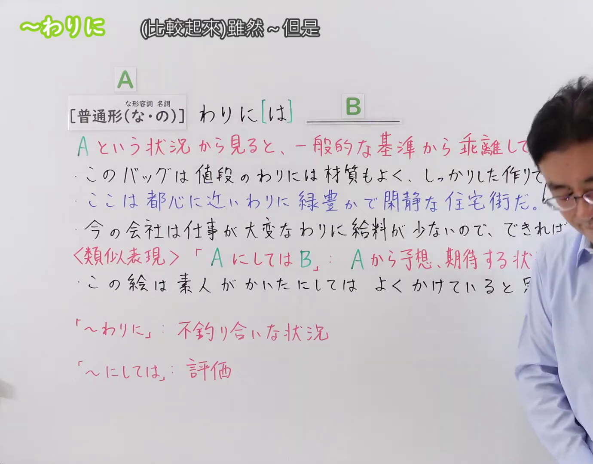

---
{
  "id": "N3-G-0088",
  "kind": "grammar",
  "level": "N3",
  "title": "〜わりに／〜わりには（比较起来虽然……但是……；以……而言却……）",
  "card_revision": 1,
  "schema_version": 1,
  "source": {
    "lesson": "N3 第88个语法",
    "material": "出口日語原视频板书、日语自动字幕与日本語NET文法正文",
    "video": "https://www.youtube.com/watch?v=ayg65NvyNtw",
    "screenshot": "assets/grammar/n3/N3-G-0088-connection.png",
    "screenshot_seconds": 1,
    "screenshot_crop": {
      "x": 0,
      "y": 0,
      "width": 1380,
      "height": 1080
    }
  },
  "tags": [
    "わりに",
    "わりには",
    "N3"
  ],
  "confusions": [
    "〜にしては",
    "〜わりに",
    "〜にもかかわらず"
  ]
}
---

# N3 第88个语法：〜わりに／〜わりには

# 视频学习资料整理

本课讲解 N3 语法形式「〜わりに／〜わりには」。

## 接续图（板书与讲解）

- 视频链接：[出口日語 N3 第88个语法](https://www.youtube.com/watch?v=ayg65NvyNtw)
- 真实时间：00:01（1.00秒）
- 原图尺寸：1920×1080
- 裁切说明：选用 00:01 画面，左上方清晰显示语法标题「〜わりに」与中文释义「（比較起來）雖然〜但是」，接续展示普通形接「わりに[は]」，红字解释「Aという状況から見ると、一般的な基準から乖離して……」。下方与类似表现「AにしてはB」对比辨析。固定左上角（0, 0），裁切区域为宽 1920、高 1080，裁去右侧讲师身躯与底部多余空白。
- 图片：

## 例句图（视频例句）

- 视频链接：[出口日語 N3 第88个语法](https://www.youtube.com/watch?v=ayg65NvyNtw)
- 真实时间：04:44（284.12秒）
- 原图尺寸：1920×1080
- 裁切说明：提取自视频 04:44 处的例句黑板页面。固定左上角（0, 0），裁切区域为宽 1920、高 1080，保留完整例句与中文释义。
- 图片：

# 核心

## 功能一：从A这一状况来看，结果却与社会一般普遍基准发生明显背离

**くわしい意味記述：**

- **わりに：** ～と思えないくらい / ～とは不釣り合いに。この程度のレベルかなと思っていたのに、実際にはそれよりもよかった、あるいは悪かった時に使う。程度の差には幅がある。（令人难以想象到……的程度／与……极不相称。原本推测可能属于这种水准程度，但实际上却出人意料地更好或更坏时使用；前后程度落差具有一定的相对弹性幅度。）

### 例句

1. 彼は勉強していなかったわりに、テストの点が良かった。

   （他平时虽然没怎么用功念书，考试成绩却考得相当不错。）

2. 田中さんは留学の経験がないわりに、綺麗な発音で英語を話す。

   （田中虽然完全没有留洋背景，英语发音却非常地道优美。）

3. このラーメンは値段のわりに、おいしかった。

   （这碗拉面以其低廉的价格而言，味道着实非常可口美味。）

4. 今日は休日のわりに人が少ないね。どうしてだろう。

   （今天明明是休息日，街上人却出奇地少呢。到底是为什么呢？）

# 来源

- [出口日語原视频](https://www.youtube.com/watch?v=ayg65NvyNtw)
- [日本語NET「～わりに」](https://nihongokyoshi-net.com/2018/11/20/jlptn3-grammar-warini/)（查询日期：2026-09-25）
