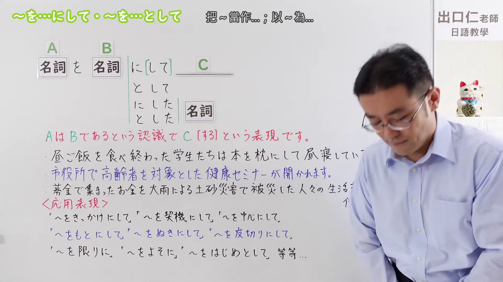
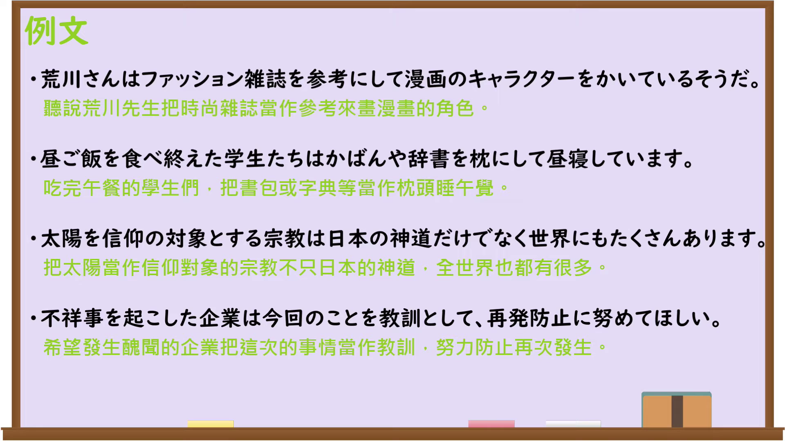

---
{
  "id": "N3-G-0089",
  "kind": "grammar",
  "level": "N3",
  "title": "〜を…にして／〜を…として（把……当作……；以……为……）",
  "card_revision": 1,
  "schema_version": 1,
  "source": {
    "lesson": "N3 第89个语法",
    "material": "出口日語原视频板书、日语自动字幕与日本語教育ナビ正文",
    "video": "https://www.youtube.com/watch?v=EagiBgKcDFI",
    "screenshot": "assets/grammar/n3/N3-G-0089-connection.png",
    "screenshot_seconds": 1,
    "screenshot_crop": {
      "x": 0,
      "y": 0,
      "width": 1920,
      "height": 1080
    }
  },
  "tags": [
    "をにして",
    "をとして",
    "にした",
    "とした",
    "N3"
  ],
  "confusions": [
    "〜として",
    "〜にしては",
    "〜をきっかけに"
  ]
}
---

# N3 第89个语法：〜を…にして／〜を…として

# 视频学习资料整理

本课讲解 N3 语法形式「〜を…にして／〜を…として」。

## 接续图（板书与讲解）

- 视频链接：[出口日語 N3 第89个语法](https://www.youtube.com/watch?v=EagiBgKcDFI)
- 真实时间：00:01（1.00秒）
- 原图尺寸：1920×1080
- 裁切说明：选用 00:01 画面，左上方清晰显示语法标题「〜を…にして・〜を…として」与中文释义「把〜當作…；以〜為…」，接续展示「名詞Aを名詞Bに[して]／として C」以及修饰名词的连体形「にした／とした 名詞」，红字解释「AはBであるという認識でC[する]という表現です」。下方列出「〜をきっかけにして」「〜を契機にして」「〜を中心にして」等应用表现。固定左上角（0, 0），裁切区域为宽 1920、高 1080，保留整幅完整板书与清晰标题。
- 图片：

## 例句图（视频例句）

- 视频链接：[出口日語 N3 第89个语法](https://www.youtube.com/watch?v=EagiBgKcDFI)
- 真实时间：04:32（272.62秒）
- 原图尺寸：1920×1080
- 裁切说明：提取自视频 04:32 处的例句黑板页面。固定左上角（0, 0），裁切区域为宽 1920、高 1080，保留完整例句与中文释义。
- 图片：

# 核心

## 功能一：带着A就是B的认识与定位，进而展开C的行动（把A当作B；以A为B）

**くわしい意味記述：**

- **を～として：** 「～は～であると考えて」という意味で使われます。「N1をN2として」の形で、「N1は、N2であると考える」という内容を表します。（表示“认为某事即是某物／把某事物当作某定位”的含义。采用“N1をN2として”的句式结构，表达“将N1认定或视为N2”的具体内涵。）

### 例句

1. 月末を1つの区切りとして、目標を立てる。

   （把月底作为一个时间节点，据此制定工作目标。）

2. 安全を第一として、怪我がないように取り組んでください。

   （请务必把安全作为第一要务，确保没有任何人员受伤地投入工作。）

3. このプロジェクトでは、利益を最重要指標として取り組んでいきましょう。

   （在这个项目中，让我们将利润视为最重要的考核指标来开展推进吧。）

4. この会議では、業務の効率化を目的として議論していきましょう。

   （在本次会议中，让我们把业务流程的高效化作为目标来进行探讨吧。）

# 来源

- [出口日語原视频](https://www.youtube.com/watch?v=EagiBgKcDFI)
- [日本語教育ナビ「「を～として」の例文・文法解説」](https://japanese-language-education.com/for-overseas-learners/wo-toshite/)（查询日期：2026-09-25）
