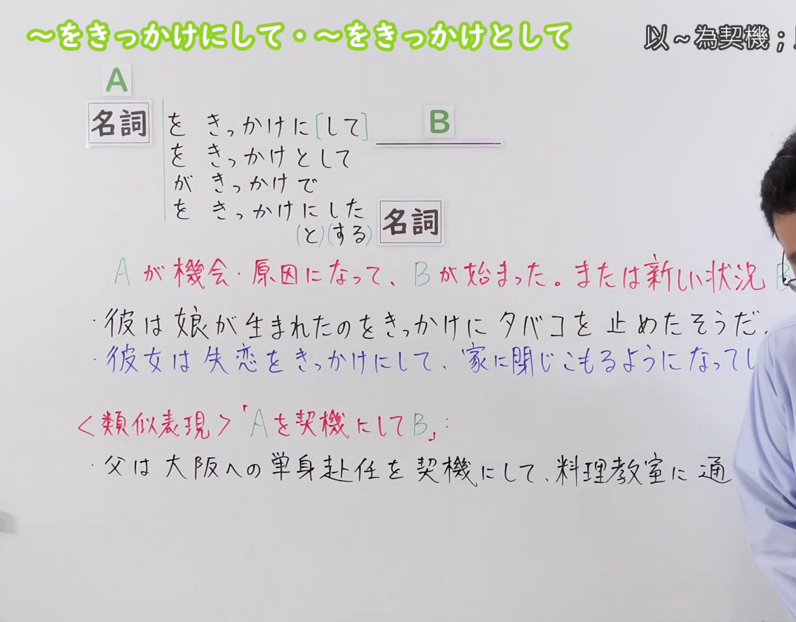
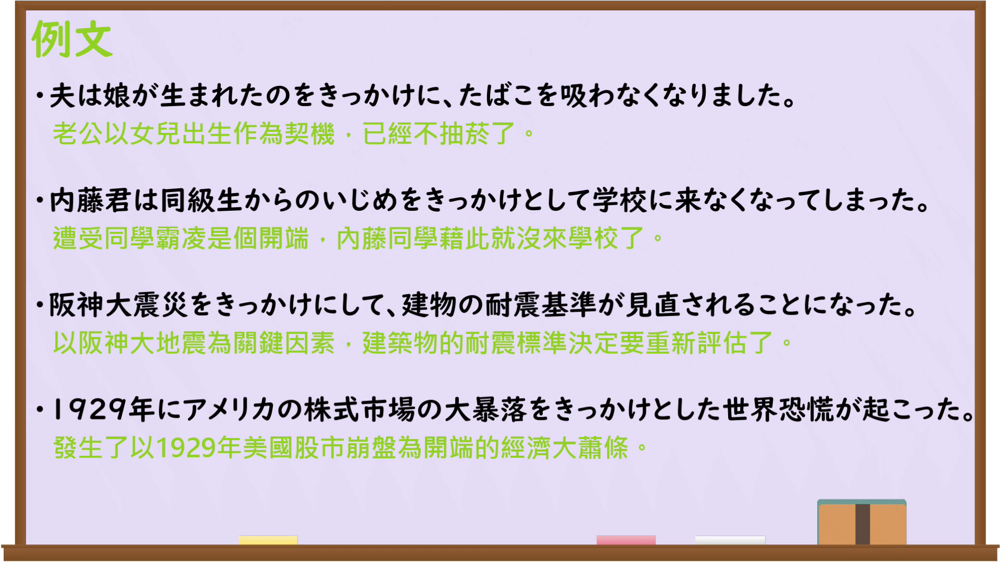

---
{
  "id": "N3-G-0090",
  "kind": "grammar",
  "level": "N3",
  "title": "〜をきっかけにして／〜をきっかけとして（以……为契机；借……之机）",
  "card_revision": 1,
  "schema_version": 1,
  "source": {
    "lesson": "N3 第90个语法",
    "material": "出口日語原视频板书、日语自动字幕与日本語NET文法正文",
    "video": "https://www.youtube.com/watch?v=bLvkte9dz7A",
    "screenshot": "assets/grammar/n3/N3-G-0090-connection.png",
    "screenshot_seconds": 1,
    "screenshot_crop": {
      "x": 0,
      "y": 0,
      "width": 1380,
      "height": 1080
    }
  },
  "tags": [
    "をきっかけにして",
    "をきっかけとして",
    "がきっかけで",
    "N3"
  ],
  "confusions": [
    "〜を契機に",
    "〜を機に",
    "〜を皮切りに"
  ]
}
---

# N3 第90个语法：〜をきっかけにして／〜をきっかけとして

# 视频学习资料整理

本课讲解 N3 语法形式「〜をきっかけにして／〜をきっかけとして」。

## 接续图（板书与讲解）

- 视频链接：[出口日語 N3 第90个语法](https://www.youtube.com/watch?v=bLvkte9dz7A)
- 真实时间：00:01（1.00秒）
- 原图尺寸：1920×1080
- 裁切说明：选用 00:01 画面，左上方清晰显示语法标题「〜をきっかけにして・〜をきっかけとして」与中文释义「以〜為契機；借〜之機」，接续展示「名詞Aをきっかけに[して]／をきっかけとして／がきっかけで B」及修饰名词的连体形，红字解释「Aが機会・原因になって、Bが始まった。または新しい状況Bが起こった」。下方与类似表现「Aを契機にB」对比说明。固定左上角（0, 0），裁切区域为宽 1920、高 1080，裁去右侧讲师身躯与底部多余空白。
- 图片：

## 例句图（视频例句）

- 视频链接：[出口日語 N3 第90个语法](https://www.youtube.com/watch?v=bLvkte9dz7A)
- 真实时间：04:50（290.50秒）
- 原图尺寸：1920×1080
- 裁切说明：提取自视频 04:50 处的例句黑板页面。固定左上角（0, 0），裁切区域为宽 1920、高 1080，保留完整例句与中文释义。
- 图片：

# 核心

## 功能一：以A为契机或诱因，B的事情得以开始展开，或者引发了B这种全新的局面状态

**くわしい意味記述：**

- **がきっかけで / をきっかけに：** 〜の行動が動機になって / それをするようになったのは〜があったからだ。（以……的行动为动机／之所以演变成如今开始去做某事，是因为当初发生了……的诱因存在。）

### 例句

1. インターネットで日本人の友達ができたことがきっかけで日本語を勉強するようになった。

   （以在网上结识了日本朋友为契机，我开始正式学习起日语来。）

2. アニメをきっかけに日本語に興味を持つ学生が多い。

   （以日本动漫为诱因契机，进而对日语产生浓厚兴趣的学生非常多。）

3. 結婚をきっかけに、新しい家を買った。

   （以喜结良缘结婚为契机，我们购置了一套全新的住房。）

4. 洋楽をきっかけに、私は英語を勉強するようになった。

   （以聆听欧美流行音乐为契机动力，我开始发奋自学起英语来。）

# 来源

- [出口日語原视频](https://www.youtube.com/watch?v=bLvkte9dz7A)
- [日本語NET「〜がきっかけで / 〜をきっかけに」](https://nihongokyoshi-net.com/2018/07/06/jlptn3-grammar-kikkake/)（查询日期：2026-09-25）
