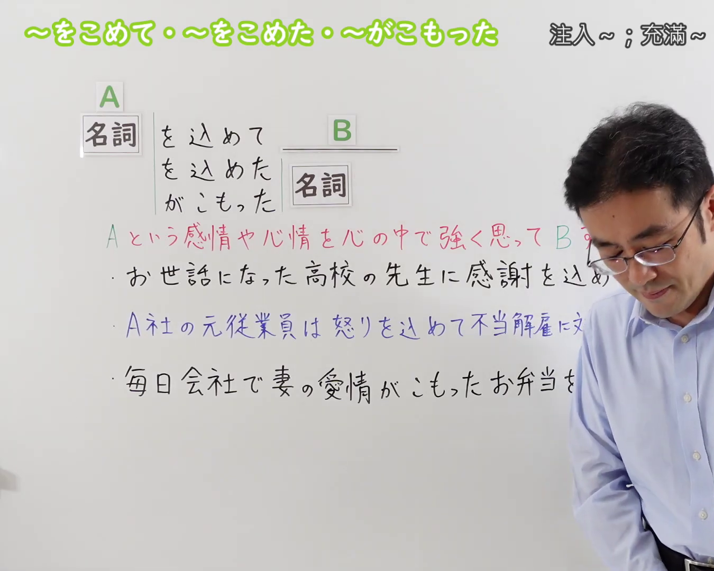
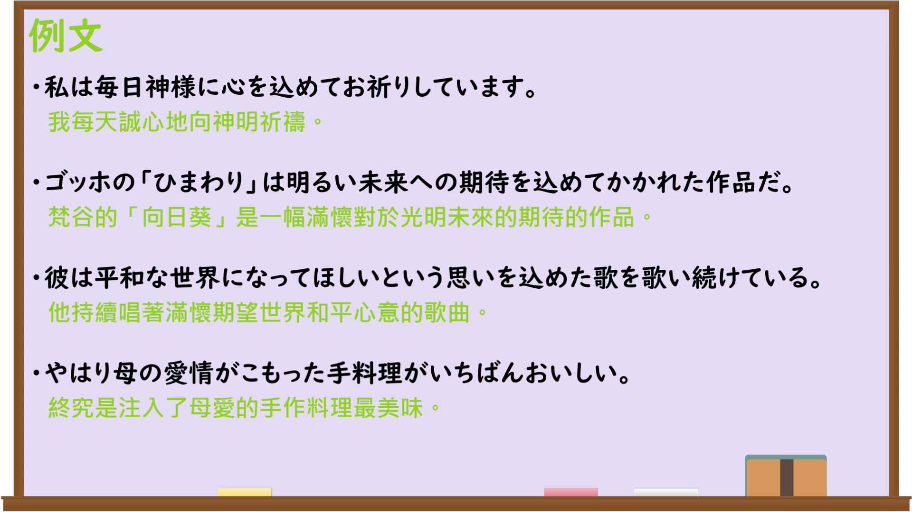

---
{
  "id": "N3-G-0091",
  "kind": "grammar",
  "level": "N3",
  "title": "〜を込めて・〜を込めた・〜がこもった（注入……；充满……）",
  "card_revision": 1,
  "schema_version": 1,
  "source": {
    "lesson": "N3 第91个语法",
    "material": "出口日語原视频板书、日语自动字幕与Hagoromo文型检索正文",
    "video": "https://www.youtube.com/watch?v=m0pJHm6bLzQ",
    "screenshot": "assets/grammar/n3/N3-G-0091-connection.png",
    "screenshot_seconds": 1,
    "screenshot_crop": {
      "x": 0,
      "y": 0,
      "width": 1350,
      "height": 1080
    }
  },
  "tags": [
    "を込めて",
    "を込めた",
    "がこもった",
    "N3"
  ],
  "confusions": [
    "〜を通じて",
    "〜をめぐって",
    "〜にかけて"
  ]
}
---

# N3 第91个语法：〜を込めて・〜を込めた・〜がこもった

# 视频学习资料整理

本课讲解 N3 语法形式「〜を込めて・〜を込めた・〜がこもった」。

## 接续图（板书与讲解）

- 视频链接：[出口日語 N3 第91个语法](https://www.youtube.com/watch?v=m0pJHm6bLzQ)
- 真实时间：00:01（1.00秒）
- 原图尺寸：1920×1080
- 裁切说明：选用 00:01 画面，左上方清晰显示语法标题「〜を込めて・〜を込めた・〜がこもった」与中文释义「注入〜；充滿〜」，接续展示名词接「を込めて」「を込めた＋名詞」「がこもった＋名詞」，并用红字详细说明「Aの強い気持ちや感情を入れてBする」。固定左上角（0, 0），裁切区域为宽 1350、高 1080，裁去右侧讲师身躯。
- 图片：

## 例句图（视频例句）

- 视频链接：[出口日語 N3 第91个语法](https://www.youtube.com/watch?v=m0pJHm6bLzQ)
- 真实时间：04:34（274.02秒）
- 原图尺寸：1920×1080
- 裁切说明：提取自视频 04:34 处的例句黑板页面。固定左上角（0, 0），裁切区域为宽 1920、高 1080，保留完整例句与中文释义。
- 图片：

# 核心

## 功能一：心中怀着A的强烈感情或心情去做B（注入……；充满……）

**最上位意味カテゴリー：**

- **を込めて：** ものごとの関係（事物之间的关系）

**中位意味カテゴリー：**

- **を込めて：** 様態（样态）

**意味：**

- **を込めて：** 様態（样态）

**くわしい意味記述：**

- **を込めて：** Xを込めて／込めたの形で，Xという気持ちを抱いて，その気持ちを十分に表すような態度や行為を行うという意味を表す。（以“Xを込めて／込めた”的形式，表示怀着X的情感，并采取能够充分体现该情感的态度或行为。）

**派生語：** がこもった

### 例句

1. 心をこめて料理を作った。

   （倾注心意做了料理。）

2. 感謝の気持ちを込めて、先生に手紙を書いた。

   （怀着感谢的心情给老师写了信。）

3. 愛の込もったプレゼントをもらって、とても嬉しかった。

   （收到充满爱意的礼物，感到非常高兴。）

4. 平和への祈りを込めて、千羽鶴を折った。

   （怀着对和平的祈愿，折了千只纸鹤。）

# 来源

- [出口日語原视频](https://www.youtube.com/watch?v=m0pJHm6bLzQ)
- [Hagoromo 文型検索「をこめて」](https://hagoromo-text.work/)（查询日期：2026-09-25）
