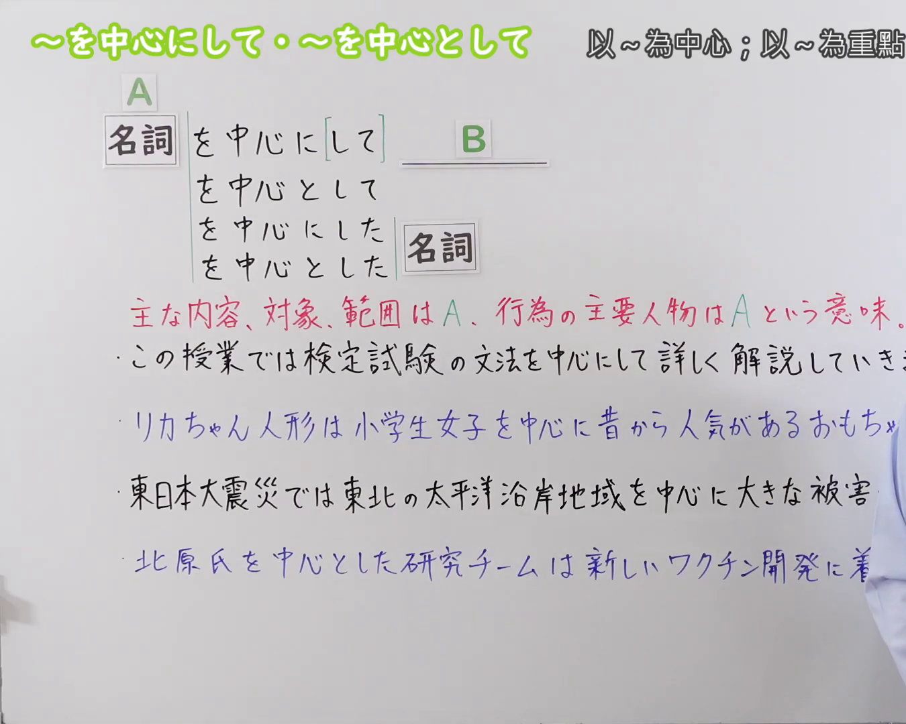
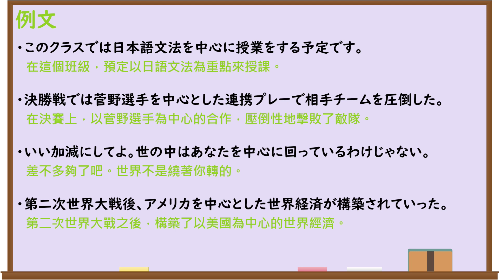

---
{
  "id": "N3-G-0092",
  "kind": "grammar",
  "level": "N3",
  "title": "〜を中心にして・〜を中心として（以……为中心；围绕着……）",
  "card_revision": 1,
  "schema_version": 1,
  "source": {
    "lesson": "N3 第92个语法",
    "material": "出口日語原视频板书、日语自动字幕与Hagoromo文型检索正文",
    "video": "https://www.youtube.com/watch?v=qbVQO_tP0Eo",
    "screenshot": "assets/grammar/n3/N3-G-0092-connection.png",
    "screenshot_seconds": 1,
    "screenshot_crop": {
      "x": 0,
      "y": 0,
      "width": 1350,
      "height": 1080
    }
  },
  "tags": [
    "を中心にして",
    "を中心として",
    "を中心に",
    "N3"
  ],
  "confusions": [
    "〜をめぐって",
    "〜をはじめ",
    "〜に基づいて"
  ]
}
---

# N3 第92个语法：〜を中心にして・〜を中心として

# 视频学习资料整理

本课讲解 N3 语法形式「〜を中心にして・〜を中心として」。

## 接续图（板书与讲解）

- 视频链接：[出口日語 N3 第92个语法](https://www.youtube.com/watch?v=qbVQO_tP0Eo)
- 真实时间：00:01（1.00秒）
- 原图尺寸：1920×1080
- 裁切说明：选用 00:01 画面，左上方清晰显示语法标题「〜を中心にして・〜を中心として」与中文释义「以〜為中心；以〜為重點；圍繞著〜」，接续展示名词接「を中心にして」「を中心として」「を中心に」，并用红字详细说明「主要な内容・対象・範囲がA、行為の主な人物がA」。固定左上角（0, 0），裁切区域为宽 1350、高 1080，裁去右侧讲师身躯。
- 图片：

## 例句图（视频例句）

- 视频链接：[出口日語 N3 第92个语法](https://www.youtube.com/watch?v=qbVQO_tP0Eo)
- 真实时间：04:22（262.82秒）
- 原图尺寸：1920×1080
- 裁切说明：提取自视频 04:22 处的例句黑板页面。固定左上角（0, 0），裁切区域为宽 1920、高 1080，保留完整例句与中文释义。
- 图片：

# 核心

## 功能一：主要内容、对象、范围是A，行为的主要人物是A（以……为中心；以……为重点；围绕着……）

**最上位意味カテゴリー：**

- **を中心にして：** ものごとの関係（事物之间的关系）

**中位意味カテゴリー：**

- **を中心にして：** 基準（基准）

**意味：**

- **を中心にして：** 基準（基准）

**くわしい意味記述：**

- **を中心にして：** Xを中核にして，という意を表す。（表示以X为核心、重点。）

**派生語：** を中心として、を中心とする

### 例句

1. この店は若者を中心にして、連日多くの客で賑わっている。

   （这家店以年轻人为中心，连日来挤满了大量顾客。）

2. 地球は太陽を中心として回っている。

   （地球以太阳为中心进行公转。）

3. 文法を中心にして日本語を勉強する。

   （以语法为重点学习日语。）

4. 東京を中心とする首都圏では、公共交通機関が非常に発達している。

   （在以东京为中心的首都圈，公共交通极其发达。）

# 来源

- [出口日語原视频](https://www.youtube.com/watch?v=qbVQO_tP0Eo)
- [Hagoromo 文型検索「ちゅうしん」](https://hagoromo-text.work/)（查询日期：2026-09-25）
