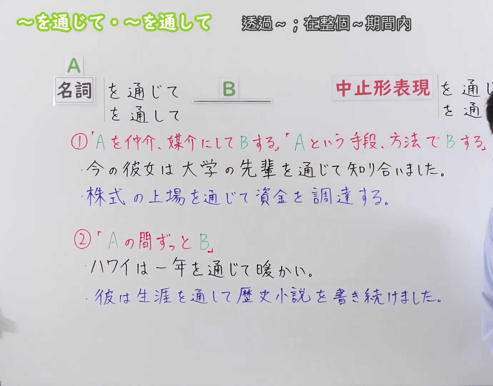
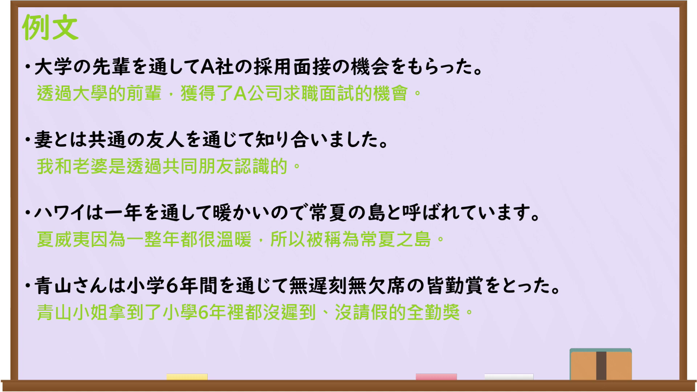

---
{
  "id": "N3-G-0093",
  "kind": "grammar",
  "level": "N3",
  "title": "〜を通じて・〜を通して（透过……；在整个……期间内）",
  "card_revision": 1,
  "schema_version": 1,
  "source": {
    "lesson": "N3 第93个语法",
    "material": "出口日語原视频板书、日语自动字幕与Hagoromo文型检索正文",
    "video": "https://www.youtube.com/watch?v=2fxbotdyhRU",
    "screenshot": "assets/grammar/n3/N3-G-0093-connection.png",
    "screenshot_seconds": 1,
    "screenshot_crop": {
      "x": 0,
      "y": 0,
      "width": 1380,
      "height": 1080
    }
  },
  "tags": [
    "を通じて",
    "を通して",
    "N3"
  ],
  "confusions": [
    "〜によって",
    "〜にわたって",
    "〜を込めて"
  ]
}
---

# N3 第93个语法：〜を通じて・〜を通して

# 视频学习资料整理

本课讲解 N3 语法形式「〜を通じて・〜を通して」。

## 接续图（板书与讲解）

- 视频链接：[出口日語 N3 第93个语法](https://www.youtube.com/watch?v=2fxbotdyhRU)
- 真实时间：00:01（1.00秒）
- 原图尺寸：1920×1080
- 裁切说明：选用 00:01 画面，左上方清晰显示语法标题「〜を通じて・〜を通して」与中文释义「透過〜；藉由〜；在整個〜期間內」，接续展示名词接「を通じて」「を通して」「を通じた名詞」「を通した名詞」，并详细说明①手段・媒介「Aを仲介にしてBする」与②期間「Aの期間中ずっとBが続く」。固定左上角（0, 0），裁切区域为宽 1380、高 1080，裁去右侧讲师身躯。
- 图片：

## 例句图（视频例句）

- 视频链接：[出口日語 N3 第93个语法](https://www.youtube.com/watch?v=2fxbotdyhRU)
- 真实时间：04:05（245.15秒）
- 原图尺寸：1920×1080
- 裁切说明：提取自视频 04:05 处的例句黑板页面。固定左上角（0, 0），裁切区域为宽 1920、高 1080，保留完整例句与中文释义。
- 图片：

# 核心

## 功能一：以A为中介媒介做B，以A为手段方法做B（透过……；藉由……）

**最上位意味カテゴリー：**

- **を通じて（手段・媒介）：** ものごとの関係（事物之间的关系）

**中位意味カテゴリー：**

- **を通じて（手段・媒介）：** 手段・媒介（手段与媒介）

**意味：**

- **を通じて（手段・媒介）：** 手段・媒介（手段与媒介）

**くわしい意味記述：**

- **を通じて（手段・媒介）：** Nを，媒介・手段として用いてという意味を表す。「を通じて」と「を通して」はほぼ同義である。（表示将N作为媒介或手段来使用。「を通じて」与「を通して」基本同义。）

**派生語：** を通して、を通じた、を通した

### 例句

1. インターネットを通じて、世界中のニュースを瞬時に知ることができる。

   （通过互联网，可以瞬间了解全世界的新闻。）

2. 私たちは共通の友人を通じて知り合いました。

   （我们是通过共同的朋友结识的。）

3. ボランティア活動を通して、多くの貴重な経験を得た。

   （通过志愿活动，获得了许多宝贵的经验。）

4. 社長には秘書を通じて連絡を取ってください。

   （联系社长请通过秘书进行。）

## 功能二：在A的整个期间一直持续B（在整个……期间内；贯穿……）

**最上位意味カテゴリー：**

- **を通じて（期間）：** ものごとの関係（事物之间的关系）

**中位意味カテゴリー：**

- **を通じて（期間）：** 時間的関係（时间关系）

**意味：**

- **を通じて（期間）：** 時間的限定（时间限定）

**くわしい意味記述：**

- **を通じて（期間）：** Nの期間全体にわたって，その状態が続いているという意味を表す。（表示在N的整个时间段内，某种状态一直持续。）

**派生語：** を通して

### 例句

1. この地域は一年を通じて温暖で過ごしやすい気候です。

   （这个地区一年到头气候温和，十分宜居。）

2. 彼は生涯を通して、恵まれない子供たちの支援を続けた。

   （他终其一生都在持续资助贫困儿童。）

3. 四季を通じて美しい景色が楽しめる観光地だ。

   （这是一年四季都能欣赏到美景的旅游胜地。）

4. 学生時代を通じて、無遅刻無欠席を達成した。

   （在整个学生时代，达成了不迟到不缺席的全勤。）

# 来源

- [出口日語原视频](https://www.youtube.com/watch?v=2fxbotdyhRU)
- [Hagoromo 文型検索「つうじて」](https://hagoromo-text.work/)（查询日期：2026-09-25）
