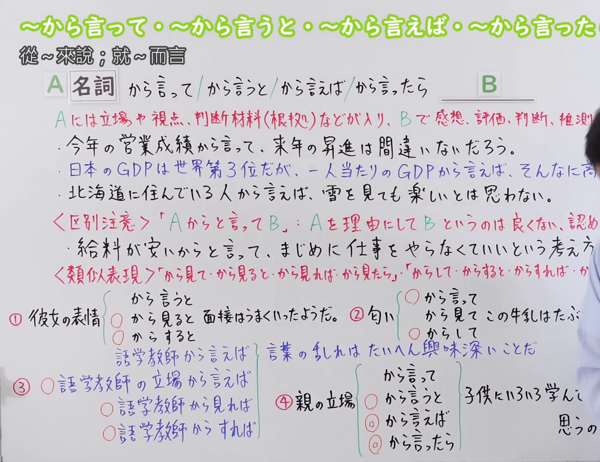
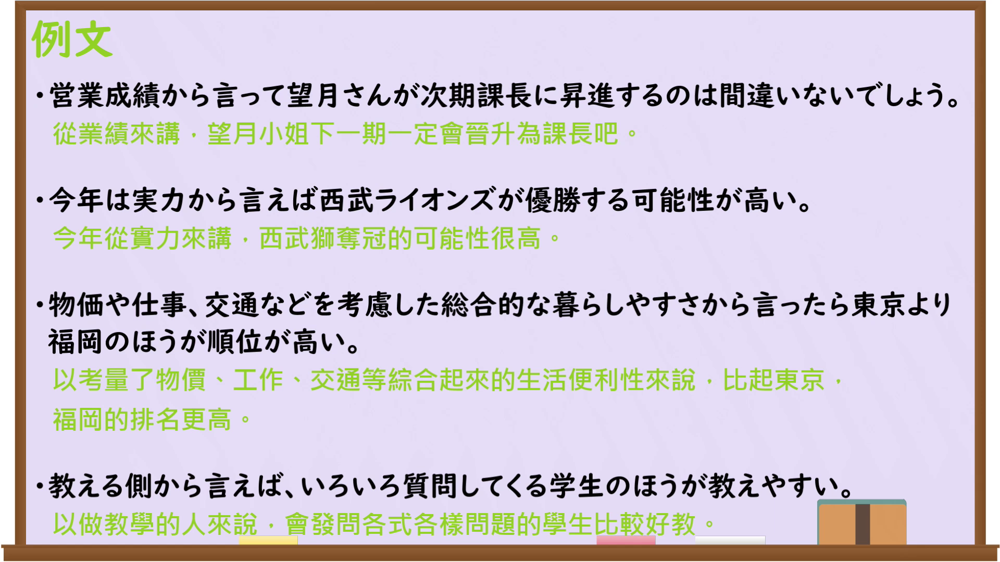

---
{
  "id": "N3-G-0094",
  "kind": "grammar",
  "level": "N3",
  "title": "〜から言って・〜から言うと・〜から言えば・〜から言ったら（从……来说；就……而言）",
  "card_revision": 1,
  "schema_version": 1,
  "source": {
    "lesson": "N3 第94个语法",
    "material": "出口日語原视频板书、日语自动字幕与Hagoromo文型检索正文",
    "video": "https://www.youtube.com/watch?v=XbSGNlvmuno",
    "screenshot": "assets/grammar/n3/N3-G-0094-connection.png",
    "screenshot_seconds": 1,
    "screenshot_crop": {
      "x": 0,
      "y": 0,
      "width": 1400,
      "height": 1080
    }
  },
  "tags": [
    "から言って",
    "から言うと",
    "から言えば",
    "から言ったら",
    "N3"
  ],
  "confusions": [
    "〜から見ると",
    "〜からして",
    "〜からすると"
  ]
}
---

# N3 第94个语法：〜から言って・〜から言うと・〜から言えば・〜から言ったら

# 视频学习资料整理

本课讲解 N3 语法形式「〜から言って・〜から言うと・〜から言えば・〜から言ったら」。

## 接续图（板书与讲解）

- 视频链接：[出口日語 N3 第94个语法](https://www.youtube.com/watch?v=XbSGNlvmuno)
- 真实时间：00:01（1.00秒）
- 原图尺寸：1920×1080
- 裁切说明：选用 00:01 画面，左上方清晰显示语法标题「〜から言って・〜から言うと・〜から言えば・〜から言ったら」与中文释义「從〜來說；就〜而言」，接续展示名词接四种形式，并详细说明「Aには立場や視点、判断材料(根拠)などが入り、Bで感想、評価、判断、推測を述べる」。固定左上角（0, 0），裁切区域为宽 1400、高 1080，裁去右侧讲师身躯。
- 图片：

## 例句图（视频例句）

- 视频链接：[出口日語 N3 第94个语法](https://www.youtube.com/watch?v=XbSGNlvmuno)
- 真实时间：14:56（896.00秒）
- 原图尺寸：1920×1080
- 裁切说明：提取自视频 14:56 处的例句黑板页面。固定左上角（0, 0），裁切区域为宽 1920、高 1080，保留完整例句与中文释义。
- 图片：

# 核心

## 功能一：以A作为立场、视点或判断根据，进而表达感想、评价、判断或推测（从……来说；就……而言）

**最上位意味カテゴリー：**

- **から言うと：** ものごとの関係（事物之间的关系）

**中位意味カテゴリー：**

- **から言うと：** 基準（基准）

**意味：**

- **から言うと：** 基準（基准）

**くわしい意味記述：**

- **から言うと：** 文頭に立つときにアドバイス，条件，指示などを求められたときに用いる。また，ある立場や視点，判断材料から判断して意見を述べるときに用いる。（处于句首或针对被寻求建议、条件、指示等场景使用；也用于从某种立场、视角、判断依据出发阐述评价与意见。）

**派生語：** から言って、から言えば、から言ったら

### 例句

1. 今年の営業成績から言って、彼の昇進は間違いないだろう。

   （从今年的营业业绩来说，他的升职毫无疑问吧。）

2. 日本のGDPは世界第3位だが、一人当たりのGDPから言えばそんなに高くない。

   （日本的GDP虽居世界第三，但从人均GDP来说并不算那么高。）

3. 北海道に住んでいる人から言えば、雪を見ても楽しいとは思わない。

   （对于住在北海道的人而言，看到雪并不觉得有什么开心。）

4. 私の立場から言うと、その提案には賛成しかねます。

   （站在我的立场上来说，很难赞同那个提案。）

# 来源

- [出口日語原视频](https://www.youtube.com/watch?v=XbSGNlvmuno)
- [Hagoromo 文型検索「からいうと」](https://hagoromo-text.work/)（查询日期：2026-09-25）
