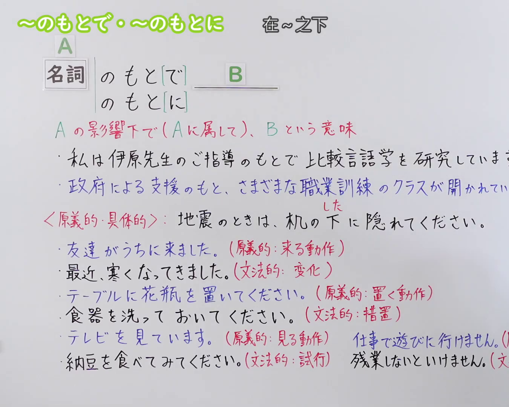

---
{
  "id": "N3-G-0095",
  "kind": "grammar",
  "level": "N3",
  "title": "〜のもとで・〜のもとに（在……之下）",
  "card_revision": 1,
  "schema_version": 1,
  "source": {
    "lesson": "N3 第95个语法",
    "material": "出口日語原视频板书、日语自动字幕与Hagoromo文型检索正文",
    "video": "https://www.youtube.com/watch?v=svVRQ-8sRek",
    "screenshot": "assets/grammar/n3/N3-G-0095-connection.png",
    "screenshot_seconds": 1,
    "screenshot_crop": {
      "x": 0,
      "y": 0,
      "width": 1350,
      "height": 1080
    }
  },
  "tags": [
    "のもとで",
    "のもとに",
    "N3"
  ],
  "confusions": [
    "〜に基づいて",
    "〜に応じて",
    "〜の下で"
  ]
}
---

# N3 第95个语法：〜のもとで・〜のもとに

# 视频学习资料整理

本课讲解 N3 语法形式「〜のもとで・〜のもとに」。

## 接续图（板书与讲解）

- 视频链接：[出口日語 N3 第95个语法](https://www.youtube.com/watch?v=svVRQ-8sRek)
- 真实时间：00:01（1.00秒）
- 原图尺寸：1920×1080
- 裁切说明：选用 00:01 画面，左上方清晰显示语法标题「〜のもとで・〜のもとに」与中文释义「在〜之下」，接续展示名词接「のもとで」「のもとに」，并详细说明「Aの影響範囲や指導、管理下でBを展開する」。固定左上角（0, 0），裁切区域为宽 1350、高 1080，裁去右侧讲师身躯。
- 图片：

## 例句图（视频例句）

- 视频链接：[出口日語 N3 第95个语法](https://www.youtube.com/watch?v=svVRQ-8sRek)
- 真实时间：07:05（425.00秒）
- 原图尺寸：1920×1080
- 裁切说明：提取自视频 07:05 处的例句黑板页面。固定左上角（0, 0），裁切区域为宽 1920、高 1080，保留完整例句与中文释义。
- 图片：

# 核心

## 功能一：在A的影响范围或指导管辖之下展开B（在……之下）

**最上位意味カテゴリー：**

- **のもとで：** ものごとの関係（事物之间的关系）

**中位意味カテゴリー：**

- **のもとで：** 状況（状况）

**意味：**

- **のもとで：** 状況（状况）

**くわしい意味記述：**

- **のもとで：** 「〜の影響が及ぶ範囲で」「〜の指導や条件のもとで」という意味を表す。「〜のもとで」は主に人や環境，「〜のもとに」は主に理念や条件，支配などを表す名詞に接続する。（表示“在……的影响波及范围内”或“在……的指导与条件之下”。「〜のもとで」多接表示人或环境的名词，「〜のもとに」多接表示理念、条件、支配等抽象概念的名词。）

**派生語：** のもとに

### 例句

1. 有名な先生のご指導のもとで、研究に励んでいます。

   （在名师的悉心指导下，努力进行研究。）

2. 子供たちは温かい家庭環境のもとで、すくすくと育っている。

   （孩子们在温馨的家庭环境之下健康快乐地成长。）

3. 双方が合意した条件のもとに、契約が締結された。

   （在双方达成一致的条件之下，签订了合同。）

4. 法の支配のもとに、国民の自由と権利が保障されている。

   （在法治支配之下，国民的自由与权利得到保障。）

# 来源

- [出口日語原视频](https://www.youtube.com/watch?v=svVRQ-8sRek)
- [Hagoromo 文型検索「のもとで」](https://hagoromo-text.work/)（查询日期：2026-09-25）
