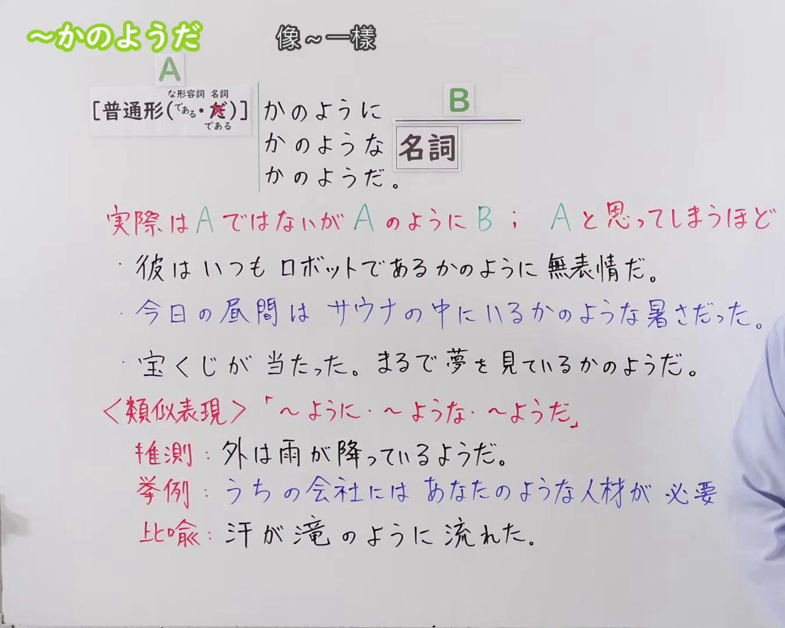
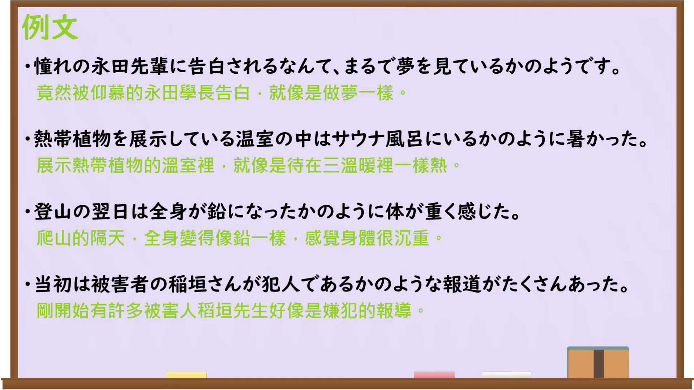

---
{
  "id": "N3-G-0096",
  "kind": "grammar",
  "level": "N3",
  "title": "〜かのように・〜かのような・〜かのようだ（像……一样）",
  "card_revision": 1,
  "schema_version": 1,
  "source": {
    "lesson": "N3 第96个语法",
    "material": "出口日語原视频板书、日语自动字幕与Hagoromo文型检索正文",
    "video": "https://www.youtube.com/watch?v=MF9Eh3i87PU",
    "screenshot": "assets/grammar/n3/N3-G-0096-connection.png",
    "screenshot_seconds": 1,
    "screenshot_crop": {
      "x": 0,
      "y": 0,
      "width": 1350,
      "height": 1080
    }
  },
  "tags": [
    "かのように",
    "かのような",
    "かのようだ",
    "N3"
  ],
  "confusions": [
    "〜まるで〜ようだ",
    "〜みたいに",
    "〜らしい"
  ]
}
---

# N3 第96个语法：〜かのように・〜かのような・〜かのようだ

# 视频学习资料整理

本课讲解 N3 语法形式「〜かのように・〜かのような・〜かのようだ」。

## 接续图（板书与讲解）

- 视频链接：[出口日語 N3 第96个语法](https://www.youtube.com/watch?v=MF9Eh3i87PU)
- 真实时间：00:01（1.00秒）
- 原图尺寸：1920×1080
- 裁切说明：选用 00:01 画面，左上方清晰显示语法标题「〜かのように・〜かのような・〜かのようだ」与中文释义「像〜一樣」，接续展示普通形接「かのように」「かのような名詞」「かのようだ」，并详细说明「実際はAではないが、まるでAであるかのように振る舞う・見える」。固定左上角（0, 0），裁切区域为宽 1350、高 1080，裁去右侧讲师身躯。
- 图片：

## 例句图（视频例句）

- 视频链接：[出口日語 N3 第96个语法](https://www.youtube.com/watch?v=MF9Eh3i87PU)
- 真实时间：05:10（310.00秒）
- 原图尺寸：1920×1080
- 裁切说明：提取自视频 05:10 处的例句黑板页面。固定左上角（0, 0），裁切区域为宽 1920、高 1080，保留完整例句与中文释义。
- 图片：

# 核心

## 功能一：实际上并非A但表现得如同A一样，甚至让人误以为就是A（像……一样）

**最上位意味カテゴリー：**

- **かのように：** ものごとの関係（事物之间的关系）

**中位意味カテゴリー：**

- **かのように：** 比況（比况）

**意味：**

- **かのように：** 比況（比况）

**くわしい意味記述：**

- **かのように：** 実際にはそうではないが，あたかもそのようであるという意味を表す。（表示实际上并非如此，但宛如那就是真的一样。）

**派生語：** かのような、かのようだ

### 例句

1. 彼はすべてを知っているかのように、得意げに話している。

   （他得意洋洋地讲着，就好像什么都知道一样。）

2. まだ春なのに、真夏であるかのような暑さだ。

   （明明还是春天，却宛如盛夏一般的酷暑。）

3. 何事もなかったかのように、平気な顔をして教室に入ってきた。

   （他一副若无其事的神情走进了教室，好像什么都没发生过一样。）

4. 彼女はまるで自分の家であるかのように寛いでいる。

   （她十分放松地呆着，宛如在自己家里一样。）

# 来源

- [出口日語原视频](https://www.youtube.com/watch?v=MF9Eh3i87PU)
- [Hagoromo 文型検索「かのように」](https://hagoromo-text.work/)（查询日期：2026-09-25）
