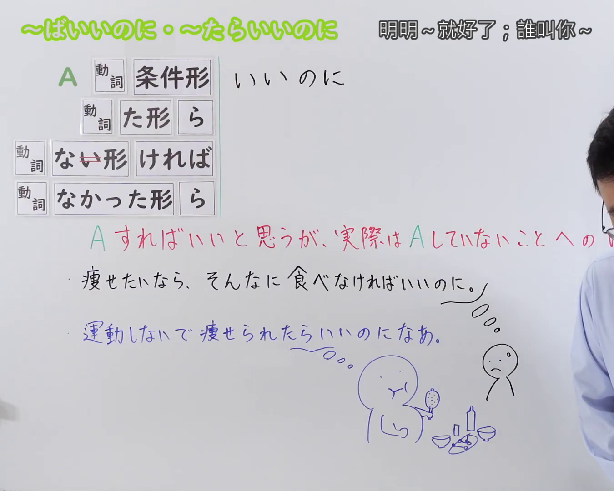
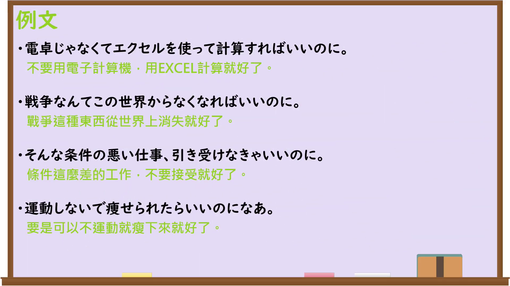

---
{
  "id": "N3-G-0097",
  "kind": "grammar",
  "level": "N3",
  "title": "〜ばいいのに・〜たらいいのに（明明……就好了；要是……多好）",
  "card_revision": 1,
  "schema_version": 1,
  "source": {
    "lesson": "N3 第97个语法",
    "material": "出口日語原视频板书、日语自动字幕与Hagoromo文型检索正文",
    "video": "https://www.youtube.com/watch?v=_AUQp36qeUg",
    "screenshot": "assets/grammar/n3/N3-G-0097-connection.png",
    "screenshot_seconds": 1,
    "screenshot_crop": {
      "x": 0,
      "y": 0,
      "width": 1350,
      "height": 1080
    }
  },
  "tags": [
    "ばいいのに",
    "たらいいのに",
    "いいのに",
    "N3"
  ],
  "confusions": [
    "〜ばよかった",
    "〜べきだった",
    "〜たらいい"
  ]
}
---

# N3 第97个语法：〜ばいいのに・〜たらいいのに

# 视频学习资料整理

本课讲解 N3 语法形式「〜ばいいのに・〜たらいいのに」。

## 接续图（板书与讲解）

- 视频链接：[出口日語 N3 第97个语法](https://www.youtube.com/watch?v=_AUQp36qeUg)
- 真实时间：00:01（1.00秒）
- 原图尺寸：1920×1080
- 裁切说明：选用 00:01 画面，左上方清晰显示语法标题「〜ばいいのに・〜たらいいのに」与中文释义「明明〜就好了；誰叫你〜」，接续展示动词条件形/たら形接「いいのに」，并详细说明「Aをすればよかったのに実際はしなかったことに対する残念な気持ちや非難を表す」。固定左上角（0, 0），裁切区域为宽 1350、高 1080，裁去右侧讲师身躯。
- 图片：

## 例句图（视频例句）

- 视频链接：[出口日語 N3 第97个语法](https://www.youtube.com/watch?v=_AUQp36qeUg)
- 真实时间：04:18（258.32秒）
- 原图尺寸：1920×1080
- 裁切说明：提取自视频 04:18 处的例句黑板页面。固定左上角（0, 0），裁切区域为宽 1920、高 1080，保留完整例句与中文释义。
- 图片：

# 核心

## 功能一：认为要是做了A就好了，但实际上却未能做到的遗憾与责备（明明……就好了；谁叫你……）

**最上位意味カテゴリー：**

- **ば〜のに：** 話し手の心的態度（说话人的心理态度）

**中位意味カテゴリー：**

- **ば〜のに：** 評価・感情（评价与情感）

**意味：**

- **ば〜のに：** 残念・不満（遗憾与不满）

**くわしい意味記述：**

- **ば〜のに：** 事実と違うことを述べ，もしそのことが実現していれば，起こっていたことを述べる。残念な気持ちや相手への不満・非難を表すことが多い。（陈述与事实相反的假设，说明如果当初实现了该行为本应发生的结果。常用于表达遗憾的心情或对对方的不满与责备。）

**派生語：** たらいいのに

### 例句

1. わからないなら、先生に聞けばいいのに。

   （不懂的话去问老师就好了嘛（明明问了就行，却不问）。）

2. 無理をしないで、今日は仕事を休んだらいいのに。

   （别勉强了，今天请假休息多好啊。）

3. もっと早く言ってくれればいいのに、直前になって困るよ。

   （明明早点告诉我就好了，临到头来真让人伤脑筋。）

4. 天気が良ければ一緒に出かけられたのに、雨で残念だ。

   （要是天气好本能一起出门的，下雨真遗憾。）

# 来源

- [出口日語原视频](https://www.youtube.com/watch?v=_AUQp36qeUg)
- [Hagoromo 文型検索「ば〜のに」](https://hagoromo-text.work/)（查询日期：2026-09-25）
