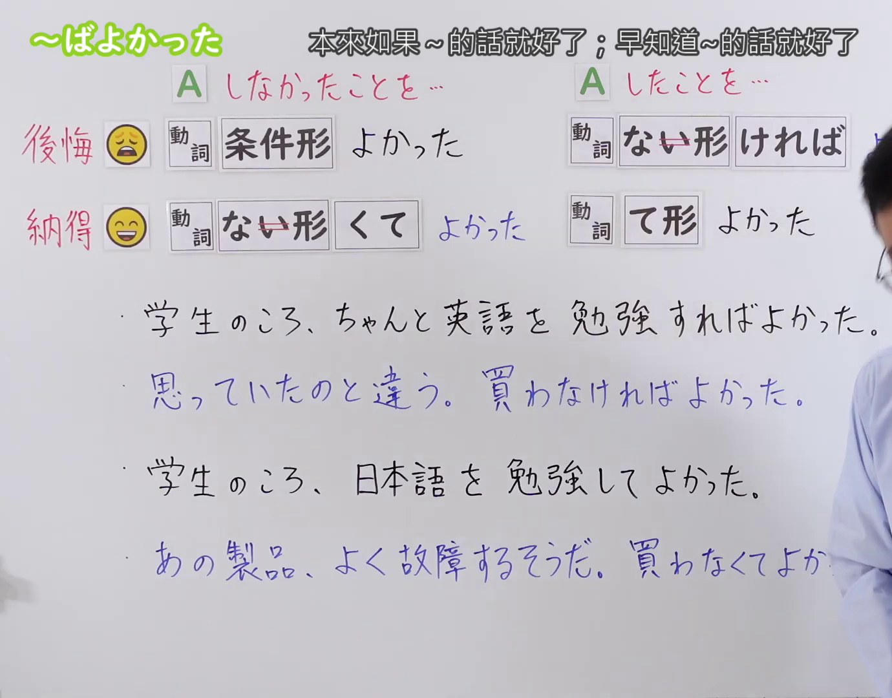
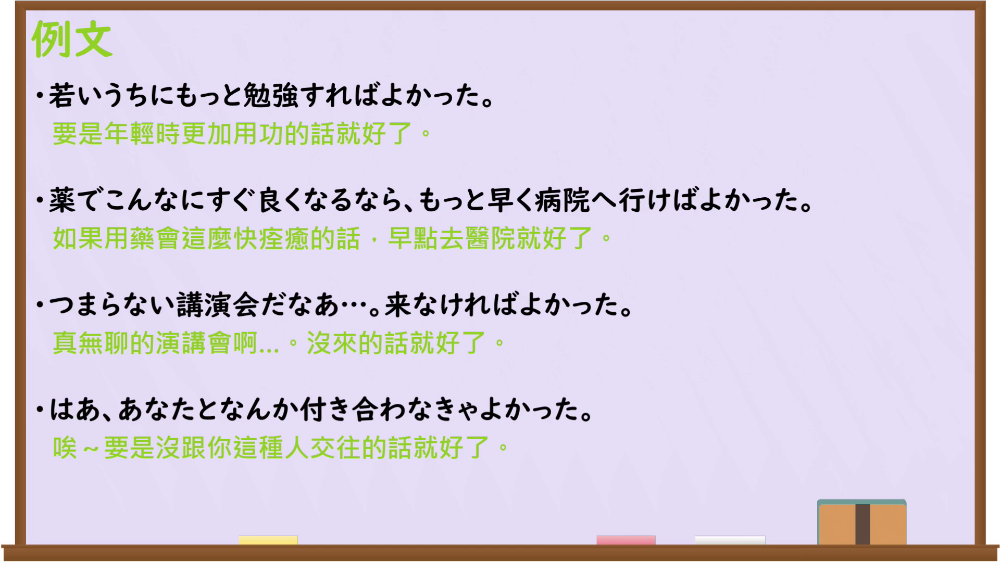

---
{
  "id": "N3-G-0098",
  "kind": "grammar",
  "level": "N3",
  "title": "〜ばよかった（早知道……就好了；本来如果……就好了）",
  "card_revision": 1,
  "schema_version": 1,
  "source": {
    "lesson": "N3 第98个语法",
    "material": "出口日語原视频板书、日语自动字幕与Hagoromo文型检索正文",
    "video": "https://www.youtube.com/watch?v=anzUWUSbXVM",
    "screenshot": "assets/grammar/n3/N3-G-0098-connection.png",
    "screenshot_seconds": 1,
    "screenshot_crop": {
      "x": 0,
      "y": 0,
      "width": 1380,
      "height": 1080
    }
  },
  "tags": [
    "ばよかった",
    "なければよかった",
    "よかった",
    "N3"
  ],
  "confusions": [
    "〜ばいいのに",
    "〜べきだった",
    "〜てよかった"
  ]
}
---

# N3 第98个语法：〜ばよかった

# 视频学习资料整理

本课讲解 N3 语法形式「〜ばよかった」。

## 接续图（板书与讲解）

- 视频链接：[出口日語 N3 第98个语法](https://www.youtube.com/watch?v=anzUWUSbXVM)
- 真实时间：00:01（1.00秒）
- 原图尺寸：1920×1080
- 裁切说明：选用 00:01 画面，左上方清晰显示语法标题「〜ばよかった」与中文释义「本來如果〜的話就好了；早知道〜的話就好了」，接续展示动词条件形「〜ばよかった」与否定条件「〜なければよかった」，并对比后悔与庆幸的表现。固定左上角（0, 0），裁切区域为宽 1380、高 1080，裁去右侧讲师身躯。
- 图片：

## 例句图（视频例句）

- 视频链接：[出口日語 N3 第98个语法](https://www.youtube.com/watch?v=anzUWUSbXVM)
- 真实时间：05:20（320.00秒）
- 原图尺寸：1920×1080
- 裁切说明：提取自视频 05:20 处的例句黑板页面。固定左上角（0, 0），裁切区域为宽 1920、高 1080，保留完整例句与中文释义。
- 图片：

# 核心

## 功能一：对过去没做A的事感到后悔，早知如此要是做了A就好了（本来如果……的话就好了；早知道……的话就好了）

**最上位意味カテゴリー：**

- **ばよかった：** 話し手の心的態度（说话人的心理态度）

**中位意味カテゴリー：**

- **ばよかった：** 評価・感情（评价与情感）

**意味：**

- **ばよかった：** 後悔・反省（后悔与反省）

**くわしい意味記述：**

- **ばよかった：** 過去にしなかった行為について，「もしその行為をしていればよかった」と後悔したり反省したりする気持ちを表す。（对过去没有做出的行为，表示“要是当初做了那件事就好了”的后悔与反省心理。）

**派生語：** なければよかった

### 例句

1. 学生のころ、もっとちゃんと英語を勉強すればよかった。

   （学生时代要是更加认真学英语就好了。）

2. 傘を持ってくればよかった。こんなに大雨になるとは思わなかった。

   （早知道带把伞就好了，没想到会下这么大的雨。）

3. 思っていたのと違う。あんな服、買わなければよかった。

   （跟想象的完全不同，真不该买那件衣服的。）

4. あんなひどいこと、彼に言わなければよかったと深く後悔している。

   （我深感后悔，真不该对他说那样过分的话。）

# 来源

- [出口日語原视频](https://www.youtube.com/watch?v=anzUWUSbXVM)
- [Hagoromo 文型検索「ばよかった」](https://hagoromo-text.work/)（查询日期：2026-09-25）
