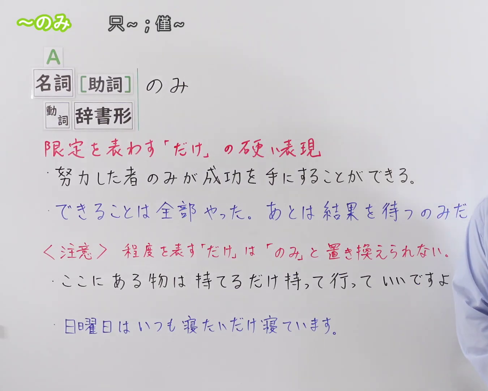
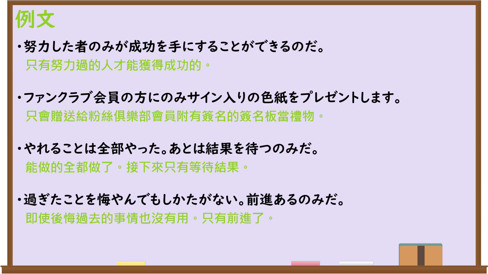

---
{
  "id": "N3-G-0099",
  "kind": "grammar",
  "level": "N3",
  "title": "〜のみ（只……；仅……）",
  "card_revision": 1,
  "schema_version": 1,
  "source": {
    "lesson": "N3 第99个语法",
    "material": "出口日語原视频板书、日语自动字幕与Hagoromo文型检索正文",
    "video": "https://www.youtube.com/watch?v=boX-itMr5gc",
    "screenshot": "assets/grammar/n3/N3-G-0099-connection.png",
    "screenshot_seconds": 1,
    "screenshot_crop": {
      "x": 0,
      "y": 0,
      "width": 1350,
      "height": 1080
    }
  },
  "tags": [
    "のみ",
    "N3"
  ],
  "confusions": [
    "〜だけ",
    "〜ばかり",
    "〜きり"
  ]
}
---

# N3 第99个语法：〜描写・限定：のみ

# 视频学习资料整理

本课讲解 N3 语法形式「〜描写・限定：のみ」。

## 接续图（板书与讲解）

- 视频链接：[出口日語 N3 第99个语法](https://www.youtube.com/watch?v=boX-itMr5gc)
- 真实时间：00:01（1.00秒）
- 原图尺寸：1920×1080
- 裁切说明：选用 00:01 画面，左上方清晰显示语法标题「〜のみ」与中文释义「只〜；僅〜」，接续展示名词或动词字典形接「のみ」，并详细说明「『だけ』の硬い書き言葉表現で、範囲を限定する」。固定左上角（0, 0），裁切区域为宽 1350、高 1080，裁去右侧讲师身躯。
- 图片：

## 例句图（视频例句）

- 视频链接：[出口日語 N3 第99个语法](https://www.youtube.com/watch?v=boX-itMr5gc)
- 真实时间：03:07（187.53秒）
- 原图尺寸：1920×1080
- 裁切说明：提取自视频 03:07 处的例句黑板页面。固定左上角（0, 0），裁切区域为宽 1920、高 1080，保留完整例句与中文释义。
- 图片：

# 核心

## 功能一：表示限定范围，属于「だけ」的生硬书面语表现（只……；仅……）

**最上位意味カテゴリー：**

- **のみ：** ものごとの関係（事物之间的关系）

**中位意味カテゴリー：**

- **のみ：** 限定（限定）

**意味：**

- **のみ：** 限定（限定）

**くわしい意味記述：**

- **のみ：** それだけ，それに限るという意味を表す。「だけ」の硬い表現で，書き言葉や改まった話し言葉で用いられる。（表示“仅此、仅限于此”。属于「だけ」的书面、生硬表现，多用于书面语或郑重的口语表达。）

**派生語：** のみならず

### 例句

1. このコンテストには、学生のみ参加することができます。

   （只有学生才可以参加本次竞赛。）

2. 詳細はホームページにてご確認ください。電話でのお問い合わせは平日のみ受け付けております。

   （详情请在主页查看。电话咨询仅限工作日接待。）

3. 今できることは、全力を尽くして結果を待つのみだ。

   （现在能做的，唯有竭尽全力静待结果。）

4. 経験者のみならず、未経験者の応募も歓迎いたします。

   （不仅欢迎有经验者，也欢迎无经验者应聘。）

# 来源

- [出口日語原视频](https://www.youtube.com/watch?v=boX-itMr5gc)
- [Hagoromo 文型検索「のみ」](https://hagoromo-text.work/)（查询日期：2026-09-25）
