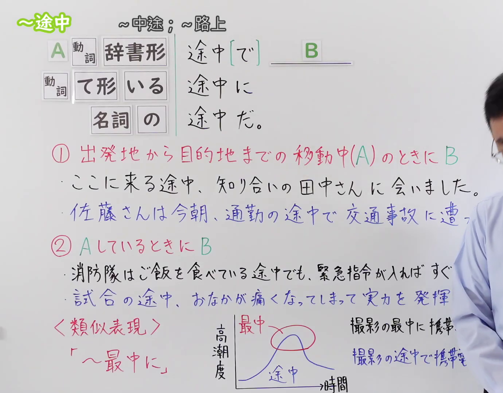

---
{
  "id": "N3-G-0100",
  "kind": "grammar",
  "level": "N3",
  "title": "〜途中・〜途中で・〜途中に・〜途中だ（……中途；在……路上）",
  "card_revision": 1,
  "schema_version": 1,
  "source": {
    "lesson": "N3 第100个语法",
    "material": "出口日語原视频板书、日语自动字幕与Hagoromo文型检索正文",
    "video": "https://www.youtube.com/watch?v=7bpiJKNm1jo",
    "screenshot": "assets/grammar/n3/N3-G-0100-connection.png",
    "screenshot_seconds": 1,
    "screenshot_crop": {
      "x": 0,
      "y": 0,
      "width": 1380,
      "height": 1080
    }
  },
  "tags": [
    "途中",
    "途中で",
    "途中に",
    "途中だ",
    "N3"
  ],
  "confusions": [
    "〜うちに",
    "〜あいだに",
    "〜最中に"
  ]
}
---

# N3 第100个语法：〜途中・〜途中で・〜途中に・〜途中だ

# 视频学习资料整理

本课讲解 N3 语法形式「〜途中・〜途中で・〜途中に・〜途中だ」。

## 接续图（板书与讲解）

- 视频链接：[出口日語 N3 第100个语法](https://www.youtube.com/watch?v=7bpiJKNm1jo)
- 真实时间：00:01（1.00秒）
- 原图尺寸：1920×1080
- 裁切说明：选用 00:01 画面，左上方清晰显示语法标题「〜途中・〜途中で・〜途中に・〜途中だ」与中文释义「〜中途；〜路上」，接续展示动词辞书形/ている接「途中(で/に/だ)」，名词接「の途中(で/に/だ)」，并详细说明①移动途中做B与②动作进行半途中发生B。固定左上角（0, 0），裁切区域为宽 1380、高 1080，裁去右侧讲师身躯。
- 图片：

## 例句图（视频例句）

- 视频链接：[出口日語 N3 第100个语法](https://www.youtube.com/watch?v=7bpiJKNm1jo)
- 真实时间：05:50（350.00秒）
- 原图尺寸：1920×1080
- 裁切说明：提取自视频 05:50 处的例句黑板页面。固定左上角（0, 0），裁切区域为宽 1920、高 1080，保留完整例句与中文释义。
- 图片：

# 核心

## 功能一：在从出发地前往目的地的位移移动中做B（在前往……的途中；路上）

**最上位意味カテゴリー：**

- **途中（移動）：** ものごとの関係（事物之间的关系）

**中位意味カテゴリー：**

- **途中（移動）：** 時間的関係（时间关系）

**意味：**

- **途中（移動）：** 時間的限定（时间限定）

**くわしい意味記述：**

- **途中（移動）：** ある場所から目的の場所へ移動する行程の半ばを表す。（表示从某个地点前往目的地的位移移动行程的正中途。）

**派生語：** 途中で、途中に

### 例句

1. 家に帰る途中、コンビニに寄って夜食を買ってきた。

   （在回家的路上，顺道去便利店买了夜宵回来。）

2. 学校へ行く途中にスズメバチの巣があって、とても危険です。

   （去学校的路上有虎头蜂的蜂巢，非常危险。）

3. 会社へ向かう途中で、偶然高校時代の友人に会った。

   （在前往公司的路上，偶然遇到了高中时代的同窗。）

4. 出張の途中で京都に立ち寄り、お寺を参拝した。

   （在出差的中途顺路去了趟京都，参拜了寺庙。）

## 功能二：正在进行A动作的半途之中发生了B（在……进行中；做……的半截）

**最上位意味カテゴリー：**

- **途中（進行中）：** ものごとの関係（事物之间的关系）

**中位意味カテゴリー：**

- **途中（進行中）：** 局面（局面）

**意味：**

- **途中（進行中）：** 継続・進行（持续与进行）

**くわしい意味記述：**

- **途中（進行中）：** ある動作や出来事がまだ完了せず，進行している半ばの状態を表す。（表示某种动作或事件尚未完成、正处于进行中途的状态。）

**派生語：** 途中で、途中だ

### 例句

1. パソコンでレポートを書いている途中、停電になってデータが消えた。

   （在用电脑写报告的半途中停电了，数据全部丢失。）

2. 授業の途中で教室をこっそり出て行く学生がいる。

   （有在上课中途悄悄溜出教室的学生。）

3. 食事の途中で急な電話がかかってきて、席を立った。

   （正吃饭的半截来了紧急电话，便离席去接了。）

4. 本を読んでいる途中で、いつの間にか眠ってしまった。

   （读书读到一半，不知不觉就睡着了。）

# 来源

- [出口日語原视频](https://www.youtube.com/watch?v=7bpiJKNm1jo)
- [Hagoromo 文型検索「途中」](https://hagoromo-text.work/)（查询日期：2026-09-25）
