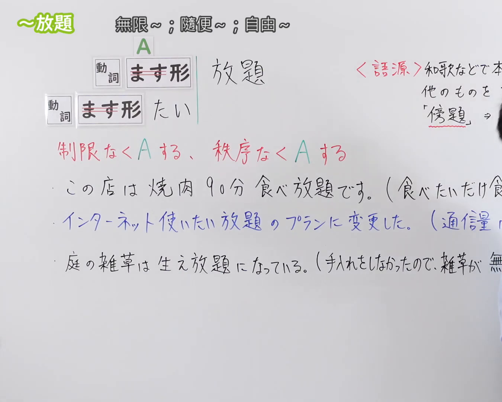
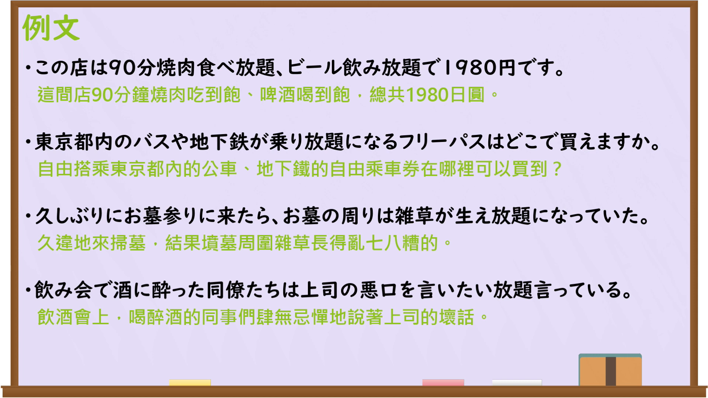

---
{
  "id": "N3-G-0101",
  "kind": "grammar",
  "level": "N3",
  "title": "〜放題（无限……；尽情……）",
  "card_revision": 1,
  "schema_version": 1,
  "source": {
    "lesson": "N3 第101个语法",
    "material": "出口日語原视频板书、日语自动字幕与Hagoromo文型检索正文",
    "video": "https://www.youtube.com/watch?v=LDccAzriyFo",
    "screenshot": "assets/grammar/n3/N3-G-0101-connection.png",
    "screenshot_seconds": 1,
    "screenshot_crop": {
      "x": 0,
      "y": 0,
      "width": 1350,
      "height": 1080
    }
  },
  "tags": [
    "放題",
    "ほうだい",
    "たい放題",
    "N3"
  ],
  "confusions": [
    "〜まくる",
    "〜っぱなし",
    "〜きり"
  ]
}
---

# N3 第101个语法：〜放題

# 视频学习资料整理

本课讲解 N3 语法形式「〜放題」。

## 接续图（板书与讲解）

- 视频链接：[出口日語 N3 第101个语法](https://www.youtube.com/watch?v=LDccAzriyFo)
- 真实时间：00:01（1.00秒）
- 原图尺寸：1920×1080
- 裁切说明：选用 00:01 画面，左上方清晰显示语法标题「〜放題」与中文释义「無限〜；隨便〜；自由〜」，接续展示动词ます形/ます形たい接「放題」，并用红字详细说明「制限なくAする、秩序なくAする」。固定左上角（0, 0），裁切区域为宽 1350、高 1080，裁去右侧讲师身躯。
- 图片：

## 例句图（视频例句）

- 视频链接：[出口日語 N3 第101个语法](https://www.youtube.com/watch?v=LDccAzriyFo)
- 真实时间：02:36（156.00秒）
- 原图尺寸：1920×1080
- 裁切说明：提取自视频 02:36 处的例句黑板页面。固定左上角（0, 0），裁切区域为宽 1920、高 1080，保留完整例句与中文释义。
- 图片：

# 核心

## 功能一：不受限制地尽情做A；毫无顾忌任由放任自流（无限……；尽情……）

**最上位意味カテゴリー：**

- **放題：** ものごとの関係（事物之间的关系）

**中位意味カテゴリー：**

- **放題：** 程度（程度）

**意味：**

- **放題：** 極限・放任（极限与放任）

**くわしい意味記述：**

- **放題：** 動詞のます形について，「制限なくいくらでも自由に〜する」「〜したいだけする」「気の済むまで勝手に〜する」という意味を表す。（接动词连用形后，表示毫无限制地自由做某事，或者任由事物放任自流。）

**派生語：** たい放題

### 例句

1. この店は90分焼肉食べ放題、ビール飲み放題で1980円です。

   （这家店90分钟烤肉无限吃、啤酒畅饮，只要1980日元。）

2. 東京都内のバスや地下鉄が乗り放題になるフリーパスはどこで買えますか。

   （东京都内巴士和地铁随意无限搭乘的一日通票在哪里买？）

3. 久しぶりにお墓参りに来たら、お墓の周りは雑草が生え放題になっていた。

   （久违地来扫墓，发现坟墓周围杂草长得乱七八糟。）

4. 飲み会で酒に酔った同僚たちは、上司の悪口を言いたい放題言っている。

   （饮酒会上喝醉的同事们肆无忌惮地尽情说着上司的坏话。）

# 来源

- [出口日語原视频](https://www.youtube.com/watch?v=LDccAzriyFo)
- [日本語NET「〜放題」](https://nihongokyoshi-net.com/)（查询日期：2026-09-25）
