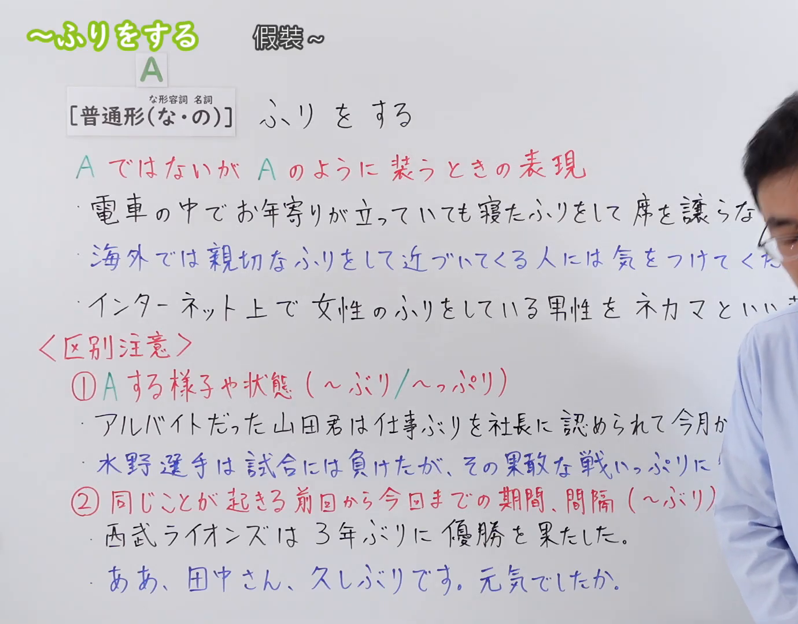
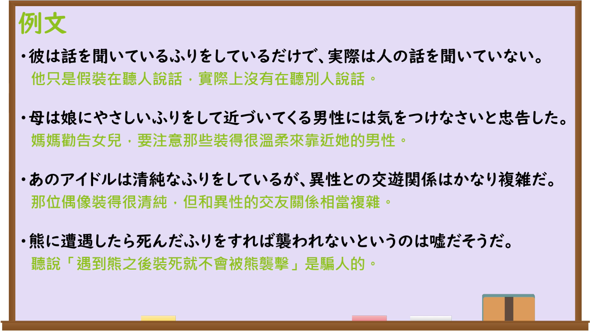

---
{
  "id": "N3-G-0102",
  "kind": "grammar",
  "level": "N3",
  "title": "〜ふりをする（假装……）",
  "card_revision": 1,
  "schema_version": 1,
  "source": {
    "lesson": "N3 第102个语法",
    "material": "出口日語原视频板书、日语自动字幕与Hagoromo文型检索正文",
    "video": "https://www.youtube.com/watch?v=Akx9wWRHuQc",
    "screenshot": "assets/grammar/n3/N3-G-0102-connection.png",
    "screenshot_seconds": 1,
    "screenshot_crop": {
      "x": 0,
      "y": 0,
      "width": 1380,
      "height": 1080
    }
  },
  "tags": [
    "ふりをする",
    "ふりをして",
    "ふり",
    "N3"
  ],
  "confusions": [
    "〜かのように",
    "〜くせに",
    "〜みたいに"
  ]
}
---

# N3 第102个语法：〜ふりをする

# 视频学习资料整理

本课讲解 N3 语法形式「〜ふりをする」。

## 接续图（板书与讲解）

- 视频链接：[出口日語 N3 第102个语法](https://www.youtube.com/watch?v=Akx9wWRHuQc)
- 真实时间：00:01（1.00秒）
- 原图尺寸：1920×1080
- 裁切说明：选用 00:01 画面，左上方清晰显示语法标题「〜ふりをする」与中文释义「假裝〜」，接续展示普通形（な形な・名詞の）接「ふりをする」，并用红字详细说明「AではないがAのように装うときの表現」。固定左上角（0, 0），裁切区域为宽 1380、高 1080，裁去右侧讲师身躯。
- 图片：

## 例句图（视频例句）

- 视频链接：[出口日語 N3 第102个语法](https://www.youtube.com/watch?v=Akx9wWRHuQc)
- 真实时间：06:35（395.00秒）
- 原图尺寸：1920×1080
- 裁切说明：提取自视频 06:35 处的例句黑板页面。固定左上角（0, 0），裁切区域为宽 1920、高 1080，保留完整例句与中文释义。
- 图片：

# 核心

## 功能一：实际上并非A，却装成A的样子以掩人耳目（假装……）

**最上位意味カテゴリー：**

- **ふりをする：** ものごとの様子（事物的样态）

**中位意味カテゴリー：**

- **ふりをする：** 偽装・比況（伪装与比况）

**意味：**

- **ふりをする：** 仮装・装い（假装）

**くわしい意味記述：**

- **ふりをする：** 実際はそうではないのに，まるでそうであるかのように見せかける。（实际上并非如此，却装作宛如就是那样的姿态。）

**派生語：** ふりをしている

### 例句

1. 電車の中でお年寄りが立っていても、寝たふりをして席を譲らない人がいる。

   （电车里即便有老人站着，也有人假装睡着而不让座。）

2. 海外では親切なふりをして近づいてくる人には、十分に気をつけてください。

   （在国外对于假装亲切主动靠近的人，请务必多加小心。）

3. 彼は本当は何も知らないのに、知っているふりをして相槌を打っていた。

   （他其实什么都不知道，却装作知道的样子随声附和。）

4. インターネット上で女性のふりをしている男性を「ネカマ」という。

   （在网络上假装成女性的男性被称为“人妖网虫”。）

# 来源

- [出口日語原视频](https://www.youtube.com/watch?v=Akx9wWRHuQc)
- [日本語NET「〜ふりをする」](https://nihongokyoshi-net.com/2019/11/25/jlptn3-grammar-furiwosuru/)（查询日期：2026-09-25）
