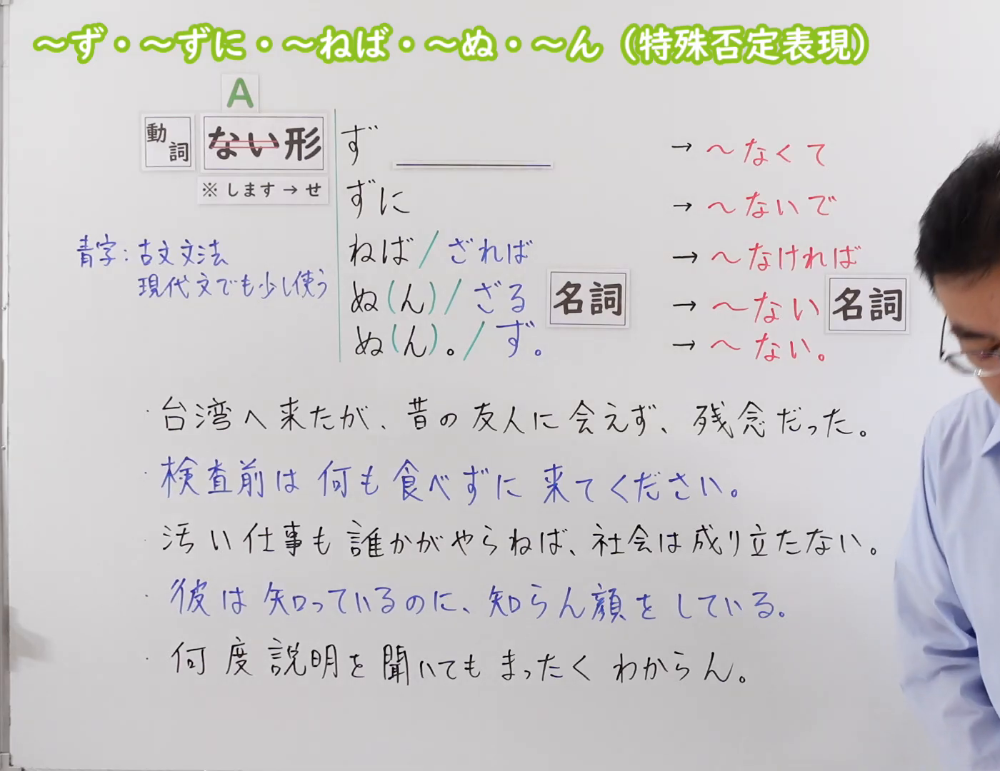
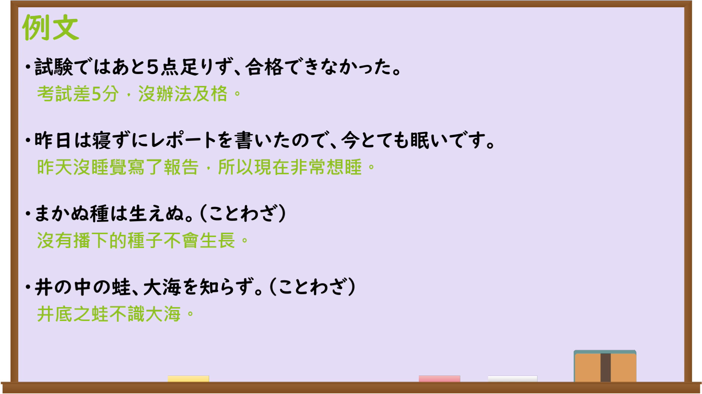

---
{
  "id": "N3-G-0103",
  "kind": "grammar",
  "level": "N3",
  "title": "〜ず・〜ずに・〜ねば・〜ぬ・〜ん（特殊否定表现）",
  "card_revision": 1,
  "schema_version": 1,
  "source": {
    "lesson": "N3 第103个语法",
    "material": "出口日語原视频板书、日语自动字幕与Hagoromo文型检索正文",
    "video": "https://www.youtube.com/watch?v=M3d6ZfPL0Oo",
    "screenshot": "assets/grammar/n3/N3-G-0103-connection.png",
    "screenshot_seconds": 1,
    "screenshot_crop": {
      "x": 0,
      "y": 0,
      "width": 1400,
      "height": 1080
    }
  },
  "tags": [
    "ず",
    "ずに",
    "ねば",
    "ぬ",
    "ん",
    "N3"
  ],
  "confusions": [
    "〜ないで",
    "〜なくて",
    "〜なければ"
  ]
}
---

# N3 第103个语法：〜ず・〜ずに・〜ねば・〜ぬ・〜ん（特殊否定表現）

# 视频学习资料整理

本课讲解 N3 语法形式「〜ず・〜ずに・〜ねば・〜ぬ・〜ん（特殊否定表現）」。

## 接续图（板书与讲解）

- 视频链接：[出口日語 N3 第103个语法](https://www.youtube.com/watch?v=M3d6ZfPL0Oo)
- 真实时间：00:01（1.00秒）
- 原图尺寸：1920×1080
- 裁切说明：选用 00:01 画面，左上方清晰显示语法标题「〜ず・〜ずに・〜ねば・〜ぬ・〜ん（特殊否定表現）」，接续展示动词ない形接各种文语否定形式，并详细说明古文语法在现代日语中的对应。固定左上角（0, 0），裁切区域为宽 1400、高 1080，裁去右侧讲师身躯。
- 图片：

## 例句图（视频例句）

- 视频链接：[出口日語 N3 第103个语法](https://www.youtube.com/watch?v=M3d6ZfPL0Oo)
- 真实时间：06:17（377.00秒）
- 原图尺寸：1920×1080
- 裁切说明：提取自视频 06:17 处的例句黑板页面。固定左上角（0, 0），裁切区域为宽 1920、高 1080，保留完整例句与中文释义。
- 图片：

# 核心

## 功能一：源自古日语的特殊书面否定形式（不……；没……）

**最上位意味カテゴリー：**

- **ずに：** ものごとの関係（事物之间的关系）

**中位意味カテゴリー：**

- **ずに：** 状況（状况）

**意味：**

- **ずに：** 付帯状況・理由（附带状况与理由）

**くわしい意味記述：**

- **ずに：** 「Vないで」「Vなくて」という意味を表す。話し言葉でも使うが，少し硬い表現である。古語に由来する否定表現。（表示“不……而……”或“由于没有……”。古语由来的否定表达，较书面郑重。）

**派生語：** ず、ねば、ぬ、ん

### 例句

1. 台湾へ来たが、昔の友人に会えず、残念だった。

   （来到台湾旅行，但没能见到老朋友感到很遗憾。）

2. 検査前は何も食べずに来てください。

   （检查前请什么都不要吃前来。）

3. 汚い仕事も誰かがやらねば、社会は成り立たない。

   （哪怕是脏活累活如果没人去干的话，社会便无法正常运转。）

4. 何度説明を聞いても、この理論の要点がさっぱりわからん。

   （不论听了多少遍解释，对这套理论的要点依然完全搞不懂。）

# 来源

- [出口日語原视频](https://www.youtube.com/watch?v=M3d6ZfPL0Oo)
- [Hagoromo 文型検索「ずに」](https://hagoromo-text.work/)（查询日期：2026-09-25）
