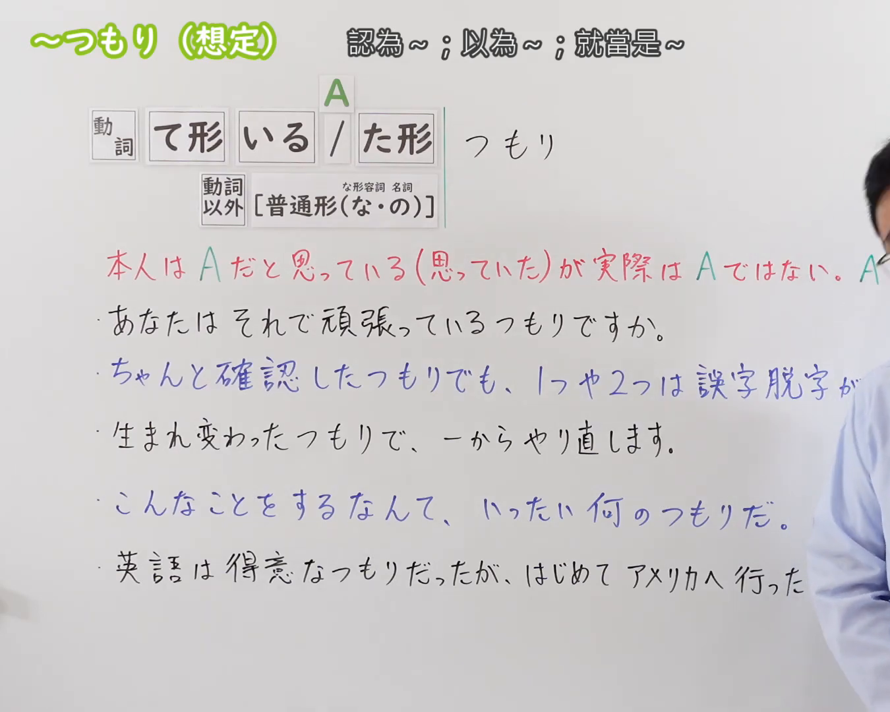
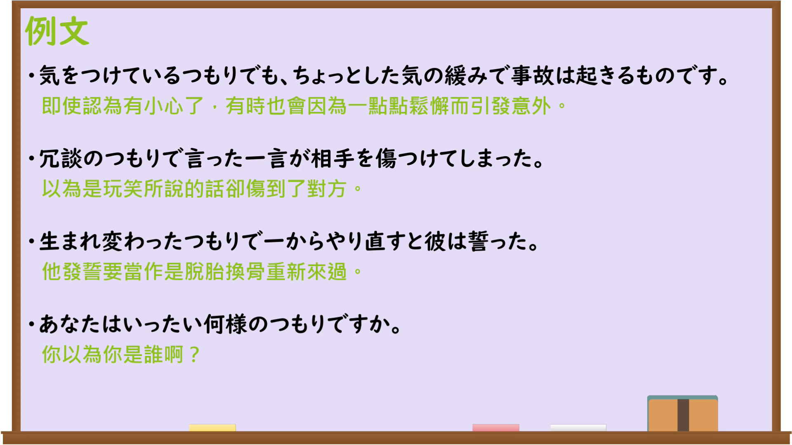

---
{
  "id": "N3-G-0104",
  "kind": "grammar",
  "level": "N3",
  "title": "〜つもり（当作……；自以为……）",
  "card_revision": 1,
  "schema_version": 1,
  "source": {
    "lesson": "N3 第104个语法",
    "material": "出口日語原视频板书、日语自动字幕与Hagoromo文型检索正文",
    "video": "https://www.youtube.com/watch?v=YUMxOWwK-8I",
    "screenshot": "assets/grammar/n3/N3-G-0104-connection.png",
    "screenshot_seconds": 1,
    "screenshot_crop": {
      "x": 0,
      "y": 0,
      "width": 1350,
      "height": 1080
    }
  },
  "tags": [
    "つもり",
    "つもりだ",
    "つもりで",
    "N3"
  ],
  "confusions": [
    "〜気味",
    "〜ふり",
    "〜気分"
  ]
}
---

# N3 第104个语法：〜つもり（想定）

# 视频学习资料整理

本课讲解 N3 语法形式「〜つもり（想定）」。

## 接续图（板书与讲解）

- 视频链接：[出口日語 N3 第104个语法](https://www.youtube.com/watch?v=YUMxOWwK-8I)
- 真实时间：00:01（1.00秒）
- 原图尺寸：1920×1080
- 裁切说明：选用 00:01 画面，左上方清晰显示语法标题「〜つもり（想定）」与中文释义「認為〜；以為〜；就當是〜」，接续展示动词ている/た形以及名词/形容词接「つもり」，并用红字详细说明「本人はAだと思っているが実際はAではない。Aの気持ちでBする」。固定左上角（0, 0），裁切区域为宽 1350、高 1080，裁去右侧讲师身躯。
- 图片：

## 例句图（视频例句）

- 视频链接：[出口日語 N3 第104个语法](https://www.youtube.com/watch?v=YUMxOWwK-8I)
- 真实时间：03:54（234.00秒）
- 原图尺寸：1920×1080
- 裁切说明：提取自视频 03:54 处的例句黑板页面。固定左上角（0, 0），裁切区域为宽 1920、高 1080，保留完整例句与中文释义。
- 图片：

# 核心

## 功能一：实际上并非A，但自身怀着是A的心态与认识去做B（当作……；自以为……）

**最上位意味カテゴリー：**

- **つもりだ（想定・実際とは異なる）：** 話し手の心的態度（说话人的心理态度）

**中位意味カテゴリー：**

- **つもりだ（想定・実際とは異なる）：** 評価・主観的把握（评价与主观把握）

**意味：**

- **つもりだ（想定・実際とは異なる）：** 想定・仮定（设想与假定）

**くわしい意味記述：**

- **つもりだ（想定・実際とは異なる）：** 実際はそうではないが，自分ではそういう状態や気持ちで何かを行う。本人の主観的な思い込みや想定を表す。（实际上并非如此，但自己却怀着那样的状态或心情去做某事；用于表达本人的主观设想、错觉或认定。）

**派生語：** つもりで

### 例句

1. あなたはそれで頑張っているつもりですか。

   （你自以为那样就算是努力了吗？）

2. ちゃんと確認したつもりでも、1つや2つは誤字脱字があるものだ。

   （自以为认真检查过了，也难免会有一两个错字漏字。）

3. 生まれ変わったつもりで、一からやり直します。

   （就当作自己已经脱胎换骨，从零开始重新来过。）

4. 英語は得意なつもりだったが、はじめてアメリカへ行ったら全然通じなかった。

   （自以为英语还不错，可第一次去了美国完全听不懂也讲不通。）

# 来源

- [出口日語原视频](https://www.youtube.com/watch?v=YUMxOWwK-8I)
- [日本語NET「〜つもりだ（実際とは異なる）」](https://nihongokyoshi-net.com/2019/05/30/jlptn3-grammar-tsumorida/)（查询日期：2026-09-25）
