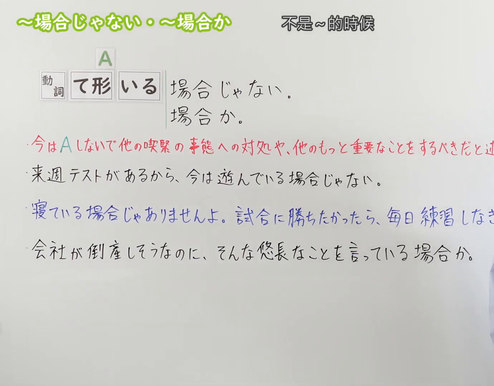
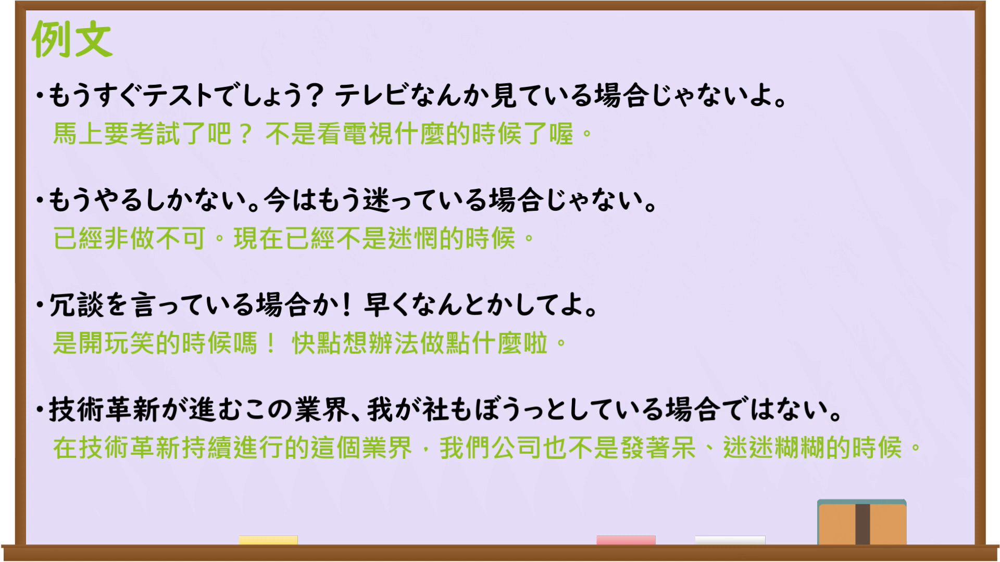

---
{
  "id": "N3-G-0105",
  "kind": "grammar",
  "level": "N3",
  "title": "〜場合じゃない・〜場合か（哪是……的时候；哪有闲工夫……）",
  "card_revision": 1,
  "schema_version": 1,
  "source": {
    "lesson": "N3 第105个语法",
    "material": "出口日語原视频板书、日语自动字幕与Hagoromo文型检索正文",
    "video": "https://www.youtube.com/watch?v=Kv5qFb7RMEA",
    "screenshot": "assets/grammar/n3/N3-G-0105-connection.png",
    "screenshot_seconds": 1,
    "screenshot_crop": {
      "x": 0,
      "y": 0,
      "width": 1380,
      "height": 1080
    }
  },
  "tags": [
    "場合じゃない",
    "場合か",
    "場合ではありません",
    "N3"
  ],
  "confusions": [
    "〜どころではない",
    "〜わけにはいかない",
    "〜べきではない"
  ]
}
---

# N3 第105个语法：〜場合じゃない・〜場合か

# 视频学习资料整理

本课讲解 N3 语法形式「〜場合じゃない・〜場合か」。

## 接续图（板书与讲解）

- 视频链接：[出口日語 N3 第105个语法](https://www.youtube.com/watch?v=Kv5qFb7RMEA)
- 真实时间：00:01（1.00秒）
- 原图尺寸：1920×1080
- 裁切说明：选用 00:01 画面，左上方清晰显示语法标题「〜場合じゃない・〜場合か」与中文释义「不是〜的時候」，接续展示动词ている接「場合じゃない」「場合か」，并用红字详细说明「今はAしないで他の喫緊の事態への対処や、他のもっと重要なことをするべきだと述べる」。固定左上角（0, 0），裁切区域为宽 1380、高 1080，裁去右侧讲师身躯。
- 图片：

## 例句图（视频例句）

- 视频链接：[出口日語 N3 第105个语法](https://www.youtube.com/watch?v=Kv5qFb7RMEA)
- 真实时间：03:23（203.00秒）
- 原图尺寸：1920×1080
- 裁切说明：提取自视频 03:23 处的例句黑板页面。固定左上角（0, 0），裁切区域为宽 1920、高 1080，保留完整例句与中文释义。
- 图片：

# 核心

## 功能一：面临紧迫局面，绝非从容做A的时候（哪是……的时候；哪有闲工夫……）

**最上位意味カテゴリー：**

- **場合じゃない：** 話し手の心的態度（说话人的心理态度）

**中位意味カテゴリー：**

- **場合じゃない：** 判断・主張（判断与主张）

**意味：**

- **場合じゃない：** 禁止・諫言（禁止与规劝）

**くわしい意味記述：**

- **場合じゃない：** 今はもっと緊急で重要な事態があるため，そんな悠長なことをしている状況ではないと強く諌めたり主張したりする。（现在有更紧迫重要的事态，绝不是做那种悠闲之事的时候，用于强烈规劝或表达主张。）

**派生語：** 場合か、場合ではありません

### 例句

1. 来週テストがあるから、今は遊んでいる場合じゃない。

   （下周就有考试了，现在可不是贪玩的时候。）

2. 寝ている場合じゃありませんよ。試合に勝ちたかったら、毎日練習しなさい。

   （现在哪是睡觉的时候呀！想在比赛中获胜的话，就每天好好训练！）

3. 会社が倒産しそうなのに、そんな悠長なことを言っている場合か。

   （公司都快倒闭了，哪是说这种不紧不慢风凉话的时候！）

4. 火事だ！荷物をまとめている場合じゃない、早く逃げろ！

   （起火了！哪还顾得上收拾行李，快逃命！）

# 来源

- [出口日語原视频](https://www.youtube.com/watch?v=Kv5qFb7RMEA)
- [日本語NET「〜ている場合じゃない」](https://nihongokyoshi-net.com/2019/08/04/jlptn3-grammar-teirubaaijanai/)（查询日期：2026-09-25）
