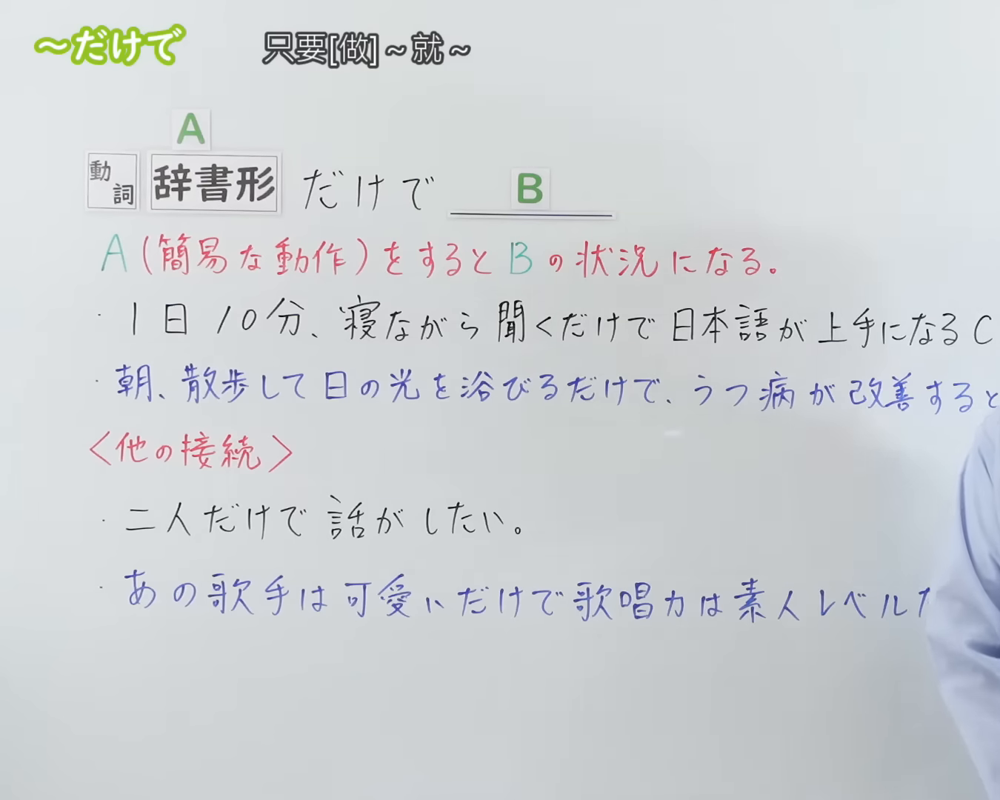
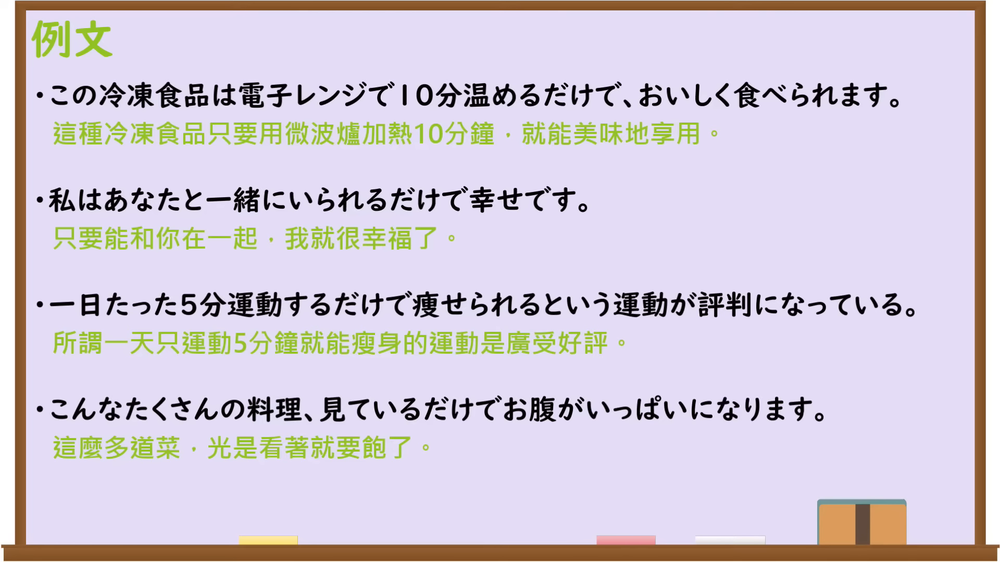

---
{
  "id": "N3-G-0106",
  "kind": "grammar",
  "level": "N3",
  "title": "〜だけで（光是……就……；只要……就……）",
  "card_revision": 1,
  "schema_version": 1,
  "source": {
    "lesson": "N3 第106个语法",
    "material": "出口日語原视频板书、日语自动字幕与Hagoromo文型检索正文",
    "video": "https://www.youtube.com/watch?v=H2kzYuLFNQc",
    "screenshot": "assets/grammar/n3/N3-G-0106-connection.png",
    "screenshot_seconds": 1,
    "screenshot_crop": {
      "x": 0,
      "y": 0,
      "width": 1350,
      "height": 1080
    }
  },
  "tags": [
    "だけで",
    "だけでも",
    "だけ",
    "N3"
  ],
  "confusions": [
    "〜さえ〜ば",
    "〜だけで（は）ない",
    "〜ばかりで"
  ]
}
---

# N3 第106个语法：〜だけで

# 视频学习资料整理

本课讲解 N3 语法形式「〜だけで」。

## 接续图（板书与讲解）

- 视频链接：[出口日語 N3 第106个语法](https://www.youtube.com/watch?v=H2kzYuLFNQc)
- 真实时间：00:01（1.00秒）
- 原图尺寸：1920×1080
- 裁切说明：选用 00:01 画面，左上方清晰显示语法标题「〜だけで」与中文释义「只要[做]〜就〜」，接续展示动词辞书形接「だけで」，并用红字详细说明「A(簡易な動作)をするとBの状況になる」。固定左上角（0, 0），裁切区域为宽 1350、高 1080，裁去右侧讲师身躯。
- 图片：

## 例句图（视频例句）

- 视频链接：[出口日語 N3 第106个语法](https://www.youtube.com/watch?v=H2kzYuLFNQc)
- 真实时间：03:02（182.00秒）
- 原图尺寸：1920×1080
- 裁切说明：提取自视频 03:02 处的例句黑板页面。固定左上角（0, 0），裁切区域为宽 1920、高 1080，保留完整例句与中文释义。
- 图片：

# 核心

## 功能一：仅需完成简易动作A，就足以引发B的状况或结果（光是……就……；只要……就……）

**最上位意味カテゴリー：**

- **だけで：** ものごとの関係（事物之间的关系）

**中位意味カテゴリー：**

- **だけで：** 条件・限定（条件与限定）

**意味：**

- **だけで：** 十分条件（充分条件）

**くわしい意味記述：**

- **だけで：** その簡易な動作や条件だけで，十分にその状態や結果が生じるという意味を表す。（表示仅凭那一项简便动作或条件，就足以产生后面的状态与结果。）

**派生語：** だけでも

### 例句

1. 1日10分、寝ながら聞くだけで日本語が上手になるCDを買った。

   （买了号称只要每天躺着听10分钟就能让日语变好的CD。）

2. 朝、散歩して日の光を浴びるだけで、うつ病が改善すると言われている。

   （据说清晨散散步晒晒太阳，抑郁情绪就会得到改善。）

3. あの事故のことは、思い出すだけでも恐ろしい。

   （关于那场事故，光是回想起来都让人毛骨悚然。）

4. 彼女は声を聞くだけで、誰だかすぐにわかる。

   （光是听声音，就能立刻知道是她。）

# 来源

- [出口日語原视频](https://www.youtube.com/watch?v=H2kzYuLFNQc)
- [日本語NET「〜だけで」](https://nihongokyoshi-net.com/)（查询日期：2026-09-25）
