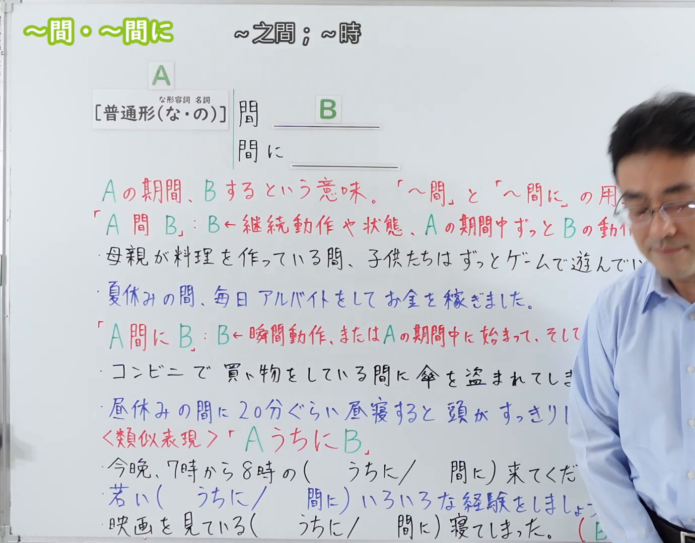
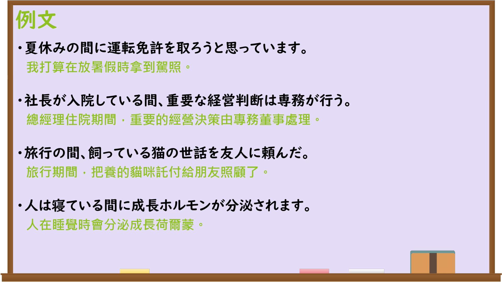

---
{
  "id": "N3-G-0107",
  "kind": "grammar",
  "level": "N3",
  "title": "〜間・〜間に（在……期间；在……期间内）",
  "card_revision": 1,
  "schema_version": 1,
  "source": {
    "lesson": "N3 第107个语法",
    "material": "出口日語原视频板书、日语自动字幕与Hagoromo文型检索正文",
    "video": "https://www.youtube.com/watch?v=_s_9oYPgtoQ",
    "screenshot": "assets/grammar/n3/N3-G-0107-connection.png",
    "screenshot_seconds": 1,
    "screenshot_crop": {
      "x": 0,
      "y": 0,
      "width": 1380,
      "height": 1080
    }
  },
  "tags": [
    "間",
    "間に",
    "あいだ",
    "あいだに",
    "N3"
  ],
  "confusions": [
    "〜うちに",
    "〜最中に",
    "〜途中で"
  ]
}
---

# N3 第107个语法：〜間・〜間に

# 视频学习资料整理

本课讲解 N3 语法形式「〜間・〜間に」。

## 接续图（板书与讲解）

- 视频链接：[出口日語 N3 第107个语法](https://www.youtube.com/watch?v=_s_9oYPgtoQ)
- 真实时间：00:01（1.00秒）
- 原图尺寸：1920×1080
- 裁切说明：选用 00:01 画面，左上方清晰显示语法标题「〜間・〜間に」与中文释义「〜之間；〜時」，接续展示普通形（な形な・名詞の）接「間」「間に」，并详细对比「A間B: B←継続動作や状態」「A間にB: B←瞬間動作、または期間中に始まって終わる」。固定左上角（0, 0），裁切区域为宽 1380、高 1080，裁去右侧讲师身躯。
- 图片：

## 例句图（视频例句）

- 视频链接：[出口日語 N3 第107个语法](https://www.youtube.com/watch?v=_s_9oYPgtoQ)
- 真实时间：07:54（474.00秒）
- 原图尺寸：1920×1080
- 裁切说明：提取自视频 07:54 处的例句黑板页面。固定左上角（0, 0），裁切区域为宽 1920、高 1080，保留完整例句与中文释义。
- 图片：

# 核心

## 功能一：在A持续的整个期间内，B的动作或状态一直持续（在……期间）

**最上位意味カテゴリー：**

- **間：** 場所・時間（场所与时间）

**中位意味カテゴリー：**

- **間：** 時間的関係（时间关系）

**意味：**

- **間：** 時間的限定（时间限定）

**くわしい意味記述：**

- **間：** 「その時間ずっと」という意味を表す。時間幅のある状態を表す言葉に続く。（表示在具有时间跨度的期间内，某种状态一直持续。）

**派生語：** 間中

### 例句

1. 母親が料理を作っている間、子供たちは居間でずっとゲームで遊んでいた。

   （母亲做饭期间，孩子们一直在客厅玩游戏。）

2. 夏休みの間、毎日アルバイトをしてお金を稼ぎました。

   （暑假期间，几乎每天都去打工赚钱。）

3. 彼が日本にいる間、私はずっと日本語の通訳を務めた。

   （他在日本期间，我一直担任他的日语翻译。）

4. 授業の間、ずっと集中してノートを取っていた。

   （上课期间，自始至终都在聚精会神地记笔记。）

## 功能二：在A进行的时间跨度当中的某个时间点，发生了瞬间性事件B（在……期间内）

**最上位意味カテゴリー：**

- **間に：** 場所・時間（场所与时间）

**中位意味カテゴリー：**

- **間に：** 時間的関係（时间关系）

**意味：**

- **間に：** 時間的限定（时间限定）

**くわしい意味記述：**

- **間に：** ある時間幅の途中で，瞬間的な出来事や新しい事態が起こることを表す。（表示在某个时间段的半途中，发生了瞬间性的事件或新的事态。）

**派生語：** の間に

### 例句

1. コンビニで買い物をしている間に、傘を盗まれてしまった。

   （在便利店买东西的工夫，雨伞被偷走了。）

2. 昼休みの間に20分ぐらい昼寝すると、頭がすっきりする。

   （在午休期间小睡个20分钟左右，头脑就会变得清醒。）

3. 子供が寝ている間に、溜まっていた家事を一気に片付けた。

   （趁着孩子熟睡的期间，把堆积的家务一口气处理完了。）

4. 留守の間に、宅急便が届いていたようだ。

   （外出不在家期间，似乎有快递送过来了。）

# 来源

- [出口日語原视频](https://www.youtube.com/watch?v=_s_9oYPgtoQ)
- [Hagoromo 文型検索「あいだ」](https://hagoromo-text.work/)（查询日期：2026-09-25）
