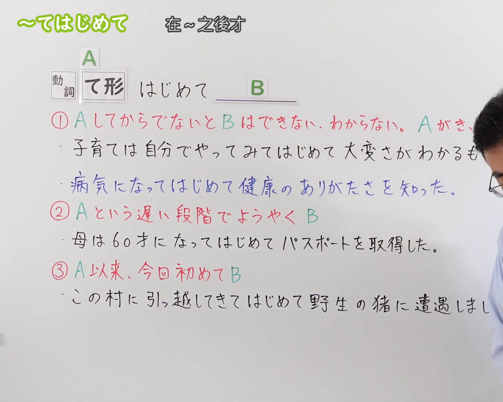
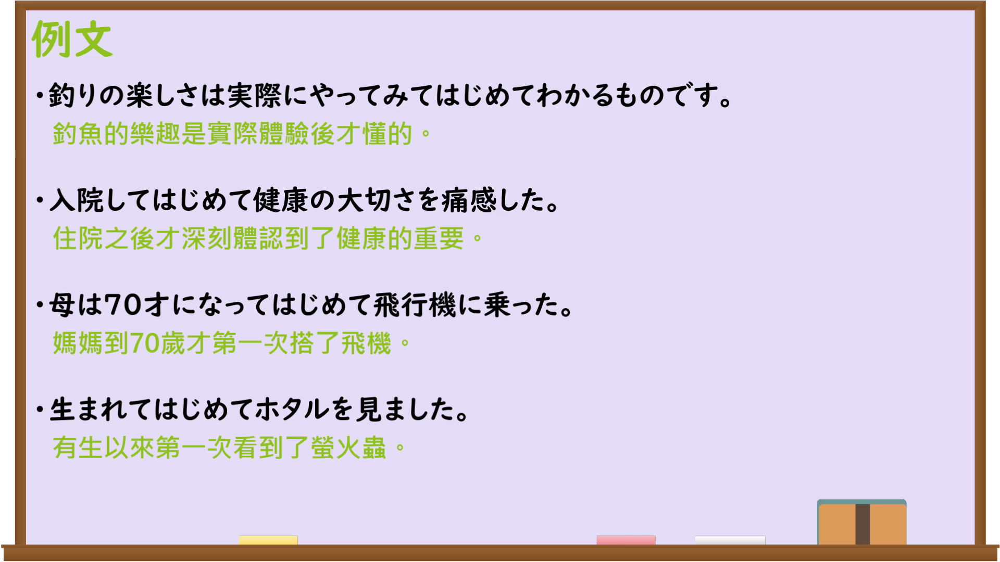

---
{
  "id": "N3-G-0108",
  "kind": "grammar",
  "level": "N3",
  "title": "〜てはじめて（……之后才初次……）",
  "card_revision": 1,
  "schema_version": 1,
  "source": {
    "lesson": "N3 第108个语法",
    "material": "出口日語原视频板书、日语自动字幕与Hagoromo文型检索正文",
    "video": "https://www.youtube.com/watch?v=zKc6yr7blno",
    "screenshot": "assets/grammar/n3/N3-G-0108-connection.png",
    "screenshot_seconds": 1,
    "screenshot_crop": {
      "x": 0,
      "y": 0,
      "width": 1350,
      "height": 1080
    }
  },
  "tags": [
    "てはじめて",
    "て初めて",
    "N3"
  ],
  "confusions": [
    "〜てからでないと",
    "〜てからというもの",
    "〜て以来"
  ]
}
---

# N3 第108个语法：〜てはじめて

# 视频学习资料整理

本课讲解 N3 语法形式「〜てはじめて」。

## 接续图（板书与讲解）

- 视频链接：[出口日語 N3 第108个语法](https://www.youtube.com/watch?v=zKc6yr7blno)
- 真实时间：00:01（1.00秒）
- 原图尺寸：1920×1080
- 裁切说明：选用 00:01 画面，左上方清晰显示语法标题「〜てはじめて」与中文释义「在〜之後才」，接续展示动词て形接「はじめて」，并详细说明①做了A才了解B/A是契机②在A这个迟到的阶段终于B③自A以来本次初次B。固定左上角（0, 0），裁切区域为宽 1350、高 1080，裁去右侧讲师身躯。
- 图片：

## 例句图（视频例句）

- 视频链接：[出口日語 N3 第108个语法](https://www.youtube.com/watch?v=zKc6yr7blno)
- 真实时间：04:08（248.00秒）
- 原图尺寸：1920×1080
- 裁切说明：提取自视频 04:08 处的例句黑板页面。固定左上角（0, 0），裁切区域为宽 1920、高 1080，保留完整例句与中文释义。
- 图片：

# 核心

## 功能一：在做了动作A之后，才初次察觉、理解或切实体会到B（……之后才初次……）

**最上位意味カテゴリー：**
- **てはじめて：** 場所・時間（场所与时间）

**中位意味カテゴリー：**
- **てはじめて：** 時間的関係（时间关系）

**意味：**
- **てはじめて：** 契機（契机）

**くわしい意味記述：**
- **てはじめて：** ある行為や出来事を経験してはじめて，それまで気づかなかったことの大切さや真実を実感するという意を表す。「AしてからでないとBはできない、わからない」「AがきっかけでBを知った、実感した」という文脈で用いる。（表示只有在经历过某种行为或事件之后，才初次切身体会到其重要性或真相。常用于“不做了A就无法做到B或不懂得B”、“以A为契机才首次认识/切实体会到B”的语境。）

**派生語：** てみてはじめて

### 例句

1. 釣りの楽しさは実際にやってみてはじめてわかるものです。

   （钓鱼的乐趣是实际体验后才懂的。）

2. 入院してはじめて健康の大切さを痛感した。

   （住院之后才深刻体认到了健康的重要。）

3. 子育ては自分でやってみてはじめて、その大変さがわかるものだ。

   （养育子女只有亲自经历过之后，才真正懂得其中的艰辛。）

4. 親元を離れて一人暮らしをしてはじめて、家族のありがたみが身に染みた。

   （离开父母独自生活之后，才初次深刻体会到家人的可贵。）

## 功能二：到了A这样一个较迟的阶段、年龄或时期，才终于实现了B（到……才终于……）

**最上位意味カテゴリー：**
- **てはじめて：** 場所・時間（场所与时间）

**中位意味カテゴリー：**
- **てはじめて：** 時間的関係（时间关系）

**意味：**
- **てはじめて：** 時間的遅延・到達（时间延迟与到达）

**くわしい意味記述：**
- **てはじめて：** 通常よりも遅い段階や年齢になって，ようやくある事態が実現したことを表す。「Aという遅い段階でようやくB」というニュアンスを表す。（表示直到通常而言较迟的某个阶段或年龄，某事才终于得以实现。带有“到了A这样一个较迟的阶段才终于B”的语感。）

### 例句

1. 母は70才になってはじめて飛行機に乗った。

   （妈妈到70岁才第一次搭了飞机。）

2. 母は60才になってはじめて、パスポートを取得した。

   （母亲到了60岁，才初次办理了护照。）

3. 彼は30歳を過ぎてはじめて、自分のやりたい仕事を見つけることができた。

   （他过了30岁之后，才终于找到了自己真正想做的工作。）

4. 社会人になってはじめて、お金を稼ぐことの大変さを学んだ。

   （步入社会之后，才终于领会到了挣钱的艰辛。）

## 功能三：自A这一事件发生以来，本次才是初次经历B（自……以来第一次……）

**最上位意味カテゴリー：**
- **てはじめて：** 場所・時間（场所与时间）

**中位意味カテゴリー：**
- **てはじめて：** 時間的関係（时间关系）

**意味：**
- **てはじめて：** 初経験（初次经验）

**くわしい意味記述：**
- **てはじめて：** ある契機や出来事があってから以降，今回が最初の経験であることを表す。「A以来、今回初めてB」という意味を表す。（表示自从某一事件或契机发生以来，这次才是初次发生或经历。带有“自A以来，本次才是初次B”的含义。）

### 例句

1. 生まれてはじめてホタルを見ました。

   （有生以来第一次看到了萤火虫。）

2. この村に引っ越してきてはじめて、野生の猪に遭遇しました。

   （搬到这个村子之后，才初次遭遇了野生野猪。）

3. 日本へ留学に来てはじめて、歌舞伎を鑑賞した。

   （来到日本留学之后，才第一次观看了歌舞伎。）

4. この会社に入社してはじめて、大きなプロジェクトのリーダーを任された。

   （进入这家公司之后，才第一次被委以重大项目负责人的重任。）

# 来源

- [出口日語原视频](https://www.youtube.com/watch?v=zKc6yr7blno)
- [Hagoromo 文型検索「Vてみてはじめて」](https://hagoromo-text.work/)（查询日期：2026-09-25）
