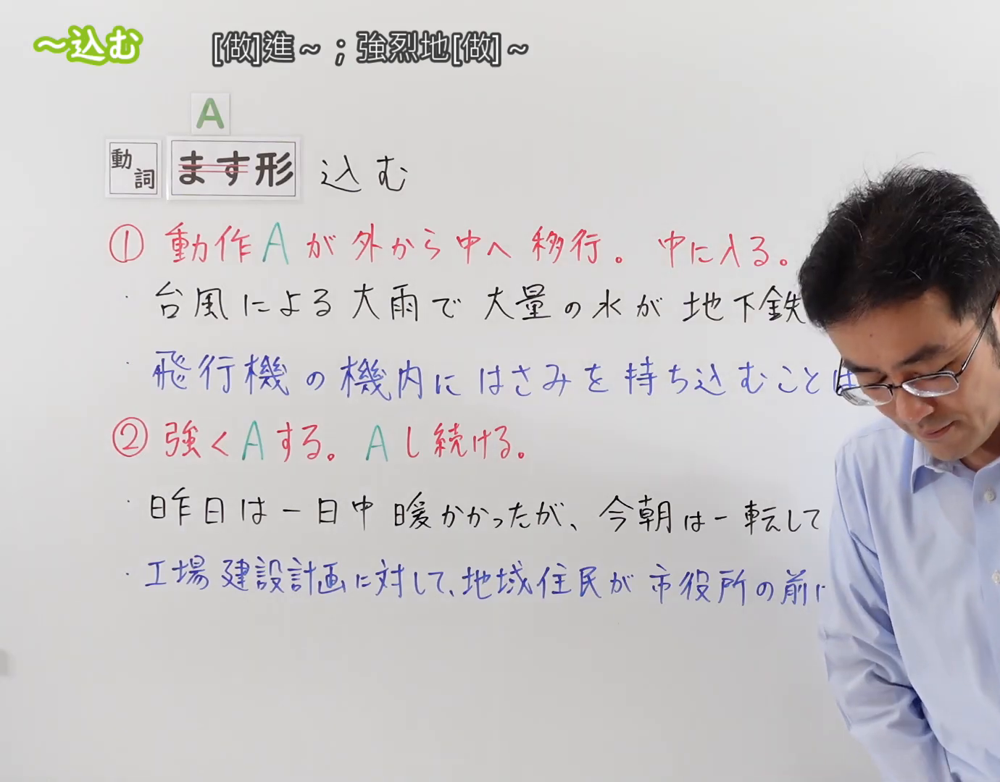
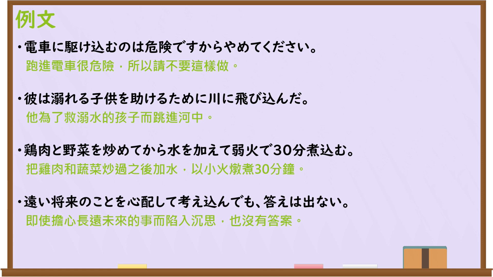

---
{
  "id": "N3-G-0109",
  "kind": "grammar",
  "level": "N3",
  "title": "〜込む（深入……；充分……）",
  "card_revision": 1,
  "schema_version": 1,
  "source": {
    "lesson": "N3 第109个语法",
    "material": "出口日語原视频板书、日语自动字幕与Hagoromo文型检索正文",
    "video": "https://www.youtube.com/watch?v=6NvfMD1c6q0",
    "screenshot": "assets/grammar/n3/N3-G-0109-connection.png",
    "screenshot_seconds": 1,
    "screenshot_crop": {
      "x": 0,
      "y": 0,
      "width": 1380,
      "height": 1080
    }
  },
  "tags": [
    "込む",
    "こむ",
    "込み",
    "N3"
  ],
  "confusions": [
    "〜きる",
    "〜つくす",
    "〜ぬく"
  ]
}
---

# N3 第109个语法：〜込む

# 视频学习资料整理

本课讲解 N3 语法形式「〜込む」。

## 接续图（板书与讲解）

- 视频链接：[出口日語 N3 第109个语法](https://www.youtube.com/watch?v=6NvfMD1c6q0)
- 真实时间：00:01（1.00秒）
- 原图尺寸：1920×1080
- 裁切说明：选用 00:01 画面，左上方清晰显示语法标题「〜込む」与中文释义「[做]進〜；強烈地[做]〜」，接续展示动词ます形接「込む」，并详细说明①动作由外向内移行进入②强烈做A或持续做A。固定左上角（0, 0），裁切区域为宽 1380、高 1080，裁去右侧讲师身躯。
- 图片：

## 例句图（视频例句）

- 视频链接：[出口日語 N3 第109个语法](https://www.youtube.com/watch?v=6NvfMD1c6q0)
- 真实时间：03:48（228.00秒）
- 原图尺寸：1920×1080
- 裁切说明：提取自视频 03:48 处的例句黑板页面。固定左上角（0, 0），裁切区域为宽 1920、高 1080，保留完整例句与中文释义。
- 图片：

# 核心

## 功能一：动作主体由外向内深入转移、进入（[做]进……；深入……）

**最上位意味カテゴリー：**
- **込む：** ものごとの関係（事物之间的关系）

**中位意味カテゴリー：**
- **込む：** 空間・移動（空间与移动）

**意味：**
- **込む：** 方向・進入（方向与进入）

**くわしい意味記述：**
- **込む：** 動詞のます形について，ある対象や主体が外側から内側へと深く移動・進入する意を表す。板書説明：「動作Aが外から中へ移行。中に入る」。（接动词连用形后，表示动作主体或客体从外部向内部深入移动或进入。板书说明：“动作A由外向内转移、进入”。）

**派生語：** 駆け込む、飛び込む、持ち込む、流れ込む

### 例句

1. 電車に駆け込むのは危険ですからやめてください。

   （跑进电车很危险，所以请不要这样做。）

2. 彼は溺れる子供を助けるために川に飛び込んだ。

   （他为了救溺水的孩子而跳进河中。）

3. 台風による大雨で、大量の水が地下鉄の駅に流れ込んできた。

   （台风带来的大雨导致大量积水倒灌涌入了地铁站。）

4. 飛行機の機内にはさみを持ち込むことは、法律で禁止されている。

   （向飞机机舱内携带剪刀等物品，是法律明令禁止的。）

## 功能二：动作程度强烈深化，或动作彻底持续不断（强烈地[做]……；彻底持续……）

**最上位意味カテゴリー：**
- **込む：** ものごとの関係（事物之间的关系）

**中位意味カテゴリー：**
- **込む：** 深化・継続（深化与持续）

**意味：**
- **込む：** 極限・徹底（极限与彻底）

**くわしい意味記述：**
- **込む：** 動詞のます形について，その動作を深くまで徹底的に行う意，あるいは長時間継続して強く集中して行う意を表す。板書説明：「強くAする。Aし続ける」。（接动词连用形后，表示将该动作深层彻底地进行，或者长时间持续强烈地集中进行。板书说明：“强烈地做A；彻底持续做A”。）

**派生語：** 煮込む、考え込む、座り込む、思い込む

### 例句

1. 鶏肉と野菜を炒めてから水を加えて弱火で30分煮込む。

   （把鸡肉和蔬菜炒过之后加水，以小火炖煮30分钟。）

2. 遠い将来のことを心配して考え込んでも、答えは出ない。

   （即使担心长远未来的事而陷入沉思，也没有答案。）

3. 昨夜は何か悩み事があるらしく、彼は一人でじっと考え込んでいた。

   （昨晚似乎有什么烦心事，他一个人独自陷入了深思。）

4. 工場建設計画に対して、地域住民が市役所の前に座り込んで抗議した。

   （针对工厂建设计划，当地居民在市政厅门前静坐抗议。）

# 来源

- [出口日語原视频](https://www.youtube.com/watch?v=6NvfMD1c6q0)
- [日本語NET「〜込む」](https://nihongokyoshi-net.com/2019/11/12/jlptn3-grammar-komu/)（查询日期：2026-09-25）
