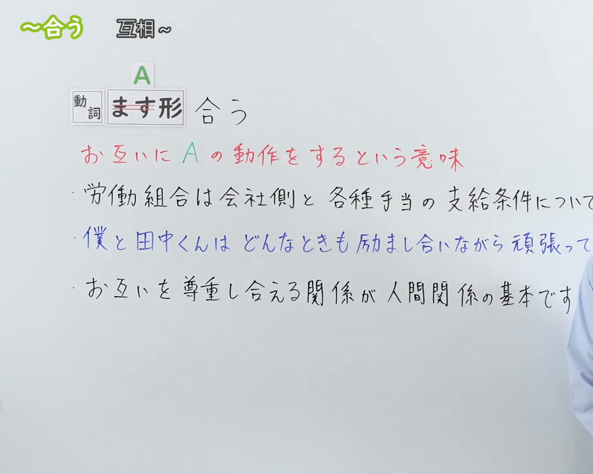
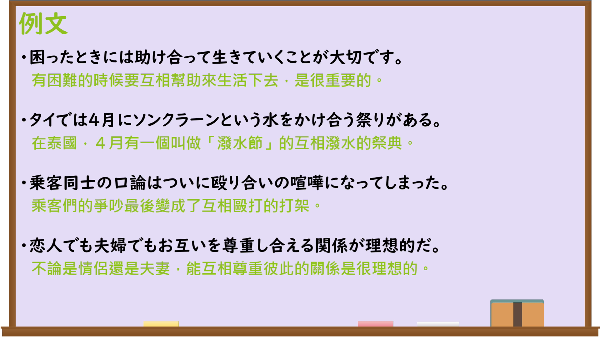

---
{
  "id": "N3-G-0110",
  "kind": "grammar",
  "level": "N3",
  "title": "〜合う（互相……）",
  "card_revision": 1,
  "schema_version": 1,
  "source": {
    "lesson": "N3 第110个语法",
    "material": "出口日語原视频板书、日语自动字幕与Hagoromo文型检索正文",
    "video": "https://www.youtube.com/watch?v=WdL-4lWFwmg",
    "screenshot": "assets/grammar/n3/N3-G-0110-connection.png",
    "screenshot_seconds": 1,
    "screenshot_crop": {
      "x": 0,
      "y": 0,
      "width": 1350,
      "height": 1080
    }
  },
  "tags": [
    "合う",
    "あう",
    "合い",
    "N3"
  ],
  "confusions": [
    "〜同士",
    "〜お互い",
    "〜交わす"
  ]
}
---

# N3 第110个语法：〜合う

# 视频学习资料整理

本课讲解 N3 语法形式「〜合う」。

## 接续图（板书与讲解）

- 视频链接：[出口日語 N3 第110个语法](https://www.youtube.com/watch?v=WdL-4lWFwmg)
- 真实时间：00:01（1.00秒）
- 原图尺寸：1920×1080
- 裁切说明：选用 00:01 画面，左上方清晰显示语法标题「〜合う」与中文释义「互相〜」，接续展示动词ます形接「合う」，并详细说明双方互相进行该动作的用法。固定左上角（0, 0），裁切区域为宽 1350、高 1080，裁去右侧讲师身躯。
- 图片：

## 例句图（视频例句）

- 视频链接：[出口日語 N3 第110个语法](https://www.youtube.com/watch?v=WdL-4lWFwmg)
- 真实时间：02:14（134.00秒）
- 原图尺寸：1920×1080
- 裁切说明：提取自视频 02:14 处的例句黑板页面。固定左上角（0, 0），裁切区域为宽 1920、高 1080，保留完整例句与中文释义。
- 图片：

# 核心

## 功能一：两个以上的动作主体彼此相互进行同一行为或交互作用（互相……）

**最上位意味カテゴリー：**

- **合う：** 人との関係（人际关系）

**中位意味カテゴリー：**

- **合う：** 相互行為（相互行为）

**意味：**

- **合う：** 協調・対立（协调与对立）

**くわしい意味記述：**

- **合う：** 動詞のます形について，複数の主体が互いに相手に対して同じ動作や働きかけを行うことを表す。（接动词连用形后构成复合动词，表示多个主体彼此对对方进行相同的动作或行为。）

**派生語：** 合い、合える

### 例句

1. 困ったときには助け合って生きていくことが大切です。

   （有困难的时候相互帮助共同生活下去，是非常重要的。）

2. タイでは4月にソンクラーンという水をかけ合う祭りがある。

   （在泰国4月有一个叫作“泼水节”的互相泼水庆祝的节日。）

3. 乗客同士の口論は、ついに殴り合いの喧嘩になってしまった。

   （乘客之间的口角争吵，最终演变成了互相殴打的斗殴。）

4. 恋人でも夫婦でも、お互いを尊重し合える関係が理想的だ。

   （不论是情侣还是夫妻，能够互相尊重彼此的关系才是理想的。）

# 来源

- [出口日語原视频](https://www.youtube.com/watch?v=WdL-4lWFwmg)
- [日本語NET「〜合う」](https://nihongokyoshi-net.com/2019/11/11/jlptn3-grammar-au/)（查询日期：2026-09-25）
