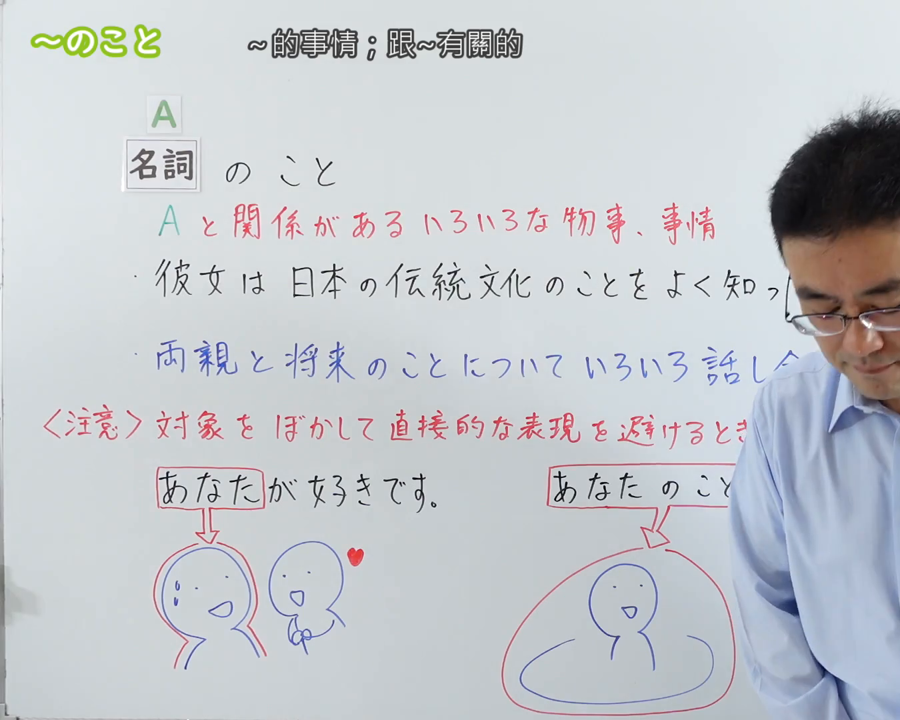
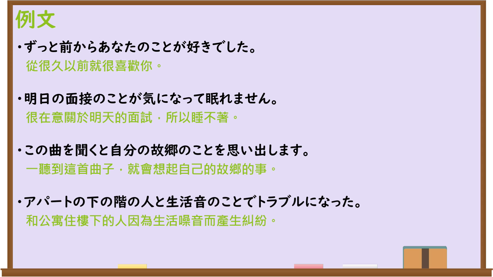

---
{
  "id": "N3-G-0111",
  "kind": "grammar",
  "level": "N3",
  "title": "〜のこと（关于……的事情；跟……有关的）",
  "card_revision": 1,
  "schema_version": 1,
  "source": {
    "lesson": "N3 第111个语法",
    "material": "出口日語原视频板书、日语自动字幕与Hagoromo文型检索正文",
    "video": "https://www.youtube.com/watch?v=X_VpZIV7-9c",
    "screenshot": "assets/grammar/n3/N3-G-0111-connection.png",
    "screenshot_seconds": 1,
    "screenshot_crop": {
      "x": 0,
      "y": 0,
      "width": 1350,
      "height": 1080
    }
  },
  "tags": [
    "のこと",
    "こと",
    "N3"
  ],
  "confusions": [
    "〜について",
    "〜に関して",
    "〜に対して"
  ]
}
---

# N3 第111个语法：〜のこと

# 视频学习资料整理

本课讲解 N3 语法形式「〜のこと」。

## 接续图（板书与讲解）

- 视频链接：[出口日語 N3 第111个语法](https://www.youtube.com/watch?v=X_VpZIV7-9c)
- 真实时间：00:01（1.00秒）
- 原图尺寸：1920×1080
- 裁切说明：选用 00:01 画面，左上方清晰显示语法标题「〜のこと」与中文释义「〜的事情；跟〜有關的」，接续展示名词接「のこと」，并详细说明①涉及A的各种事情与②委婉虚化对象避免直接生硬（如「あなたのことが好きです」）。固定左上角（0, 0），裁切区域为宽 1350、高 1080，裁去右侧讲师身躯。
- 图片：

## 例句图（视频例句）

- 视频链接：[出口日語 N3 第111个语法](https://www.youtube.com/watch?v=X_VpZIV7-9c)
- 真实时间：02:56（176.83秒）
- 原图尺寸：1920×1080
- 裁切说明：提取自视频 02:56 处的例句黑板页面。固定左上角（0, 0），裁切区域为宽 1920、高 1080，保留完整例句黑板与中文释义。
- 图片：

# 核心

## 功能一：涉及A的相关种种事态与情况（关于……的事情；跟……有关的）

**最上位意味カテゴリー：**

- **のこと：** ものごとの関係（事物之间的关系）

**中位意味カテゴリー：**

- **のこと：** 対象・範囲（对象与范围）

**意味：**

- **のこと：** 事象・内容（事象与内容）

**くわしい意味記述：**

- **のこと：** 名詞について，その人や事物に関係する様々な物事や事情，詳細な内容全体を広く指し示す。板書説明：「Aと関係があるいろいろな物事、事情」。（接名词后，广泛指代与该人或事物相关联的种种物事、事情或详情。）

### 例句

1. 彼女は日本の伝統文化のことをよく知っている。

   （她很了解关于日本传统文化的种种事情。）

2. 両親と将来のことについていろいろ話し合いました。

   （和父母就关于未来的事情进行了很多商量。）

3. 授業で自分の住んでいる町のことを調べて、レポートを書いた。

   （在课上调查了关于自己所居住的城镇的事情，并写了报告。）

4. 昔のことを思い出して、懐かしい気持ちになった。

   （回忆起过去的事情，涌起怀念的心情。）

## 功能二：虚化指代具体对象，避免直白生硬以示委婉（……这个人；……本身）

**最上位意味カテゴリー：**

- **のこと（対象のぼかし）：** 人との関係（人际关系）

**中位意味カテゴリー：**

- **のこと（対象のぼかし）：** 感情・配慮（情感与顾虑）

**意味：**

- **のこと（対象のぼかし）：** 婉曲・ぼかし（委婉与虚化）

**くわしい意味記述：**

- **のこと（対象のぼかし）：** 人を表す名詞について，その人そのものを直接名指しする生硬さを避け，心理的配慮や情緒的ニュアンスを込めて対象をぼかす表現。板書説明：「対象をぼかして直接的な表現を避けるときに使う」。（接表示人的名词后，避免直接指代该人本身的生硬直白，带有心理关照与情绪色彩以示委婉。）

### 例句

1. あなたのことが好きです。

   （我喜欢你这个人。）

2. 彼のことが心配で、夜も眠れない。

   （我很担心他，晚上都睡不着觉。）

3. 私のことなら心配しないで、自分の仕事に集中してください。

   （我的话请不用担心，请专注于你自己的工作。）

4. 先生のことは今でも深く尊敬しています。

   （对老师我至今仍怀着深深的敬意。）

# 来源

- [出口日語原视频](https://www.youtube.com/watch?v=X_VpZIV7-9c)
- [日本語NET「〜のこと」](https://nihongokyoshi-net.com/2019/08/07/jlptn3-grammar-nokoto/)（查询日期：2026-09-25）
